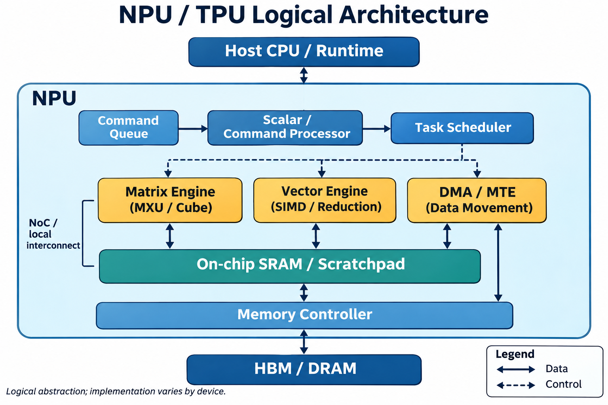
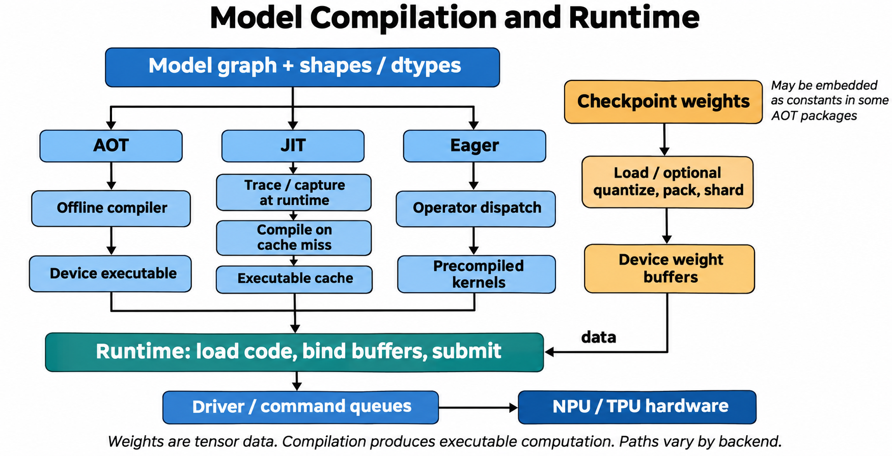

.. _ai-npu:

AI NPU/TPU
**********

本文从计算、存储、控制和互联四个角度，梳理 TPU/NPU 的架构与执行机制，
并结合 Transformer 推理说明如何分析算子性能及多设备扩展瓶颈。

相关基础可参见 :doc:`AI-theory`，推理运行时可参见 :doc:`llm-runtime`。

TPU / NPU 的基本定位
==============================

TPU（Tensor Processing Unit）和 NPU（Neural Processing Unit）都是针对 AI 工作负载优化的计算加速器。

其核心目标是：**通过专用计算阵列、片上存储、显式数据搬运和高效调度，提高矩阵及张量计算的吞吐量和能效。**

TPU 通常指 Google 的专用 AI 加速器产品；NPU 是更通用的概念，包括端侧神经网络加速单元和数据中心 AI 芯片。
下文主要讨论数据中心场景。端侧 NPU 往往共享系统内存，并不一定配置 HBM。
Google 的 `TPU 架构文档 <https://docs.cloud.google.com/tpu/docs/system-architecture-tpu-vm>`_
介绍了矩阵、向量和标量计算单元；其他产品的模块划分与命名可能不同。

典型 NPU 的设计思想是：

- 使用 Matrix / Tensor Engine 执行高吞吐矩阵运算。
- 使用 Vector Engine 执行逐元素、归约、归一化等运算。
- 使用 Scalar / Command Processor 负责控制、调度和指令执行。
- 使用 DMA / Data Movement Engine 负责不同存储层级之间的数据搬运。
- 使用片上 SRAM 缓存数据，降低对 HBM 的访问压力。
- 通过 NoC / Interconnect 连接计算单元、存储资源及其他 NPU。

相比通用 CPU，NPU 通常减少对复杂动态指令调度和通用控制逻辑的依赖，将更多芯片面积和功耗分配给矩阵计算、数据存储及搬运。

典型 NPU 硬件架构
========================

可以将一个典型 NPU 抽象成以下结构：

   GPT Image 生成的 NPU/TPU 逻辑架构示意图。实线表示数据通路，虚线表示控制关系。
   主机经命令队列提交任务；图中连接仅用于概括模块关系，不限定实际物理拓扑。

.. note::

   图中的 Scratchpad（暂存存储器）是由程序或编译器显式管理的片上高速存储区，
   通常使用 SRAM 实现，用于存放当前计算块的输入、权重和中间结果。
   SRAM 描述存储实现技术，Scratchpad 描述管理方式，两者并不是同一层面的概念。
   通用 CPU 中更常见的是 Cache：硬件根据访存自动加载数据，并决定缓存位置及淘汰时机；
   Scratchpad 则由软件指定缓冲区，并安排数据何时搬入、何时覆盖或复用，搬运通常由 DMA 等机制完成。
   CPU 的分支和指针访问较多，Cache 能适应运行时变化；NPU 的矩阵计算通常能提前确定数据访问顺序，
   因而适合显式分块和预取，例如计算当前矩阵块时，将下一块搬入另一缓冲区。
   因此，这个术语在通用 CPU 架构介绍中较少出现，但并非 CPU 领域没有类似设计：
   一些嵌入式处理器的 TCM（紧耦合存储器）及 DSP 的本地存储也有相近用途，具体机制因架构而异。

以上是逻辑抽象，并非所有 NPU 都采用完全相同的连接方式。
主机与加速器可以通过 PCIe 等链路连接，也可以集成在同一个 SoC 内；
不能据此假定所有产品都支持 CXL 或共享一致性内存。

实际架构中，计算单元、DMA 和 SRAM 往往通过多个内部端口直接连接，不一定需要所有数据经过一个统一 NoC。

Scalar / Command Processor
----------------------------------------------------

Scalar Processor 或 Command Processor 负责控制任务执行。

典型职责：

- 解析或执行设备侧指令。
- 管理执行队列及任务依赖。
- 配置 Matrix、Vector 和 DMA 单元。
- 执行循环、分支、地址计算及同步。
- 处理任务完成事件。

它可以采用 RISC-V、ARM 或厂商自定义控制架构。

**需要注意：Scalar Processor 不一定是一个完整的通用 CPU，也不一定采用复杂的乱序流水线。**

不同 NPU 可能采用微控制器、简单指令流水线、硬件命令处理器或多级调度系统。

它的主要价值是控制计算和数据流，而不是承担大规模矩阵计算。

Matrix Engine / MXU / Cube
----------------------------------------------------

Matrix Engine 是 NPU 的核心计算单元，主要执行：

- GEMM：矩阵乘法。
- MatMul：矩阵乘法算子。
- Batched MatMul：批量矩阵乘法。
- Convolution：卷积。
- 其他可映射为矩阵乘加的计算。

例如：

.. math::

   C_{M\times N}=A_{M\times K}B_{K\times N}

其理论计算量通常按照：

.. math::

   FLOPs\approx 2MNK

估算，其中一次乘法与一次加法分别计算为一个浮点操作。

Matrix Engine 往往由大量 MAC 单元构成。

MAC（Multiply-Accumulate）完成：

.. math::

   acc\leftarrow acc+a\times b

在矩阵计算阵列中，MAC 是基本的算术构件，而 GEMM 是软件可见的高层计算算子，两者不是同一个抽象层级。

Systolic Array
----------------------------

部分 TPU/NPU 采用脉动阵列（Systolic Array）执行矩阵计算。

其典型特点：

- 大量 PE（Processing Element）按照规则阵列组织。
- 数据沿阵列方向逐级传递。
- PE 在流水线稳定、输入就绪时按设计吞吐率执行乘加操作。
- 数据可以在多个 PE 间复用。
- 减少重复访问片外存储器。

示意：

.. code-block:: text

                B Data
                  |
                  v
           +------+------+------+
   A ----> | PE   | PE   | PE   |
           +------+------+------+
           | PE   | PE   | PE   |
           +------+------+------+
           | PE   | PE   | PE   |
           +------+------+------+

Systolic Array 并非所有 NPU 必须采用的实现形式。部分芯片使用其他矩阵数据流组织或 Tensor Core 类型的执行结构。

Vector Engine / SIMD
----------------------------------------

Vector Engine 主要执行不适合直接映射到矩阵阵列的计算，例如：

- Element-wise Add / Mul。
- ReLU、GELU、SiLU。
- Softmax 的部分计算阶段。
- LayerNorm / RMSNorm。
- Reduction。
- 数据格式转换。
- Quantization / Dequantization。

例如 SiLU：

.. math::

   \operatorname{SiLU}(x)=x\sigma(x)

与 GEMM 不同，这类计算通常具有逐元素、归约或特殊函数特征，因此更适合 Vector / SIMD 执行单元。

实际 NPU 可能将一些特殊函数通过查找表、近似运算或专用指令实现。

DMA / MTE
------------------------

DMA（Direct Memory Access）或 MTE（Memory Transfer Engine）用于数据搬运。
具体实现中，计算阵列与本地缓冲之间也可能由专用加载、存储通路完成传输，
不一定全部由同一个 DMA 模块控制。

主要负责：

- HBM → 片上 SRAM。
- SRAM → Matrix Engine。
- Matrix Engine → SRAM。
- SRAM → HBM。
- 不同片上存储区域之间的数据复制或转换。

DMA 可以在不需要 Scalar Processor 逐字节参与的情况下执行大规模数据传输。

典型流水过程：

.. code-block:: text

   DMA Load Tile N+1
           |
           | 与计算重叠
           v
   Matrix Compute Tile N
           |
           | 与写回重叠
           v
   DMA Store Tile N-1

上述三项表示稳态下并发推进的不同 Tile 阶段，箭头不代表必须串行等待。
这就是计算与访存重叠（Compute-Memory Overlap）。

通过 Double Buffering，NPU 可以在计算当前 Tile 时，提前加载下一块数据。

能否真正实现完全重叠，还取决于 DMA 通道、SRAM 端口、带宽、同步依赖和硬件调度能力。

NPU 存储层次与数据流
========================

典型 NPU 的存储层次可以抽象为：

.. code-block:: text

   Registers / Accumulators
             |
   Local Buffer / Scratchpad
             |
   Shared On-Chip SRAM
             |
           L2 Cache
             |
        HBM / DRAM

不同产品未必同时拥有以上所有层级，层级之间也未必构成严格的串联路径。
Scratchpad 通常由软件显式管理；Cache 则通常由硬件按缓存策略管理，二者不能仅按 SRAM 材质等同。

为什么需要大量片上 SRAM？
------------------------------

大规模矩阵运算的一个核心瓶颈是数据搬运。

计算单元的理论算力可能很高，但如果每次 MAC 都需要访问 HBM，芯片很容易受到内存带宽限制。

因此 NPU 通常采用 Tiling：

将大矩阵拆分为多个适合片上 SRAM 和计算阵列尺寸的 Tile。

例如：

.. code-block:: text

   Large GEMM
       |
       v
   Tile 0 -> MXU
   Tile 1 -> MXU
   Tile 2 -> MXU
   ...

每次将一个或多个 Tile 搬运到片上存储区，重复利用其中的数据，再写回结果。

Arithmetic Intensity
----------------------------------------

算术强度（Arithmetic Intensity）定义为：

.. math::

   AI=\frac{FLOPs}{Bytes}

单位为 FLOPs/Byte。

它表示每搬运一个字节数据所执行的计算操作数量。

Arithmetic Intensity 越高，通常越有利于发挥计算单元的峰值吞吐量。

这里的 AI 指 Arithmetic Intensity，而不是 Artificial Intelligence。
算术强度必须注明对应的存储层级；HBM 与片上 SRAM 的流量口径不同。

以一个 GEMM Tile 为例
------------------------------

设一次计算 :math:`C_t=A_tB_t`，Tile 的尺寸分别为
:math:`m\times k`、:math:`k\times n` 和 :math:`m\times n`。
若输入、输出元素均占 :math:`s` 字节，且每个输入只从 HBM 读取一次、输出只写回一次，
忽略原始 C 的读取与额外临时数据，则理想算术强度为：

.. math::

   I_{\mathrm{HBM}}=\frac{2mnk}{s(mk+kn+mn)}

例如 :math:`m=n=k=128`、:math:`s=2` 时，约为 42.7 FLOPs/Byte。
这只是给定数据搬运假设下的估算。跨 Tile 复用可以继续减少 HBM 流量，
而中间结果溢出、布局转换或重复加载会增加流量。累加器也可能采用比输入更高的精度，
因此片上容量预算需要分别计算输入缓冲、输出缓冲及累加器占用。

Roofline Model
----------------------------

Roofline Model 用于估算计算 Kernel 的理论性能上限：

.. math::

   P_{\mathrm{attainable}}
   \leq
   \min(P_{\mathrm{peak}},AI\times BW)

其中：

- :math:`P_{\mathrm{peak}}`：硬件峰值计算吞吐量。
- :math:`AI`：算术强度。
- :math:`BW`：对应存储层级的有效带宽。

如果 :math:`AI\times BW` 小于峰值算力，则属于 Memory-Bound 区域。

否则可能进入 Compute-Bound 区域。

实际性能仍会受到计算利用率、访存冲突、调度开销、数据依赖及其他资源约束影响。

NPU 与 CPU / GPU 的核心区别
==========================================

.. list-table::
   :header-rows: 1

   * - 维度
     - CPU
     - GPU
     - TPU / NPU
   * - 主要目标
     - 通用控制与低延迟执行
     - 大规模并行计算
     - AI 张量计算与能效
   * - 计算组织
     - Core + SIMD
     - SM/CU + SIMT + Matrix Unit
     - Matrix / Vector / Scalar Engine
   * - 指令调度
     - 高性能 CPU 常采用 OoO
     - 大规模线程调度
     - 依架构采用命令、静态或混合调度
   * - 主要计算方式
     - Scalar / SIMD
     - SIMT / Tensor Core
     - Matrix / Vector
   * - 存储体系
     - Cache 为核心
     - Cache + Shared Memory + HBM
     - SRAM / Scratchpad / Cache + HBM
   * - 数据搬运
     - Cache / Load-Store
     - Load-Store / Async Copy / DMA 类机制
     - 常强调 DMA/MTE 与显式数据流
   * - 灵活性
     - 最高
     - 较高
     - 依产品而定，通常更专用
   * - 主要优势
     - 通用性、单线程响应
     - 可编程并行能力与成熟生态
     - 特定 AI 任务的吞吐与能效

需要强调：现代 GPU 也拥有强大的 Tensor Core、片上 Shared Memory、异步数据搬运和专用调度机制，因此 GPU 与 NPU 的微架构界限并不是绝对的。

同样，NPU 也不必然采用静态调度或显式 Scratchpad。

**总体区别在于设计优化目标及软硬件抽象，而不是某一个计算模块是否存在。**

从 AI Framework 到 NPU 的完整执行链路
========================================================

图编译、权重准备与运行是相互关联的三个步骤：**编译器决定怎样计算，权重提供计算所需的参数，
Runtime 将可执行程序与数据绑定并提交到设备。** 编译发生在部署前还是程序启动后，取决于所用后端，
并不是由 TPU/NPU 这个硬件名称决定的。

   模型编译与运行链路。权重数据与可执行程序在 Runtime 汇合；具体边界因框架和后端而异。

AOT、JIT 与逐算子执行
----------------------------------------

.. list-table::
   :header-rows: 1

   * - 执行方式
     - 何时编译
     - 运行时做什么
     - 主要影响
   * - AOT（提前编译）
     - 部署前或首次实际执行前，按目标设备及输入约束生成可执行产物
     - 加载产物、绑定参数和输入，然后执行
     - 将主要编译成本前移；产物仍有设备、形状及版本等适用范围
   * - JIT（即时编译）
     - 运行过程中捕获计算图，在所需变体未命中缓存时编译
     - 编译完成后执行，并在兼容条件下复用缓存
     - 首次运行可能较慢；新的形状或静态参数可能触发再次编译
   * - Eager / 算子库路径
     - 设备 Kernel 通常预先编译，也可能在启动时加载或特化
     - 框架逐算子调度相应实现
     - 无须每次编译整个模型，但可能增加调度与中间数据搬运开销

“直接运行”需要区分：程序可以直接调用已有 Kernel，也可以在首次调用时触发 JIT；
这两种情况都不是设备直接解释 Python 或直接执行权重文件。
实际系统还可能混合使用图编译、算子库和主机执行，不支持的算子能否回退取决于后端配置。

以 JAX/XLA 为例，JIT 会在首次需要某个计算变体时进行追踪和编译，后续调用可以复用结果；
也可以显式分开 tracing、lowering 和 compilation，提前获得可执行对象。
这里的 AOT 不必然表示一个可以脱离原环境分发的独立二进制文件，序列化与跨环境部署需要后端另行支持。
详见 `JAX JIT 文档 <https://docs.jax.dev/en/latest/jit-compilation.html>`_ 与
`JAX AOT 文档 <https://docs.jax.dev/en/latest/aot.html>`_。

模型权重到底如何“编译”？
----------------------------------------

模型通常同时包含计算结构和参数。Checkpoint 中的权重是张量数据，
仅有权重文件通常不足以确定完整的计算过程，还需要模型结构、配置和算子语义。
例如 :math:`Y=XW` 中，编译器为矩阵乘法生成或选择实现，运行时把 :math:`W` 的数据交给该实现使用。

部署工具所称的“编译模型”往往包含以下工作，但这些步骤不一定都由同一个编译器完成：

1. **计算图转换**：从模型程序导出或捕获计算图，推导 Shape、Dtype，进行算子融合、分块与代码生成。
2. **参数准备**：读取权重，按需要做精度转换、布局重排、矩阵打包或多设备分片。
   这些工作可以发生在离线转换阶段，也可以发生在模型加载阶段。
3. **可选量化**：按目标 Kernel 的格式生成低比特权重以及 Scale、Zero Point 等元数据。
   量化是否需要校准、使用何种粒度，由量化方案决定；它不是所有 NPU 编译都必须执行的一步。
4. **产物组织**：保存设备代码、执行计划、参数描述及必要的常量；权重可以放在同一个部署包中，
   也可以作为独立文件在加载时绑定。

权重有两种常见处理方式：

- **作为运行时参数**：编译主要依赖权重的形状、类型和布局，权重数值在运行时传入。
  满足接口及后端约束时，更换同规格权重可以复用可执行程序。
- **作为编译期常量**：冻结参数后，编译器可能进行常量折叠、预计算或专门化，
  并将常量嵌入或随可执行产物打包；更换这类参数可能需要重新编译。

因此，不能将“模型权重编译”统一理解为把每个权重数值翻译成机器指令。
量化和打包主要改变数据表示，图编译主要生成计算实现，两者会协同但职责不同。
量化的具体数据表示与校准方式可参考
`ONNX Runtime 量化文档 <https://onnxruntime.ai/docs/performance/model-optimizations/quantization.html>`_；
该文档提供的是一种软件栈实例，不代表所有 NPU 的统一格式。

从编译产物进入 Runtime
----------------------------------------

一次典型的模型部署与执行可以按下面的顺序理解，实际系统可能交错或延迟执行其中部分步骤：

1. **应用创建会话**：推理服务选择设备和后端，创建 Runtime 上下文、执行队列及模型实例。
2. **准备可执行程序**：AOT 路径加载已有产物；JIT 路径在缓存未命中时先调用编译器；
   逐算子路径则查找适用的算子实现。产物可能包含设备代码、库调用、内存规划及任务依赖。
3. **加载参数并分配缓冲区**：读取权重，完成必要的布局转换与分片，在设备内存中准备权重、输入、
   输出、Workspace 和 KV Cache。权重通常在初始化时加载并复用，也可能按显存容量采用卸载或流式加载。
4. **绑定一次调用的数据**：将输入 Token、位置、有效长度、权重和 KV Cache 等缓冲区交给执行程序；
   编译器规划的是缓冲区需求与使用关系，实际分配及地址绑定由具体 Runtime/后端完成。
5. **提交到设备**：Runtime 经驱动或设备接口向队列提交任务及依赖，设备侧命令处理器调度计算与搬运。
   数据按需从 HBM 进入片上缓冲区，Matrix / Vector Engine 执行已选定的计算。
6. **消费输出并继续执行**：通过事件或同步机制确认结果可用，后续任务在设备上继续使用输出，
   或由主机读取必要结果；并非每个算子都需要将数据拷回 CPU。

对 LLM 而言，服务通常会预热 Prefill 和 Decode 所需的计算变体。
请求到来后，Prefill 建立 KV Cache，Decode 反复使用权重和更新后的 KV Cache 生成后续 Token。
不同 Batch、序列长度或并行配置可能对应不同编译变体，也可能通过动态 Shape 或分桶复用已有产物；
是否重新编译由后端的支持范围与缓存规则决定。

性能分析时应分别记录冷启动中的加载、编译、参数准备和预热时间，以及稳态执行的 TTFT、TPOT 和吞吐量。
否则，首次 JIT 编译开销很容易被误认为设备算子的执行时间。

Operator 与 Kernel
----------------------------------

Operator（算子）表示软件层的计算语义，例如：

- GEMM。
- Softmax。
- RMSNorm。
- Attention。
- SiLU。

Kernel 则是具体硬件上的可执行实现。

同一个 Operator 可以有多个 Kernel 实现，用于不同的：

- Tensor Shape。
- Data Type。
- Layout。
- Tile Size。
- 硬件架构。
- 并行策略。

因此：

**Operator 是做什么，Kernel 是如何在硬件上实现。**

Compiler 的核心工作
----------------------------

NPU Compiler 不仅是把高级语言翻译成机器指令，还需要处理：

1. Operator Lowering：将高层算子转换为低层计算。
2. Tiling：将计算分解为硬件支持的 Tile。
3. Scheduling：确定计算与数据搬运顺序。
4. Memory Allocation：分配 SRAM、寄存器及临时存储。
5. Operator Fusion：合并多个计算阶段。
6. Code Generation：生成设备指令或命令。
7. Synchronization：处理不同执行引擎之间的依赖。

例如，一个大规模 GEMM 不可能直接映射为一个无限尺寸的硬件计算指令。

Compiler 或 Kernel 实现必须按照硬件矩阵阵列、SRAM 容量和带宽限制进行分块。

Runtime / Driver 的职责
----------------------------------------

Runtime 通常通过 Driver 或设备插件调用硬件接口；两者的边界由软件栈决定，合起来通常负责：

- 加载 Kernel。
- 管理设备内存。
- 创建 Command Queue / Stream。
- 提交任务。
- 管理依赖和同步。
- 处理执行完成事件。
- 协调多 NPU 执行。

Host CPU 通常负责模型运行时调度，而 NPU 执行具体计算任务。

需要区分主机侧任务调度与 NPU 内部硬件调度：二者可以同时存在。

LLM 推理如何映射到 NPU？
================================

以 Transformer 为例，主要计算可以分为 Attention、FFN 和 Normalization 等阶段。

Attention
------------------------

典型计算为：

.. math::

   Q=XW_Q,\qquad K=XW_K,\qquad V=XW_V

.. math::

   Attention(Q,K,V)
   =
   Softmax\left(\frac{QK^T}{\sqrt{d_k}}\right)V

硬件映射：

.. list-table::
   :header-rows: 1

   * - 计算阶段
     - 主要执行单元
   * - Q/K/V Projection
     - Matrix Engine
   * - QKᵀ
     - Matrix Engine
   * - Scale / Mask
     - Vector Engine
   * - Softmax
     - Vector / Reduction Engine
   * - Attention × V
     - Matrix Engine
   * - Output Projection
     - Matrix Engine

实际优化 Kernel，例如 `FlashAttention <https://arxiv.org/abs/2205.14135>`_，
通过 Tiling、Fusion 和在线 Softmax 避免显式物化完整 Attention Matrix，减少 HBM 流量。
该论文面向 GPU；相同的数据复用思想可以用于 NPU，但需要结合具体指令、缓冲区和同步机制实现。

FFN
------------------------

采用每行一个 Token 的表示，省略偏置后，典型 FFN 可以表示为：

.. math::

   \operatorname{FFN}(X)=\phi(XW_1)W_2

对于 SwiGLU 类型结构：

.. math::

   \operatorname{FFN}(X)=\left[\operatorname{SiLU}(XW_g)\odot(XW_u)\right]W_d

其中：

- 矩阵乘法主要由 Matrix Engine 执行。
- SiLU 和逐元素乘法主要由 Vector Engine 执行。
- 中间张量通过 SRAM / HBM 管理。

FFN 不是 Attention，而是 Transformer Block 中与 Attention 并列的主要计算模块。

Prefill 与 Decode
--------------------------------

Prefill：

- 一次处理较多输入 Token。
- 通常包含较大的矩阵计算。
- 计算并行度较高。
- 对 Matrix Engine 的吞吐能力要求较高。

Decode：

- 通常每个序列每步生成一个 Token。
- 需要频繁读取模型权重和 KV Cache。
- 小 Batch 下更容易受到访存带宽或执行开销限制。
- 随着 Batch 和上下文长度增加，瓶颈可能变化。

不能简单认为 Prefill 永远 Compute-Bound、Decode 永远 Memory-Bound；实际取决于 Batch Size、模型、上下文长度和硬件配置。

多 NPU 互联架构
========================

单 NPU 性能只是 AI 系统性能的一部分。

当模型参数量或计算需求超过单设备能力时，需要多 NPU 协同。

一般区分三个层次。

On-Chip NoC
------------------------

位于 SoC 内部：

.. code-block:: text

   MXU ──┐
   VXU ──┼── NoC ── SRAM / MC
   DMA ──┘

用于连接片上计算和存储单元。

主要关注：

- Router。
- Link Bandwidth。
- Latency。
- Routing。
- Arbitration。
- Flow Control。
- Congestion。

Scale-up Interconnect
------------------------------------------

用于连接紧耦合的多个 NPU。

典型技术包括：

- NVIDIA NVLink / NVSwitch。
- Google TPU 的芯片互联网络。
- 其他厂商提供的加速器专用互联。

Scale-up 通常希望提供高带宽、低延迟，以及适合紧密协同计算的通信语义。

但是不同系统的拓扑、寻址模型、协议和一致性语义并不完全相同，不能将 Scale-up 等同于全局硬件 Cache Coherence。

Scale-out Interconnect
--------------------------------------------

Scale-out 主要用于跨节点、跨机柜和大规模集群通信。

典型技术：

- Ethernet / RoCE。
- InfiniBand。
- RDMA 网络。
- 多级 Clos 网络拓扑。

典型场景是将数百、数千甚至更多 NPU 连接成训练或推理集群。

Scale-up 和 Scale-out 的边界并不严格由卡数决定，而是由具体网络架构、通信语义和系统组织方式决定。

大模型并行计算中的通信
========================

典型并行方式包括：

.. list-table::
   :header-rows: 1

   * - 并行方式
     - 核心机制
     - 主要通信
   * - Data Parallelism（DP）
     - 不同设备处理不同数据
     - 训练时同步梯度：All-Reduce / Reduce-Scatter
   * - Tensor Parallelism（TP）
     - 张量计算拆分到多个设备
     - All-Reduce / All-Gather 等
   * - Pipeline Parallelism（PP）
     - 模型不同层分配到不同设备
     - Send / Receive
   * - Expert Parallelism（EP）
     - MoE Expert 分散到多个设备
     - All-to-All

上述 DP 通信主要针对训练；独立副本推理通常不需要每步同步梯度。
分片训练和混合并行的通信还取决于参数、梯度及优化器状态的划分方式。

MoE 为什么重视高速互联？
----------------------------

以 Expert Parallelism 为例：

.. code-block:: text

   Tokens
      |
      v
   MoE Router
      |
      v
   All-to-All Dispatch
      |
      v
   Remote Experts
      |
      v
   All-to-All Combine
      |
      v
   Next Transformer Layer

Token 需要按照 Router 的选择被分派到不同设备上的 Expert。

Expert 计算完成后，还需要将输出返回并组合。

这会带来显著的跨设备通信需求。

通信开销模型
------------------------

最简单的通信模型：

.. math::

   T_{\mathrm{comm}}
   \approx
   \alpha+\frac{Bytes}{BW_{\mathrm{effective}}}

其中：

- :math:`\alpha`：通信启动、协议及固定延迟。
- :math:`BW_{\mathrm{effective}}`：实际有效带宽。
- :math:`Bytes`：需要传输的数据量。

更复杂的模型还需要考虑：

- 拓扑。
- 多跳路由。
- 端口竞争。
- Buffer / Credit。
- 拥塞。
- 不同通信流之间的并发。
- Compute-Communication Overlap。

对于 MoE，网络带宽、链路争用以及负载不均都可能成为瓶颈。

为什么高速交换互联具有较高技术壁垒？
------------------------------------

完整高速互联系统不仅涉及网络协议，还包含：

1. SerDes / PHY。
2. 高速交换芯片。
3. Switch Fabric 与 Buffer。
4. Flow Control / Congestion Control。
5. 高速 PCB、线缆与光互联。
6. Collective Communication Library。
7. 故障检测和恢复。
8. 大规模集群拓扑及通信调度。

其中部分组件可以通过第三方采购获得，但系统级性能优化仍需要大量软硬件协同。

NPU 性能建模的关键指标
==========================

对于系统级 NPU 性能仿真，可重点关注以下参数。

计算资源
------------------------

- Matrix Engine 数量。
- Matrix Tile Shape。
- MAC 数量。
- Clock Frequency。
- Peak FLOPS / TOPS。
- Data Type（FP16、BF16、FP8、INT8 等）。
- Compute Efficiency。

存储资源
------------------------

- HBM Capacity。
- HBM Bandwidth。
- SRAM Capacity。
- SRAM Bandwidth。
- Memory Latency。
- DMA Channel Count。
- DMA Throughput。

互联资源
------------------------

- NoC Topology。
- Link Bandwidth。
- Router Latency。
- Buffer Capacity。
- Switch Arbitration。
- Scale-up Link Bandwidth。
- Scale-out Network Bandwidth。
- Collective Latency。

系统级指标
------------------------

- Operator Latency。
- Kernel Latency。
- End-to-End Inference Latency。
- TTFT（Time to First Token）。
- TPOT（Time per Output Token）。
- Tokens/s。
- MFU（Model FLOPs Utilization）。
- Compute Utilization。
- Memory Bandwidth Utilization。
- Communication Overhead。

其中 MFU 的定义应明确模型 FLOPs 统计口径，尤其涉及 MoE、稀疏计算和推理时，不应直接混用训练 MFU 公式。
峰值 FLOPS/TOPS 也必须注明精度、稀疏性和 MAC 计数方式；整数运算宜使用 OPs 而非 FLOPs。
TTFT 应说明是否包含排队、分词及主机开销；TPOT 应说明是否排除首 Token，以及是单请求还是批次统计。

总结
========================

TPU/NPU 可以理解为一种以 **Matrix Compute + Vector Compute + Explicit Data Movement + On-Chip Memory + Specialized Scheduling** 为核心的 AI 加速器架构。

其关键技术链路：

1. **计算层**：Matrix Engine、Vector Engine、Scalar Processor。
2. **数据层**：DMA、SRAM、HBM、Tiling、Double Buffering。
3. **控制层**：Compiler、Kernel、Runtime、Command Queue、Task Scheduling。
4. **互联层**：NoC、Scale-up、Scale-out、Collective Communication。
5. **系统层**：资源竞争、计算通信重叠、任务依赖和集群性能。

对于 LLM 推理，Matrix Engine 承担主要矩阵运算，Vector Engine 处理归一化和逐元素计算，DMA 和存储体系决定数据能否及时送达计算单元，多 NPU 互联决定模型并行执行的扩展效率。

参考资料
========================

* `Google Cloud：TPU architecture <https://docs.cloud.google.com/tpu/docs/system-architecture-tpu-vm>`_：
  TPU 的计算单元与系统架构。
* `Jouppi 等：In-Datacenter Performance Analysis of a Tensor Processing Unit <https://arxiv.org/abs/1704.04760>`_：
  第一代 TPU 的矩阵乘法阵列、软件管理片上存储与性能分析；具体参数只适用于论文中的硬件。
* `Dao 等：FlashAttention <https://arxiv.org/abs/2205.14135>`_：
  通过分块和片上数据复用降低 Attention 的 HBM 访问量。

* `OpenXLA：XLA architecture <https://openxla.org/xla/architecture>`_：
  从图级 IR 优化到目标设备可执行程序的编译过程。
* `JAX：Ahead-of-time lowering and compilation <https://docs.jax.dev/en/latest/aot.html>`_：
  将追踪、降低与编译分开执行。
* `JAX：Just-in-time compilation <https://docs.jax.dev/en/latest/jit-compilation.html>`_：
  首次编译与后续调用缓存复用。
* `ONNX Runtime：Quantize ONNX models <https://onnxruntime.ai/docs/performance/model-optimizations/quantization.html>`_：
  量化表示、预处理及校准。
