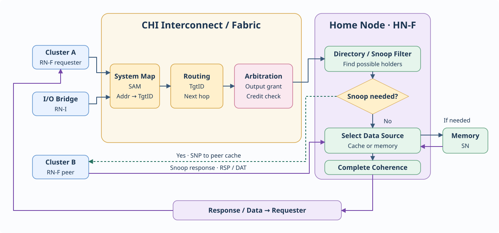
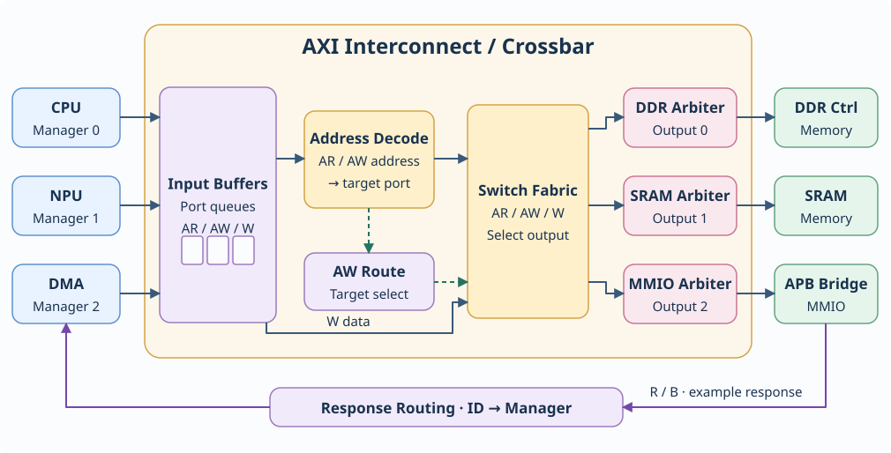
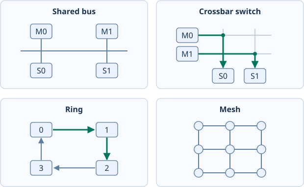

SoC 总线协议
############

**AMBA（Advanced Microcontroller Bus Architecture）** 是 ARM 发布的一组协议规范。
AXI、CHI、AHB 和 APB 是其中的协议名称。

- **协议规范** 定义端点如何互通，包括信号或消息的含义、合法传输、handshake、
  flow control、backpressure，以及响应与排序规则。AXI 用 VALID/READY 控制每条通道的交接。
  接收端可用 READY 为低施加 backpressure，发送端在等待期间必须保持 VALID 和 payload 稳定。
  CHI 链路用 link credit 表示接收端的接收额度，发送端必须有相应 credit 才能发出 flit。
  路由和仲裁也有协议层约束。例如 CHI 定义目标节点 ID（TgtID）及其确定规则，
  AXI 定义可供仲裁使用的 QoS 字段。具体逐跳路由和 round-robin 等仲裁算法由互连实现决定。
  这些规则约束接口行为，缓冲深度和具体流量调度由实现决定。参见 `ARM AXI 与 ACE 规范`_ 和 `ARM CHI Issue H`_。
- **IP 实现与芯片集成** 在协议允许的范围内选择接口位宽、缓冲深度、互连拓扑、
  地址映射（address map）、地址译码逻辑（address decoding）、事务路由（routing）、
  仲裁策略（arbitration）和时钟域。例如，AXI 互连按 address map 对 AR 或 AW 携带的地址做译码，
  选出 target 端口，再将 transaction 路由到该端口。AXI 规范定义了地址无法译码时的 DECERR（decode error）响应。
  以 AXI 的 burst 为例，规范约束一笔 transaction 可包含
  多少个 data beat、每个 beat 如何通过 handshake 完成传输、各 beat 的地址如何计算，
  以及整个 burst 不得跨越 4 KiB 地址边界。
  支持的 outstanding transaction count和读响应时延取决于互连、目标端和系统配置。

查握手、编码或顺序规则时读协议规范，查具体 IP 的端口、队列和配置选项时读
Technical Reference Manual（TRM），查芯片上的地址窗口和连接关系时读芯片集成手册。

.. list-table::
   :header-rows: 1

   * - 协议
     - 主要机制
     - 典型使用场景
   * - CHI
     - 节点角色、一致性消息与链路流控
     - CPU cluster、Home Node、内存侧节点
   * - AXI
     - 独立地址、数据和响应通道，支持 burst 和多笔 outstanding transactions
     - DMA、内存控制器、供多个发起端共享的片上 SRAM
   * - AHB
     - 流水化的地址/控制阶段与数据阶段
     - MCU 子系统，例如本地 SRAM
   * - APB
     - Setup 和 Access 两阶段
     - UART、timer、看门狗的寄存器口

- **beat** 是数据通道上一次 handshake 交接的数据单元。以 AXI 的 R 通道为例，
  只有在时钟边沿同时采到 RVALID 和 RREADY，才算传完一个 beat。
  如果 RVALID 已拉高而 RREADY 连续几个周期为低，等待的仍是同一个 beat。
- **burst** 是一笔 transaction 中由同一份地址信息描述的一个或多个 data beat。
  地址通道给出起始地址、beat 数量、每个 beat 的大小和地址变化方式。
  例如一次每 beat 16 B、共 4 个 beat 的递增地址读（INCR），只发送一次起始地址，随后依次返回 64 B 数据。
- **outstanding** 描述地址请求已经被接收、响应还未完成的 transaction。
  在同一个 AXI 接口上，读 transaction 从 AR handshake 起计入，
  到带 RLAST 的最后一个 beat 完成 handshake 时减去。写 transaction 则从 AW handshake 数到 B handshake。

规范入口见 `ARM AMBA`_，历史沿革见 `AMBA 百科条目`_。

CHI 协议
===========

CHI（Coherent Hub Interface）定义 CPU cluster、共享缓存、内存侧节点和 I/O 入口之间
如何交换请求、snoop、数据和完成消息。
对于需要一致性的访问，Home Node 协调各节点对同一 cache line 的副本和访问权限，
并根据当前状态安排数据从 cache 或内存返回。

``snoop`` 是发往 cache 节点的一致性请求。
在 CHI 中，Home Node 可以针对指定的 cache line 向可能持有副本的 Request Node 发出 snoop。
接收节点检查本地 cache，并按请求类型报告副本状态、
提供数据、降级权限或使副本失效。例如，另一个 core 的 cache 若持有尚未写回内存的最新数据，
Home Node 可以通过 snoop 让该 cache 提供数据。

同一 cache line 可以在多个 private cache 中有干净副本。
一个 core 写这条 line 前需要取得写权限并使其他旧副本失效。
如果另一个 cache 持有最新的脏数据，从 DRAM 直接读取会得到旧值。
缓存一致性主要约束同一地址的副本与写入可见性；跨地址的可见顺序还受
memory model、同步原语和 barrier 约束。参见 `ARM CHI 规范`_ 和 `ARM CHI 导读`_。

.. figure:: pic/amba/chi.svg
   :width: 620px
   :align: center
   :alt: CHI Request Node、Home Node 和 Subordinate Node

   获取独占权限的逻辑角色。省略可选消息和中间路由，数据也可走直接转发路径。

- **RN（Request Node）** 发起事务。RN-F 是 fully coherent requester，
  可以持有 coherent cache 并接收 snoop。RN-I 是 I/O-coherent requester 的一种接口角色，
  例如由 bridge 代表 DMA 设备发请求，无需提供 RN-F 的可探测缓存接口。
- **HN（Home Node）** 负责一组地址。HN-F 协调这些地址上的 coherent 事务，
  决定要探测哪些 RN，并安排下游访问。实现可用 directory 或 snoop filter
  跟踪潜在 sharer 或 owner，也可在 Home 一侧集成 system-level cache。
- **SN（Subordinate Node）** 提供下游访问，例如接到内存子系统。
  若最新数据能从其他 cache 获取，当前事务可以省去对 DRAM 的读取。

例如 RN-F A 在写缺失时发 ReadUnique。地址映射将其送到负责该 line 的 Home。
Home 向可能持有副本的 RN-F B 发 snoop，B 交出相关权限并在需要时提供数据。
A 最终取得数据与写权限。若初始状态不同，或者用直接供数机制，
数据源、响应路径和完成消息也会变化。
例如启用 Direct Cache Transfer（DCT）时，持有者可直接把数据送给发起者，
Home 仍负责协调事务。若读事务要求完成确认，发起者还要发送 CompAck。
CHI 的另一个常见路径是 I/O 读：DMA 读到仍驻留于 CPU cache 的脏 line 时，
Home 可探测持有者并取得最新数据，具体是否降级或失效取决于请求类型。

   一种 CHI 实现中的逻辑路径。SAM 可以位于 RN 或互连入口，图中标出 SAM 的地址映射结果。
   HN-F 根据 cache line 状态选择 snoop 和内存访问，图中分支按需发生。
   绿色虚线表示发往 Cluster B 的 snoop，紫线表示响应或数据。消息经 CHI fabric 转发，图中省略中间跳和可选完成确认。
   参见 `ARM CHI Issue H`_ 的 B2–B3 章。

CHI 导读将接口划分为三个层次：

- **Protocol layer** 定义事务和一致性语义。REQ、RSP、DAT、SNP
  分别承载请求、响应、数据和探测。节点 ID 用于寻址，事务 ID 等字段用于关联消息。
- **Network layer** 负责节点间的传送。ring 或 mesh 及具体逐跳路由由互连设计决定，
  实现需要保证各类消息满足协议的前进约束，避免缓冲或通道依赖形成死锁。
- **Link layer** 负责相邻端口之间的 flit 传递与 link credit。
  发送 flit 消耗接收端授予的 credit。RetryAck 和 PCrdGrant
  则处理事务接纳和重试许可，资源作用域与逐链路的 credit 不同。

AXI4 设备可通过有一致性能力的 I/O bridge 访问 coherent domain。
bridge 根据地址与事务属性生成 CHI 请求，由 Home 处理与 CPU cache 的交互。
是否保证共享 buffer 的一致性，要沿入口端口、bridge、地址窗口和内存属性核对。
完全一致的缓存端点还要实现 snoop 和相应的状态转换。

AXI 协议
=========

基础 AXI 协议本身不提供缓存一致性，ACE（AXI Coherency Extensions）为 AXI 增加一致性机制。
AXI（Advanced eXtensible Interface）定义发起端与目标端之间如何传输请求、数据和响应。
本节以 memory-mapped AXI4 为主。处理器或 DMA engine 用地址指定要访问的内存位置或外设寄存器。
读地址、读数据、写地址、写数据和写响应各有独立通道。
AXI4 支持用一笔 transaction 传输多个 data beat，也允许发起端在前一笔 transaction 完成前发出新的请求。

AXI4 在线路上使用各通道预先定义的信号字段。以写入为例，AW 通道用 AWADDR、AWLEN 和 AWSIZE
分别给出起始地址、beat 数量减一和每个 beat 的传输大小。W 通道用 WDATA 携带数据，
用 WSTRB 标出哪些字节有效，用 WLAST 标记最后一个 beat。
同一个接口的 WDATA 位宽在设计时确定，每笔 transaction 的有效字节数和 beat 数可以变化。
例如，采用 32 位地址和 64 位数据的 AXI4 端口，AWADDR 为 32 bit，AWLEN 为 8 bit，
AWSIZE 为 3 bit，WDATA 为 64 bit，WSTRB 为 8 bit（每个 byte lane 对应一位），WLAST 为 1 bit。
这些都是定宽的 RTL 信号。信号可以由组合逻辑驱动，也可以由寄存器或 FIFO 驱动，
具体取决于流水线和缓冲设计。发送端遇到反压时须保持 VALID 和 payload 稳定，直到 handshake。

AXI4-Lite 是适合控制寄存器的 AXI4 子集，每笔读或写事务只有一个数据 beat。
AXI4-Stream 是用于流式数据的独立接口。AXI5 与 ACE 的扩展能力应按对应版本查阅。
参见 `ARM AXI 规范`_ 和 `ARM AXI 导读`_。

.. figure:: pic/amba/axi.svg
   :width: 600px
   :align: center
   :alt: AXI 五条通道及其 payload 方向

   五条通道各有自己的 VALID/READY。图中箭头表示 payload 方向，READY 反向传递。

每条通道都在 ACLK 上升沿同时采到 VALID 和 READY 时交接一次 payload。
发送端不能等 READY 才拉起 VALID。只要尚未握手，就要保持 VALID 和 payload 稳定。
接收端可以提前拉起 READY，也可以在观察到 VALID 后拉起。
规范约束接口输入和输出之间的组合路径，互连可用 register slice 或带寄存器的 skid buffer 切断长路径。

- **读路径**\ 。AR 交接地址、ID 和 burst 属性，R 返回读数据、ID 和响应码。
  RLAST 随最后一个 beat 返回，每一个 beat 都可以遇到反压。
- **写路径**\ 。AW 交接地址和属性，W 交接数据、字节使能 WSTRB 和尾 beat 标志 WLAST。
  W 和 AW 可独立握手，W 甚至可以先到。AXI4 的 W 没有 WID，
  同一接口上的写数据按写地址事务的顺序关联，不交织不同 burst 的写数据。
  地址及最后一个数据 beat 都交接后才能给出整个 burst 的 B 响应。

   一种 AXI4 Crossbar 的逻辑框图。各 manager 的请求可以先经输入缓冲。
   地址译码用 AR/AW 选择 target，交换网络将来自不同入口的流量送到各输出口仲裁。
   W data 沿蓝线进入交换网络，绿色虚线表示 AW 路径为 W 保留的 target 选择。
   紫线只画出 DMA 访问 APB Bridge 时的 R/B 返回例子，其他端口也可参与响应路由。
   方框表示功能分工，实际 RTL 可以合并模块或在其间插入流水级。
   参见 `PULP AXI crossbar RTL`_ 与 `ARM AXI 规范`_。

AHB和APB协议
========================================

**AHB（Advanced High-performance Bus）** 本身不提供缓存一致性。
AHB 将地址/控制阶段与数据阶段流水重叠。
例如上一笔的数据阶段进行时，下一笔可给出 HADDR 与 HTRANS。
HREADY 表达数据阶段是否完成，等待会限制流水继续前进。
AHB-Lite 的一条接口服务单 manager，多发起端可经多层 AHB interconnect
在目标前仲裁。AHB5 的扩展见 `ARM AHB 规范`_。

片上 SRAM 可以接 AHB，也可以接 AXI。对 MCU 的本地 SRAM，短路径和低访问时延通常更重要。
如果 SRAM 控制器无需插入等待周期，AHB 流水线填满后可以每周期交接一个 data beat。
当 CPU、DMA 等发起端共享 SRAM，希望同时保持多笔 outstanding transactions 时，
AXI 的独立通道和 transaction ID 便于组织并发。实际吞吐还取决于 SRAM 的端口数、bank 组织和仲裁。

**APB（Advanced Peripheral Bus）** 本身不提供缓存一致性，常用于通过 bridge 访问外设寄存器。
Setup 置 PSEL、保持 PENABLE 为低并给出地址和控制；
Access 置 PENABLE。PREADY 为低时延长 Access 并保持信号，
为高时在采样边沿完成。紧随其后的访问仍需回到 Setup，即使仍然选择同一外设。
读数据和可选的错误信号在完成时采样。参见 `ARM APB 规范`_。

- **组合逻辑**\ 。用 PADDR 译码寄存器，再经 mux 生成 PRDATA。
  无需插入等待的设备可以固定 PREADY 为高，也可由接收状态控制。
- **时序逻辑**\ 。在 PCLK 上升沿且 PSEL、PENABLE、PREADY、PWRITE
  同时为高时提交写入。这样一个带等待的访问仅产生一次写副作用。
  支持字节写的实现还要按 PSTRB 更新。bridge 可用寄存器保存 Idle、
  Setup、Access 状态及上游请求的地址和数据。

AXI 与 APB 若处于异步时钟域，bridge 必须把请求、数据与完成一起交接。
单比特稳定控制信号可经同步器，多比特 payload 可以用握手保持整体稳定，
或用带 Gray 指针同步的 asynchronous FIFO。逐位同步无法保证在接收侧拿到同一笔数据。
设计还要规定 reset 释放以及如何清空跨域的 outstanding transactions。
参见 `PULP AXI RTL`_ 的 axi_xbar 和 axi_cdc。

互连拓扑、路由和仲裁
========================================

**Interconnect**\ （互连）是通用术语，指连接端点并承载 transaction 的硬件结构。
`ARM AXI 与 ACE 规范词汇表`_ 将具有多个 AMBA 接口、连接发起端与目标端的组件称为
interconnect component。芯片框图里的 interconnect 方框指该芯片采用的具体互连，
例如 CoreLink NI-700。实现可以包含地址译码、交换矩阵、缓冲、桥和时钟或位宽转换。

**Topology** 描述节点和链路如何连接，与接口采用哪种协议是两个设计维度。
例如，AXI 互连和 CHI 互连都可以采用 crossbar 或 mesh。
采用同一种拓扑时，互连仍需分别满足所承载协议的顺序、流控及一致性要求。
**Routing** 选择输出或下一跳，
**arbitration**\ （仲裁）决定竞争同一资源时谁先走，
**flow control** 表达接收端有没有空间。
类似网络交换机的转发表、switch fabric 和输出调度，三个功能可以分开看；
片上互连还需要维护事务关联、协议顺序和一致性依赖。

.. list-table::
   :header-rows: 1

   * - 互连拓扑（Topology）
     - 连接结构
     - 路由与仲裁
   * - Shared bus
     - 多端共享传输资源
     - 地址译码选择目标，中央或分布式仲裁分配通路
   * - Crossbar switch
     - 多个输入可连接多个输出的交换结构，也可裁剪连接
     - 入口译码选输出，不同输出可并行，同一输出单独仲裁
   * - Ring
     - 节点首尾相接，链路可单向或双向
     - 逐跳转发，注入流量与过境流量竞争可用链路或 slot
   * - Mesh
     - Router 按网格连接，每个 router 内可用局部 crossbar 连接输入和输出端口
     - 各 router 选择下一跳并仲裁输出端口，再由局部 crossbar 将获准的输入接到该输出
   * - Torus
     - 网格相对边界上的节点再接回彼此，形成环回链路
     - 路由可选择跨边界的路径，各 router 仲裁输出端口
   * - Tree / hierarchical interconnect
     - 多个局部 bus 或 crossbar 通过桥或上层交换节点分级连接
     - 本地请求可留在本支路，跨支路请求经过上层节点并竞争上行或下行链路
   * - Fat-tree
     - 在树形层次中为上层提供更多并行链路或更高的聚合带宽
     - 跨支路请求先上行再下行，有并行路径时可分散流量，各级仍各自仲裁
   * - Butterfly
     - 多级交换，每一级按固定模式连接下一级的交换节点
     - 经典 butterfly 可逐级用目标 ID 的一组位选择输出，竞争发生在级间链路
   * - Clos
     - 输入级和输出级之间设多个并行的中间交换节点
     - 从可用中间节点中选路径，在各级交换节点上仲裁输出

简单外设子系统常把 bus、crossbar 和 bridge 组合成层次互连。
Torus、fat-tree、butterfly 和 Clos 则也常见于 NoC 架构比较，适用性取决于节点规模、流量和布线约束。
参见 `剑桥大学 SoC 课件`_ 与 `片上互连拓扑研究`_。

   四种互连拓扑示意。M 表示发起端，S 表示目标端。Crossbar 中的绿线表示两条可并行的连接，
   Ring 中的绿线表示从节点 0 经节点 1 到节点 2 的两跳路径。Mesh 中每个圆点代表一个 router。

协议规定什么
------------

片上互连要做两个决定。**Address decoding** 用 transaction 的地址确定目标端口或目标节点，
**route computation** 用目标端口或节点 ID 决定下一跳。小型 crossbar 可以直接用译码结果
选择输出。在多跳 NoC 上，入口可以先把地址译成目标 ID，后续 router 再按 ID 或包头中的路径信息转发。

- **AXI** 规定 ARADDR 和 AWADDR 怎样随请求传输，以及握手、排序和错误响应的语义。
  例如互连可对未匹配任何地址窗口的访问返回 DECERR。SoC 决定哪个地址窗口通向哪个 target，
  以及互连内部怎样转发。AXI4 的 W 通道没有地址，crossbar 需要让 W 沿对应 AW 选定的出口传输，
  因此实现通常要记录写请求的出口选择。参见 `ARM AXI 与 ACE 规范`_ 的 A3 章。
- **CHI** 对目的地确定有更明确的规定。IHI 0050 Issue H 的 B3 章规定用
  System Address Map（SAM）为常规地址型请求确定 TgtID。来自 Request Node 的普通
  coherent 请求通常以负责该地址的 Home Node 为目的地；SAM 可以在 Request Node 或互连中。
  SAM 的格式与结构由实现决定，B1.2 也给出了 crossbar、ring、mesh 等拓扑示例。
  目标节点确定后，逐跳路径仍由互连实现决定，同时要满足协议的顺序与前进性要求。
  参见 `ARM CHI Issue H`_ 的 B1.2 与 B3.1–B3.3。

从地址到 target
-----------------

假设片上外设占用 0x4000_0000 至 0x4000_FFFF 共 64 KiB。

- **固定窗口**。这段地址自然对齐，用高位匹配即可。以 32 位地址为例，
  检查地址的高 16 位是否等于 0x4000，低 16 位可作为外设窗口内的偏移。
  多个窗口可并行比较，再把命中结果编码成输出端口。
- **范围比较**。每条规则保存起始地址、结束地址和 target 编号。
  例如用「大于等于起始地址、小于结束地址」判定命中。
  窗口可以由常量描述，也可以从配置寄存器读取。
- **表项查找**。规则多时，可先按地址高位分组，再在组内比较剩余规则。
  如果输入已经是范围紧凑的目标 ID，也可用它索引 ROM 或 SRAM 得到出口。

公开 RTL 中，`PULP AXI crossbar RTL`_ 分别用地址译码器处理 AR 和 AW，
`PULP 地址译码器 RTL`_ 支持范围规则以及自然对齐的二次幂区域。
小型 crossbar 的比较、仲裁和 mux 可以放在同一段组合路径中，只要能在时钟周期内收敛。
若窗口多、扇出大或链路长，可以让第一级译码，寄存 target 编号和 payload，
再由下一级仲裁并选择输出。即使单次译码是组合逻辑，队列、outstanding transaction tracking、
round-robin 指针等仍需要时序状态。
`PULP AXI crossbar 配置文档`_ 展示了通过 LatencyMode 插入 spill register 来切断组合路径的做法。
打拍增加固定延迟，能否每周期通过一笔还取决于缓冲和反压。

ARM 的 CoreLink NI-700 提供了一个商用例子。
其 TRM 说明 AXI 入口 ASNI 对地址译码时会生成 Target ID、route vector 和越界错误指示。
每个上游入口可以有自己的 address map。对配置了 address striping 的区域，
NI-700 可以将访问分散到多个下游接口。第 8.4 节公开了一个具体算法：
两个 stripe target 时，屏蔽由 striping granularity 决定的低位后，
将剩余地址位 XOR 成一位，用它选择 target。这里能确认的是译码结果及 striping 算法。
公开 TRM 未交代译码器是否采用 TCAM，也未给出可套用到所有配置的译码周期数。
参见 `ARM NI-700 TRM`_ 的 ASNI 功能说明及第 8 章。

从目标节点到下一跳
------------------

- **Ring**。设单向环为 0、1、2、3、0。节点 0 发往节点 2，节点 1 比较目标 ID 后继续转发，
  到节点 2 取出。规则单向环用本地 ID 比较和固定转发方向就能实现。
  双向环可在入口比较顺、逆时针距离，再选择方向。过境与注入流量竞争同一链路时，再由仲裁决定谁先走。
- **Mesh**。规则网格可用 deterministic XY routing。router 先比较当前与目标的 X 坐标并沿 X 前进，
  X 相同后再沿 Y 前进。例如从 (0, 0) 去 (2, 1)，先横向走两跳再纵向走一跳。
  这种实现可用坐标比较和端口选择逻辑。不规则连接可预先生成目标到出口的映射表，
  逐跳索引，也可以在入口生成一串出口选择供后续 router 使用。
  `gem5 Garnet`_ 给出了权重表路由和 XY 路由两种可对照的模型。

下一跳确定后，多个输入仍可能争用同一输出。router 可以把 route computation、
virtual channel allocation、switch allocation 和 switch traversal 分级打拍。
固定优先级、round-robin 和加权仲裁都可用于共享输出，具体策略由实现决定。
AXI QoS 提供协议信息，互连仍要同时满足接口顺序和前进性约束。
参见 `剑桥大学 SoC 课件`_ 和 `得州大学 SoC 课件`_。

一种分区方式是在 compute die 内用 coherent ring 连接多个 core、Home 和内存入口，
在 I/O die 或旁路 I/O fabric 用 AXI 接高速设备、AHB 接简单子系统、APB 接控制寄存器。
跨 die 边界要另选链路和桥，CPU 与 I/O 的共享区域可通过 coherent I/O 入口访问。
环和网格的 router 内也可以含有局部 crossbar。

片上端点和地址窗口通常由集成配置、固件、设备树或 ACPI 描述。
PCIe 提供配置空间、BAR 和层级枚举，root complex 与 switch 支持运行时发现外接设备。
ARM SoC 也可以集成 PCIe root complex，x86 处理器内部同样使用片上互连。
PCIe DMA 的一致性受主机平台与事务属性约束。参见 :doc:`PCIe总线`。

带宽、时延和频率
==================

对每周期最多交接一个 beat 的同步数据通道，假设每个周期都完成 handshake，
且每个 beat 的所有字节都有效，理论单向峰值带宽为

.. math::

   \mathrm{BW}_{\mathrm{peak}} = \frac{W_{\mathrm{data}}}{8} \times f_{\mathrm{clk}} .

其中，:math:`\mathrm{BW}_{\mathrm{peak}}` 表示理论单向峰值带宽（peak bandwidth，BW 是 bandwidth 的缩写），单位是 byte/s（字节每秒）。
:math:`W_{\mathrm{data}}` 表示数据通道位宽（data width，W 取自 width），单位是 bit（比特）。
:math:`f_{\mathrm{clk}}` 表示通道时钟频率（clock frequency，f 取自 frequency，clk 是 clock 的缩写），单位是 Hz（周期每秒）。
这里用的是数据通道所在时钟域的频率，例如 AXI 接口的 ACLK。
CPU core 主频则决定 core 的时钟周期，一条指令所需的周期数由流水线和执行条件决定。
总线与 core 可以同频、由同一时钟源分频，也可以处于异步时钟域，由 CDC 逻辑交接请求和数据。
例如 core 跑在 3 GHz、AXI 接口跑在 1 GHz，计算该接口峰值带宽时用 1 GHz。

每字节有 8 bit，因此 :math:`W_{\mathrm{data}}/8` 是满宽 beat 的字节数。
例如，128 bit、1 GHz 的数据通道每周期可传 16 byte，理论单向峰值为 16 GB/s，即每秒 160 亿字节。
AMD 的 `Zynq 7000 峰值带宽表`_ 也采用位宽乘时钟频率的计算口径。

协议规定合法的 burst、handshake 和 backpressure；实际位宽与频率取决于 IP 配置、物理布线与时序收敛。
有效带宽还受数据对齐、burst 长度、outstanding transaction count、共享链路、CDC 和内存效率影响。
若 16 GB/s 入口接到 8 GB/s 的下游端口，端到端持续吞吐受后者限制。

首 beat latency 包含入口排队、译码与仲裁、逐跳转发、目标服务和返回排队。
尾 beat 还要加上后续传输。cache hit、远端 cache 供数、DRAM row miss 和 IOTLB miss
会形成不同的延迟分布。增加 pipeline 可能提高频率，同时增加固定周期数。
若要在 100 ns 往返时延上维持 16 GB/s，带宽时延积给出约 1600 B 的在途数据需求，
还要检查 ID、队列深度和目标实际服务能力。
比较测量值时应注明端点、traffic pattern、并发、读写比及首 beat、尾 beat 或 P99 口径。

一致性带来的开销
=================

硬件一致性可能增加 directory 或 snoop filter 元数据、cache tag/state、
outstanding transaction table、消息缓冲和控制逻辑。精确目录若为每条被跟踪的 line
保留 sharer bit vector，向量宽度随节点数增长。稀疏目录与层次化过滤
可以交换存储、额外探测、功耗和时延。面积占比需结合工艺、缓存容量、
队列规模与物理设计数据比较，无法从协议名称推算。

coherent DMA 方便 CPU 和设备共享描述符及状态字，仍需要 barrier 确保
先写描述符内容，再发布所有权。non-coherent DMA 常用 streaming mapping，
驱动按访问方向与 buffer 复用时机调用 ``dma_map_*()``\ 、
``dma_sync_*_for_cpu()``\ 、``dma_sync_*_for_device()`` 或 ``dma_unmap_*()``\ 。
同一 cache line 内混放 CPU 和设备分别写入的字段还会带来 false sharing
或 non-coherent cache maintenance 的覆盖问题。参见 `Linux DMA API 指南`_。

从协议到IP实现
=================

ARM 发布 AMBA 规范，也授权具体互连 IP。
**CoreLink CMN-700** 是基于 CHI
的 coherent mesh，
**CoreLink NI-700** 是可配置的 non-coherent NoC。
量产 SoC 可选用 ARM 或第三方 IP、用生成工具配置互连，或组合自研与开源 RTL。
即使互连由供应商提供，集成团队仍要配置地址、QoS、clock/reset 和安全域，
并验证排序、错误、CDC 和一致性。PULP 的 SystemVerilog AXI 模块展示了
在 RTL 中复用协议组件的一种方式。参见 `ARM CMN-700`_ 与 `ARM NI-700 TRM`_。

QEMU 与 gem5 的抽象边界
===========================

**QEMU** 常建模软件可见的行为。以下以 `QEMU 官方仓库 v10.2.0`_ 为源码基线。
``AddressSpace`` 和 ``MemoryRegion`` 描述地址映射。
``system/physmem.c`` 中的 ``address_space_rw()`` 可发起地址空间访问。
MMIO 在 ``system/memory.c`` 中经 ``memory_region_dispatch_read()`` 或
``memory_region_dispatch_write()`` 分派给 ``MemoryRegionOps``\ 。
DMA 模型使用相应的 AddressSpace，IOMMU MemoryRegion 可提供翻译。
这覆盖寄存器、地址翻译、IRQ 与 DMA 等功能语义，常规映射没有逐 beat 的 AXI 时序。
参见 `QEMU Memory API`_ 与 :doc:`QEMU仿真虚拟化`。

**gem5** 可以模拟访问时延、竞争和反压。以下以 `gem5 官方仓库 cbc94c1a77`_ 为源码基线。
Classic 路径以 ``Request``\ 、``Packet`` 和 timing port 表达事务。
``sendTimingReq()`` 返回 false 时，需要等待 retry 通知；
``NoncoherentXBar`` 可以模拟端口竞争和参数化的转发延迟。
Ruby 可经 ``RubyPort::MemResponsePort::recvTimingReq()`` 和
``Sequencer::makeRequest()`` 进入一致性子系统。源文件 ``src/mem/ruby/protocol/chi/CHI-cache.sm``
及其关联 SLICC 状态机描述一致性事务，
选择 Garnet 时，``NetworkInterface::flitisizeMessage()`` 将模拟消息拆成 flit，
由 router、virtual channel 和 credit 建模传输。
gem5 可以按周期计算模型的行为，精度取决于模型掌握了多少真实硬件细节。
要与实际芯片逐周期对齐，还需要知道互连在哪些逻辑之间插入寄存器、队列有多深、
采用什么仲裁策略，以及目标端何时接收请求和返回响应。例如，地址译码的结果可以先写入寄存器，
下一周期再参与输出端口仲裁，这会在这段路径上增加一个固定周期。最后还要用 RTL 仿真结果或芯片测量验证。
参见 `gem5 CHI`_、`gem5 Garnet`_ 与 :doc:`gem5访存流程`。

.. _ARM AMBA: https://www.arm.com/architecture/system-architectures/amba
.. _AMBA 百科条目: https://en.wikipedia.org/wiki/Advanced_Microcontroller_Bus_Architecture
.. _ARM AXI 规范: https://developer.arm.com/documentation/ihi0022/latest/
.. _ARM AXI 与 ACE 规范词汇表: https://documentation-service.arm.com/static/602a9df190ee6824a1e02b98
.. _ARM AXI 导读: https://documentation-service.arm.com/static/66fd59a21669c0388dca99b7
.. _ARM CHI 规范: https://developer.arm.com/documentation/ihi0050/latest/
.. _ARM CHI 导读: https://documentation-service.arm.com/static/682600710aae2a5d8f044978
.. _ARM AHB 规范: https://developer.arm.com/documentation/ihi0033/latest/
.. _ARM APB 规范: https://developer.arm.com/documentation/ihi0024/latest/
.. _Linux DMA API 指南: https://docs.kernel.org/core-api/dma-api-howto.html
.. _剑桥大学 SoC 课件: https://www.cl.cam.ac.uk/teaching/1112/SysOnChip/socdam1112.pdf
.. _片上互连拓扑研究: https://people.csail.mit.edu/sanchez/papers/2010.noc-arch.taco.pdf
.. _得州大学 SoC 课件: https://users.ece.utexas.edu/~gerstl/ee382v_f14/lectures/lecture_12.pdf
.. _PULP AXI RTL: https://github.com/pulp-platform/axi
.. _U50 平台指南: https://docs.amd.com/r/en-US/ug1120-alveo-platforms/U50-Gen3x16-XDMA-base_5-Platform
.. _DPU HBM 配置: https://docs.amd.com/r/en-US/pg367-dpucahx8h/Configuring-the-HBM
.. _ARM CMN-700: https://www.arm.com/products/silicon-ip-system/corelink-interconnect/cmn-700
.. _ARM NI-700 TRM: https://documentation-service.arm.com/static/64c2dc0438511951cb7a1956
.. _QEMU Memory API: https://www.qemu.org/docs/master/devel/memory.html
.. _QEMU 官方仓库 v10.2.0: https://github.com/qemu/qemu/tree/v10.2.0
.. _gem5 官方仓库 cbc94c1a77: https://github.com/gem5/gem5/commit/cbc94c1a773e94118070294750dbe2c9c75898cb
.. _gem5 CHI: https://www.gem5.org/documentation/general_docs/ruby/CHI/
.. _gem5 Garnet: https://www.gem5.org/documentation/general_docs/ruby/garnet-2/
.. _Zynq 7000 峰值带宽表: https://docs.amd.com/r/en-US/ug585-zynq-7000-SoC-TRM/Theoretical-Bandwidth

.. _ARM AXI 与 ACE 规范: https://documentation-service.arm.com/static/602a9df190ee6824a1e02b98
.. _ARM CHI Issue H: https://documentation-service.arm.com/static/68d13eb5bd7cab51328bee7a
.. _PULP AXI crossbar RTL: https://github.com/pulp-platform/axi/blob/master/src/axi_xbar_unmuxed.sv
.. _PULP 地址译码器 RTL: https://github.com/pulp-platform/common_cells/blob/master/src/cc_addr_decode.sv
.. _PULP AXI crossbar 配置文档: https://github.com/pulp-platform/axi/blob/master/doc/axi_xbar.md#pipelining-and-latency
