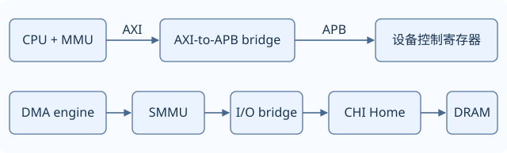
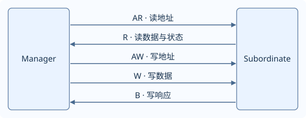
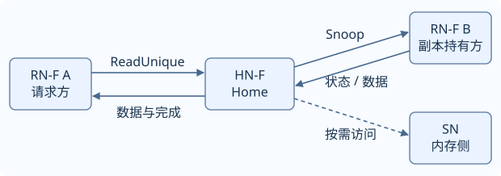

SoC 总线协议
############

从 doorbell 到 DMA
========================================

**Doorbell（门铃）** 是一种通知机制。以 DMA 提交队列为例，驱动先把工作写进共享内存，
再通过 MMIO 写设备的 doorbell 寄存器，告诉设备「队列里有新工作」。
设备手册定义写入值的含义。有的寄存器只需写一个通知值，有的要求写入新的队尾索引。

#. **准备工作**\ 。假设提交队列原本为空，队头和队尾都在槽位 4。
   驱动填好槽位 4、5 的描述符，其中包含输入和输出缓冲区的 DMA 地址、长度等信息。
#. **通知设备**\ 。驱动按 DMA 映射和设备的排序要求发布描述符，再用 MMIO 写入新队尾 6。
   设备由此知道槽位 4、5 可以消费，一次 doorbell 就提交了两笔工作。
   NVMe 的 Submission Queue Tail Doorbell 就采用这种写队尾的方式。
#. **执行并报告完成**\ 。设备用 DMA 读取描述符，再访问描述符指向的缓冲区。
   处理结束后，设备可写完成队列或更新状态寄存器，也可发 IRQ 通知 CPU。
   对驱动而言，写 doorbell 是提交动作，完成状态才是回收这批缓冲区的依据之一。

驱动需要保证设备在收到通知后能读到已发布的描述符。以内存中的 ownership 字段为例，
Linux 驱动可用 ``dma_wmb()`` 排序描述符内容和 ownership 的写入，
再用满足相应 MMIO 排序要求的 accessor 写 doorbell。若映射需要 cache 同步，
还需按 DMA API 的要求把缓冲区交给设备。参见 `Linux 内存屏障文档`_ 和 `NVMe PCIe 传输规范`_。

**GICv4 中的 doorbell** 也用于通知，但收件人是 hypervisor。
当一个虚拟中断变为 pending，而目标 vPE（虚拟处理单元）当前未装载到物理核的 GIC 接口时，
在已配置 doorbell 且触发条件满足的情况下，GIC 可以发出一个物理 doorbell IRQ。
这条 IRQ 告诉 hypervisor「这个 vPE 有待处理的虚拟中断」，供它决定何时调度目标 vCPU。
因此在 DMA 例子里，是驱动通过寄存器写通知设备取队列；在 GICv4 例子里，
是中断控制器通过物理 IRQ 通知 hypervisor 处理待运行的 vPE。
参见 `ARM GICv3/v4 虚拟化导读`_ 的图 5-4。

回到 DMA 提交队列，下面的 SoC 示例分别画出了寄存器写和 DMA 读的路径。
CPU 发出的 MMIO 写可以经 AXI-to-APB bridge 到达控制寄存器；
DMA engine 发出的内存读则可以经 SMMU、I/O bridge 和一致性互连访问共享内存。

   一种 SoC 集成方式。箭头表示请求方向，响应沿相应接口返回。

**AMBA（Advanced Microcontroller Bus Architecture）** 是 ARM 发布的一组接口规范。
规范定义信号、消息、握手、顺序约束和端点义务。
芯片集成则要选定拓扑、地址映射、接口位宽、缓冲深度、仲裁和时钟域。
阅读时可以把协议规范、IP 的 Technical Reference Manual（TRM）和芯片集成手册放在一起对照。

.. list-table::
   :header-rows: 1

   * - 接口
     - 主要抽象
     - 典型端口
   * - AXI
     - 独立地址、数据和响应通道，支持 burst 和多笔在途事务
     - DMA、内存控制器、高速设备
   * - CHI
     - 节点角色、一致性消息与链路流控
     - CPU cluster、Home Node、内存侧节点
   * - AHB
     - 流水化的地址/控制阶段与数据阶段
     - MCU 子系统、片上 SRAM
   * - APB
     - Setup 和 Access 两阶段
     - UART、timer、看门狗的寄存器口

规范入口见 `ARM AMBA`_，历史沿革见 `AMBA 百科条目`_。

AXI：地址、数据与完成
========================================

以 memory-mapped AXI4 为例，AXI4-Lite 是适合控制寄存器的单 beat 子集，
AXI4-Stream 则是用于流式数据的独立接口。AXI5 与 ACE 的扩展能力应按对应版本查阅。
参见 `ARM AXI 规范`_ 和 `ARM AXI 导读`_。

   五条通道各有自己的 VALID/READY。图中箭头表示 payload 方向，READY 反向传递。

每条通道都在 ACLK 上升沿同时采到 VALID 和 READY 时交接一次 payload。
发送端不能等 READY 才拉起 VALID。只要尚未握手，就要保持 VALID 和 payload 稳定。
接收端可以提前拉起 READY，也可以在观察到 VALID 后拉起。
规范约束接口输入和输出之间的组合路径，互连可用 register slice 或带寄存器的 skid buffer 切断长路径。

- **读路径**\ 。AR 交接地址、ID 和 burst 属性，R 返回读数据、ID 和响应码。
  RLAST 随最后一个 beat 返回，每一个 beat 都可以遇到背压。
- **写路径**\ 。AW 交接地址和属性，W 交接数据、字节使能 WSTRB 和尾 beat 标志 WLAST。
  W 和 AW 可独立握手，W 甚至可以先到。AXI4 的 W 没有 WID，
  同一接口上的写数据按写地址事务的顺序关联，不交织不同 burst 的写数据。
  地址及最后一个数据 beat 都交接后才能给出整个 burst 的 B 响应。

Burst 与 outstanding
---------------------

把 AXI 读想成「先下单，再分批收货」。
**Burst（突发传输）** 看的是一张单据要分几批交付，
**outstanding（在途事务）** 数的是已接单、还没交付完的单据有几张。

比如 DMA 要读 256 B 数据，且起始地址按 256 B 对齐，可以发一个 16 beat、每 beat 16 B 的 INCR burst。
AR 只交接一次起始地址和传输属性，R 再交接 16 次数据。每次 R 握手交接一个 beat，
最后一个 beat 带 RLAST。若第八个 beat 遇到 RREADY 为低，它就留在通道上等握手。
整个 burst 仍只算一笔读事务。

如果 DMA 连续发出 A、B 两笔读，每笔都读 16 beat，在同一个 AXI 接口上观察：

.. list-table::
   :header-rows: 1

   * - 观察到的握手
     - 尚未完成的读事务
   * - A 的 AR 被接收
     - 1 笔（A）
   * - A 尚未完成，B 的 AR 也被接收
     - 2 笔（A、B）
   * - A 的部分数据已交接
     - 仍是 2 笔（A、B）
   * - A 的 RLAST 随最后一个 beat 交接
     - 1 笔（B）
   * - B 的 RLAST 随最后一个 beat 交接
     - 0 笔

提高 burst 长度，可以让一次地址握手覆盖更多数据。允许多笔 outstanding，
则可以让目标处理后面的请求，同时发起端还在等前面的返回。
上例的两笔读若都还没返回数据，最多有 512 B 等待返回。
这也是后面用带宽时延积估算所需在途数据量时，要同时看每笔大小和在途笔数的原因。
对写事务，可以从 AW 握手数到 B 握手来观察地址已接收但尚未完成的笔数。
互连和目标能容纳多少笔，取决于各自的队列和跟踪资源。

在 AXI 中，AxLEN 为 beat 数减一，AxSIZE 编码每 beat 字节数，
AxBURST 选择 FIXED、INCR 或 WRAP，burst 不得跨过 4 KiB 边界。
使用同一个 ID 也可以有多笔 outstanding，仍须遵守同方向、同 ID 的顺序约束。
不同 ID 可以支持乱序完成。读写采用相同 ID 无法提供跨方向的内存排序。
互连可能需要记录请求来自哪个入口、改写 ID 以消除冲突、
为 W 保留 AW 选中的出口，以及处理同 ID 跨目标访问的返回顺序。
AXI 的 B 响应说明写事务的完成，doorbell 触发的业务要由设备另行报告。

CHI：节点、缓存行和信用流控
========================================

同一 cache line 可以在多个 private cache 中有干净副本。
一个 core 写这条 line 前需要取得写权限并使其他旧副本失效。
如果另一个 cache 持有最新的脏数据，从 DRAM 直接读取会得到旧值。
CHI（Coherent Hub Interface）定义请求、探测、供数和完成的语义。
缓存一致性主要约束同一地址的副本与写入可见性；跨地址的可见顺序还受
memory model、同步原语和 barrier 约束。参见 `ARM CHI 规范`_ 和 `ARM CHI 导读`_。

   获取独占权限的逻辑角色。省略可选消息和中间路由，数据也可走直接转发路径。

- **RN（Request Node）** 发起事务。RN-F 是 fully coherent requester，
  可以持有 coherent cache 并接收 snoop。RN-I 是 I/O-coherent requester 的一种接口角色，
  例如由 bridge 代表 DMA 设备发请求，无需提供 RN-F 的可探测缓存接口。
- **HN（Home Node）** 负责一组地址。HN-F 协调这些地址上的 coherent 事务，
  决定要探测哪些 RN，并安排下游访问。实现可用 directory 或 snoop filter
  跟踪潜在 sharer 或 owner，也可在 Home 一侧集成 system-level cache。
- **SN（Subordinate Node）** 提供下游访问，例如接到内存子系统。
  若最新数据能从其他 cache 获取，当前事务可以省去对 DRAM 的读取。

例如 RN-F A 在写缺失时发 ReadUnique。地址映射将其送到负责该 line 的 Home。
Home 向可能持有副本的 RN-F B 发 snoop，B 交出相关权限并在需要时提供数据。
A 最终取得数据与写权限。若初始状态不同，或者用直接供数机制，
数据源、响应路径和完成消息也会变化。
例如启用 Direct Cache Transfer（DCT）时，持有者可直接把数据送给发起者，
Home 仍负责协调事务。若读事务要求完成确认，发起者还要发送 CompAck。
CHI 的另一个常见路径是 I/O 读：DMA 读到仍驻留于 CPU cache 的脏 line 时，
Home 可探测持有者并取得最新数据，具体是否降级或失效取决于请求类型。

CHI 导读将接口划分为三个层次：

- **Protocol layer** 定义事务和一致性语义。REQ、RSP、DAT、SNP
  分别承载请求、响应、数据和探测。节点 ID 用于寻址，事务 ID 等字段用于关联消息。
- **Network layer** 负责节点间的传送。ring 或 mesh 及具体逐跳路由由互连设计决定，
  实现需要保证各类消息满足协议的前进约束，避免缓冲或通道依赖形成死锁。
- **Link layer** 负责相邻端口之间的 flit 传递与 link credit。
  发送 flit 消耗接收端授予的 credit。RetryAck 和 PCrdGrant
  则处理事务接纳和重试许可，资源作用域与逐链路的 credit 不同。

AXI4 设备可通过有一致性能力的 I/O bridge 访问 coherent domain。
bridge 根据地址与事务属性生成 CHI 请求，由 Home 处理与 CPU cache 的交互。
是否保证共享 buffer 的一致性，要沿入口端口、bridge、地址窗口和内存属性核对。
完全一致的缓存端点还要实现 snoop 和相应的状态转换。

MMU、SMMU 和 DMA engine
========================================

**CPU MMU** 将 CPU VA 转成物理地址或下一阶段地址，并检查权限、提供内存属性。
CPU cache 命中可能没有外部访问，cache miss、writeback 和页表 walk 才可能使用互连。
**DMA engine** 从描述符获得地址和长度，自行发出内存事务。
**SMMU** 实现 ARM 平台的 IOMMU 功能。SMMUv3 通过 StreamID 查 Stream Table Entry（STE），
启用 stage 1 时在 STE 指定的结构中选择 Context Descriptor（CD），可以用 SubstreamID 区分上下文。
启用 stage 2 时，STE 也携带相应配置。IOTLB 未命中可能引发页表读取，地址或权限错误按配置报告故障。
参见 `ARM SMMUv3 规范`_。

以 Linux 驱动提交 DMA buffer 为例：

#. 驱动准备 buffer 并通过 DMA API 获得 DMA address。CPU 用自己的 VA 访问，
   设备使用 DMA address。启用 IOMMU 映射时后者通常是 IOVA。
#. 驱动记录 DMA address 和长度，按队列规则完成同步和发布，再写 doorbell。
   DMA engine 发出取描述符和搬运 payload 的读写。
#. 经过 SMMU 的事务被翻译和检查，随后进入互连。
   coherent I/O 路径可探测 CPU cache，non-coherent 路径依赖映射属性与软件执行的 cache maintenance。
#. 设备按定义报告完成。当驱动观察到完成、执行必要的排序和 DMA 同步后，
   CPU 才接回 buffer 所有权并读取结果。

SMMU 翻译、I/O coherence 和设备完成分别回答三个问题：能访问哪里、能看到哪个版本、
什么时候可以接回所有权。SMMU 自身的页表 walk 是否 coherent，
也应与 payload 的一致性路径分别确认。参见 `Linux DMA API 指南`_。

互连拓扑、路由和仲裁
========================================

**Interconnect** 是连接 initiator 和 target 的硬件子系统，
常包含地址译码、交换矩阵、缓冲、桥和时钟或位宽转换。
**Topology** 描述连接关系。
**Routing** 选择输出或下一跳，
**arbitration**\ （仲裁）决定竞争同一资源时谁先走，
**flow control** 表达接收端有没有空间。
类似网络交换机的转发表、switch fabric 和输出调度，三个功能可以分开看；
片上互连还需要维护事务关联、协议顺序和一致性依赖。

.. list-table::
   :header-rows: 1

   * - 英文术语
     - 连接结构
     - 路由与仲裁
   * - Shared bus
     - 多端共享传输资源
     - 地址译码选择目标，中央或分布式仲裁分配通路
   * - Crossbar switch
     - 多个输入可连接多个输出的交换结构，也可裁剪连接
     - 入口译码选输出，不同输出可并行，同一输出单独仲裁
   * - Ring
     - 节点首尾相接，链路可单向或双向
     - 逐跳转发，注入流量与过境流量竞争可用链路或 slot
   * - Mesh
     - 节点按网格连接
     - 选择下一跳，在各 router 上仲裁输出端口

设单向环连接顺序为 0、1、2、3、0。节点 0 给节点 2 发消息，
经过节点 1 时比较目标 ID 后向前转发，到节点 2 取出。
规则单向环只需存本地 ID，双向环可在注入处比较两方向距离；
有保留路径、分区或故障绕行时才可能引入额外表项。
环上多个节点可以同时用不同链路，热点目标附近的链路仍可能排队。
注入限制、令牌或带优先级的仲裁可以分配这些资源。

Crossbar 可用并行范围比较器从地址选出口，例如 0x4000_0000 至 0x4000_FFFF
选外设窗口，未匹配地址走错误端口。小型 crossbar 可将译码、仲裁和 mux
放在同一组合路径上，大型设计则常分级打拍。可编程窗口可用寄存器和比较器，
简单 ID 映射可用 ROM 或 mux。TCAM 适合大量内容匹配规则，
要按条目规模、更新需求、面积和时序决定。
NoC router 则可把 route computation、virtual channel allocation、
switch allocation 和 switch traversal 分开流水化。
AXI QoS 等字段提供协议层信息；round-robin、固定优先级或加权仲裁是实现选择，
受接口顺序与前进性约束。参见 `剑桥大学 SoC 课件`_ 和 `得州大学 SoC 课件`_。

一种分区方式是在 compute die 内用 coherent ring 连接多个 core、Home 和内存入口，
在 I/O die 或旁路 I/O fabric 用 AXI 接高速设备、AHB 接简单子系统、APB 接控制寄存器。
跨 die 边界要另选链路和桥，CPU 与 I/O 的共享区域可通过 coherent I/O 入口访问。
环和网格的 router 内也可以含有局部 crossbar。

片上端点和地址窗口通常由集成配置、固件、设备树或 ACPI 描述。
PCIe 提供配置空间、BAR 和层级枚举，root complex 与 switch 支持运行时发现外接设备。
ARM SoC 也可以集成 PCIe root complex，x86 处理器内部同样使用片上互连。
PCIe DMA 的一致性受主机平台与事务属性约束。参见 :doc:`PCIe总线`。

AHB、APB 与 RTL
========================================

**AHB（Advanced High-performance Bus）** 将地址/控制阶段与数据阶段流水重叠。
例如上一笔的数据阶段进行时，下一笔可给出 HADDR 与 HTRANS。
HREADY 表达数据阶段是否完成，等待会限制流水继续前进。
AHB-Lite 的一条接口服务单 manager，多发起端可经多层 AHB interconnect
在目标前仲裁。AHB5 的扩展见 `ARM AHB 规范`_。

**APB（Advanced Peripheral Bus）** 常由 bridge 发起访问。
Setup 置 PSEL、保持 PENABLE 为低并给出地址和控制；
Access 置 PENABLE。PREADY 为低时延长 Access 并保持信号，
为高时在采样边沿完成。紧随其后的访问仍需回到 Setup，即使仍然选择同一外设。
读数据和可选的错误信号在完成时采样。参见 `ARM APB 规范`_。

- **组合逻辑**\ 。用 PADDR 译码寄存器，再经 mux 生成 PRDATA。
  无需插入等待的设备可以固定 PREADY 为高，也可由接收状态控制。
- **时序逻辑**\ 。在 PCLK 上升沿且 PSEL、PENABLE、PREADY、PWRITE
  同时为高时提交写入。这样一个带等待的访问仅产生一次写副作用。
  支持字节写的实现还要按 PSTRB 更新。bridge 可用寄存器保存 Idle、
  Setup、Access 状态及上游请求的地址和数据。

SystemVerilog 通常用 ``always_comb`` 或连续赋值描述组合逻辑，
用 ``always_ff`` 表达寄存器。在 Chisel 中可以用 ``Wire``\ 、``Mux``
建立组合路径，用 ``RegInit``\ 、``RegEnable`` 和 ``Queue`` 表达存储与排队。
``Decoupled`` 提供 ready/valid 接口形状，AXI 的停顿锁存、排序等规则仍须由模块实现。

AXI 与 APB 若处于异步时钟域，bridge 必须把请求、数据与完成一起交接。
单比特稳定控制信号可经同步器，多比特 payload 可以用握手保持整体稳定，
或用带 Gray 指针同步的 asynchronous FIFO。逐位同步无法保证在接收侧拿到同一笔数据。
设计还要规定 reset 释放以及如何清空跨域的在途事务。
参见 `Chisel 接口文档`_ 与 `PULP AXI RTL`_ 的 axi_xbar 和 axi_cdc。

带宽、时延与频率
========================================

对每周期最多交接一个 beat 的同步数据通道，理论单向峰值为
``数据位宽 / 8 × 时钟频率``\ 。128 bit、1 GHz 对应 16 GB/s。
协议规定合法的 burst、握手和背压；实际位宽与频率取决于 IP 配置、物理布线与时序收敛。
有效带宽还受数据对齐、burst 长度、在途事务数、共享链路、CDC 和内存效率影响。
若 16 GB/s 入口接到 8 GB/s 的下游端口，端到端持续吞吐受后者限制。

首 beat latency 包含入口排队、译码与仲裁、逐跳转发、目标服务和返回排队。
尾 beat 还要加上后续传输。cache hit、远端 cache 供数、DRAM row miss 和 IOTLB miss
会形成不同的延迟分布。增加 pipeline 可能提高频率，同时增加固定周期数。
若要在 100 ns 往返时延上维持 16 GB/s，带宽时延积给出约 1600 B 的在途数据需求，
还要检查 ID、队列深度和目标实际服务能力。
比较测量值时应注明端点、traffic pattern、并发、读写比及首 beat、尾 beat 或 P99 口径。

一致性成本与加速卡
========================================

硬件一致性可能增加 directory 或 snoop filter 元数据、cache tag/state、
在途事务表、消息缓冲和控制逻辑。精确目录若为每条被跟踪的 line
保留 sharer bit vector，向量宽度随节点数增长。稀疏目录与层次化过滤
可以交换存储、额外探测、功耗和时延。面积占比需结合工艺、缓存容量、
队列规模与物理设计数据比较，无法从协议名称推算。

coherent DMA 方便 CPU 和设备共享描述符及状态字，仍需要 barrier 确保
先写描述符内容，再发布所有权。non-coherent DMA 常用 streaming mapping，
驱动按访问方向与 buffer 复用时机调用 ``dma_map_*()``\ 、
``dma_sync_*_for_cpu()``\ 、``dma_sync_*_for_device()`` 或 ``dma_unmap_*()``\ 。
同一 cache line 内混放 CPU 和设备分别写入的字段还会带来 false sharing
或 non-coherent cache maintenance 的覆盖问题。参见 `Linux DMA API 指南`_。

加速器内的 scalar core 可以控制循环、生成地址与调度搬运，
tensor engine 可以只消费 scratchpad 中的 tile。按批次 DMA 搬运并经完成事件
交接 buffer 时，tensor engine 通常无需直接参加 host cache line 的探测。
若 scalar core 自己缓存 host 队列，或者与 CPU 细粒度共享指针和数据，
则应为这个边界选择硬件一致性或显式同步；scalar core 的存在本身无法决定这项选择。

例如 AMD Alveo U50 可部署 Vitis AI DPUCAHX8H CNN 加速 IP。
采用 U50 XDMA 平台时，host 经 PCIe/XDMA 与卡上缓冲区交接数据，
DPU 则以 AXI 访问板载 HBM。AMD 指南讨论了 AXI 端口和 HBM pseudo-channel 的搭配，
尤其是减少 HBM switch 上的横向流量。这个案例展示了 host buffer 到卡内 HBM 再到计算 IP
的分层。卡内 AXI 通路和 host PCIe DMA 可见性需要分别按接口契约判断。
参见 `U50 平台指南`_ 与 `DPU HBM 配置`_。

从规范到互连 IP
========================================

ARM 发布 AMBA 规范，也授权具体互连 IP。
**CoreLink CMN-700** 是基于 CHI
的 coherent mesh，
**CoreLink NI-700** 是可配置的 non-coherent NoC。
量产 SoC 可选用 ARM 或第三方 IP、用生成工具配置互连，或组合自研与开源 RTL。
即使互连由供应商提供，集成团队仍要配置地址、QoS、clock/reset 和安全域，
并验证排序、错误、CDC 和一致性。PULP 的 SystemVerilog AXI 模块展示了
在 RTL 中复用协议组件的一种方式。参见 `ARM CMN-700`_ 与 `ARM NI-700 TRM`_。

QEMU 与 gem5 的抽象边界
========================================

**QEMU** 常建模软件可见的行为。以下以 `QEMU 官方仓库 v10.2.0`_ 为源码基线。
``AddressSpace`` 和 ``MemoryRegion`` 描述地址映射。
``system/physmem.c`` 中的 ``address_space_rw()`` 可发起地址空间访问。
MMIO 在 ``system/memory.c`` 中经 ``memory_region_dispatch_read()`` 或
``memory_region_dispatch_write()`` 分派给 ``MemoryRegionOps``\ 。
DMA 模型使用相应的 AddressSpace，IOMMU MemoryRegion 可提供翻译。
这覆盖寄存器、地址翻译、IRQ 与 DMA 等功能语义，常规映射没有逐 beat 的 AXI 时序。
参见 `QEMU Memory API`_ 与 :doc:`QEMU仿真虚拟化`。

**gem5** 可以模拟访问时延、竞争和背压。以下以 `gem5 官方仓库 cbc94c1a77`_ 为源码基线。
Classic 路径以 ``Request``\ 、``Packet`` 和 timing port 表达事务。
``sendTimingReq()`` 返回 false 时，需要等待 retry 通知；
``NoncoherentXBar`` 可以模拟端口竞争和参数化的转发延迟。
Ruby 可经 ``RubyPort::MemResponsePort::recvTimingReq()`` 和
``Sequencer::makeRequest()`` 进入一致性子系统。源文件 ``src/mem/ruby/protocol/chi/CHI-cache.sm``
及其关联 SLICC 状态机描述一致性事务，
选择 Garnet 时，``NetworkInterface::flitisizeMessage()`` 将模拟消息拆成 flit，
由 router、virtual channel 和 credit 建模传输。时序与协议覆盖程度取决于所选配置，
逐周期比对实际芯片还需要相应的实现参数。
参见 `gem5 CHI`_、`gem5 Garnet`_ 与 :doc:`gem5访存流程`。

.. _ARM AMBA: https://www.arm.com/architecture/system-architectures/amba
.. _AMBA 百科条目: https://en.wikipedia.org/wiki/Advanced_Microcontroller_Bus_Architecture
.. _ARM AXI 规范: https://developer.arm.com/documentation/ihi0022/latest/
.. _ARM AXI 导读: https://documentation-service.arm.com/static/66fd59a21669c0388dca99b7
.. _ARM CHI 规范: https://developer.arm.com/documentation/ihi0050/latest/
.. _ARM CHI 导读: https://documentation-service.arm.com/static/682600710aae2a5d8f044978
.. _ARM AHB 规范: https://developer.arm.com/documentation/ihi0033/latest/
.. _ARM APB 规范: https://developer.arm.com/documentation/ihi0024/latest/
.. _ARM SMMUv3 规范: https://documentation-service.arm.com/static/6813b2bbefb0f21122c144c2
.. _Linux DMA API 指南: https://docs.kernel.org/core-api/dma-api-howto.html
.. _Linux 内存屏障文档: https://docs.kernel.org/core-api/wrappers/memory-barriers.html
.. _NVMe PCIe 传输规范: https://nvmexpress.org/wp-content/uploads/NVM-Express-PCI-Express-Transport-Specification-Revision-1.2-2025.03.11-Ratified.pdf
.. _ARM GICv3/v4 虚拟化导读: https://documentation-service.arm.com/static/65b7c197c2052a35156cc31a
.. _剑桥大学 SoC 课件: https://www.cl.cam.ac.uk/teaching/1112/SysOnChip/socdam1112.pdf
.. _得州大学 SoC 课件: https://users.ece.utexas.edu/~gerstl/ee382v_f14/lectures/lecture_12.pdf
.. _PULP AXI RTL: https://github.com/pulp-platform/axi
.. _Chisel 接口文档: https://www.chisel-lang.org/docs/explanations/interfaces-and-connections
.. _U50 平台指南: https://docs.amd.com/r/en-US/ug1120-alveo-platforms/U50-Gen3x16-XDMA-base_5-Platform
.. _DPU HBM 配置: https://docs.amd.com/r/en-US/pg367-dpucahx8h/Configuring-the-HBM
.. _ARM CMN-700: https://www.arm.com/products/silicon-ip-system/corelink-interconnect/cmn-700
.. _ARM NI-700 TRM: https://documentation-service.arm.com/static/64b99ffadf6cd61d528c840c
.. _QEMU Memory API: https://www.qemu.org/docs/master/devel/memory.html
.. _QEMU 官方仓库 v10.2.0: https://github.com/qemu/qemu/tree/v10.2.0
.. _gem5 官方仓库 cbc94c1a77: https://github.com/gem5/gem5/commit/cbc94c1a773e94118070294750dbe2c9c75898cb
.. _gem5 CHI: https://www.gem5.org/documentation/general_docs/ruby/CHI/
.. _gem5 Garnet: https://www.gem5.org/documentation/general_docs/ruby/garnet-2/
