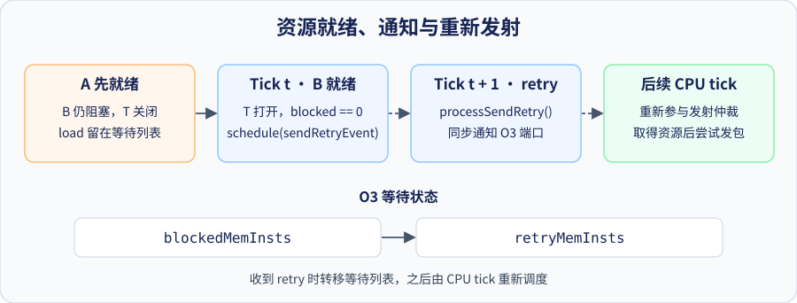

gem5 访存流程
=============

- **wall-time** 指宿主机上实际经过的时间，例如运行一次 gem5 花了多少秒。
- **sim-time** 指被模拟系统中经过的时间，以 Tick 表示。

这里在详细说一下 **sim-time**. 例如，load 从发出 到收到数据的时延，可以用这两个事件的 Tick 之差计算。 Tick 是 gem5 的 sim-time 计量单位。本例使用默认频率，每秒有 10¹² Tick， 所以 1 Tick = 1 ps（皮秒）。CPU 周期由时钟频率决定，例如 1 GHz 的 CPU 每周期是 1 ns（纳秒），等于 1,000 Tick。

**时钟周期的取整** gem5 在初始化时将时钟周期四舍五入为整数 Tick，时钟域在该频点使用固定周期。例如默认 1 Tick = 1 ps 时，5.7 GHz 对应约 175.4386 Tick，取整为 175 Tick。每周期的余数不会累积到下一周期， 因此 gem5 按取整后的周期计算，57 个周期经过 9,975 Tick（9.975 ns）。 按设定的 5.7 GHz 直接计算，57 个周期应为 10 ns（对应 10,000 Tick）。 两者相差 25 ps，来自 gem5 对单周期的取整。 `周期换算 <https://github.com/gem5/gem5/blob/f5c5a6e390f55dd5984977815bf9d0bd05da6945/src/python/m5/ticks.py#L77>`__ · `时钟域 <https://github.com/gem5/gem5/blob/f5c5a6e390f55dd5984977815bf9d0bd05da6945/src/sim/clock_domain.cc#L115>`__

源码基线 `f5c5a6e390 <https://github.com/gem5/gem5/tree/f5c5a6e390f55dd5984977815bf9d0bd05da6945>`__\ 。本文用单核、单 guest 线程、默认同一 EventQueue、 AArch64 O3 CPU、SE、Timing、Classic L1D 和 DRAM 来读普通 ``ldr x0, [x1]`` 与 ``str x0, [x1]``\ 。假设地址有效、访问对齐且在一个 cache line 内，内存可缓存。下文的跨周期行为都以这组模型为准。

先记住两个完成点。\ **Load 得到数据后写入物理寄存器，再经过依赖唤醒和 按序退休。Store 在执行时把数据放入 SQ，先退休，之后才从 SQ 发往 缓存，收到响应后回收 SQ。** 两者都能让 CPU 与其他在途指令重叠工作。

怎么读调用链
------------

- 每块中连续缩进表示同一个 C++ 调用栈。标了 ``[事件]`` 的段落从新的 ``EventQueue::serviceOne() → Event::process()`` 调用开始。
- ``[后续 CPU tick]`` 表示跨周期的流水线交接，通过 TimeBuffer 或队列 传递状态。一个流水线阶段的 C++ 函数本身通常是 CPU tick 的同步子调用。
- ``[同 Tick 可发生]`` 表示事件可能在相同的 sim-time 重新进入，调用栈已经断开。 模拟 Tick、host 线程与 guest ThreadID 是三个不同概念。

默认单 EventQueue 下，CPU、cache、互连、DRAM 的回调由同一 host 线程 执行。端口同步调用也沿同一线程进入对方。模型同时在途的活动由队列、 状态和时间戳表示。多 EventQueue 并行配置才涉及不同的 host 仿真线程。 `事件分发 <https://github.com/gem5/gem5/blob/f5c5a6e390f55dd5984977815bf9d0bd05da6945/src/sim/eventq.cc>`__ · `仿真循环 <https://github.com/gem5/gem5/blob/f5c5a6e390f55dd5984977815bf9d0bd05da6945/src/sim/simulate.cc>`__

sim-time 在哪里推进
~~~~~~~~~~~~~~~~~~~

.. code:: text

   doSimLoop()
     EventQueue::serviceOne()                 # 取队首事件
       setCurTick(event->when())              # ★ 在执行回调前，把当前 sim-time 更新到该事件的 Tick
       event->process()                       # 执行本次回调，例如 CPU::tick() 或 DRAM 响应

下文每个 ``[事件]`` 和 ``[后续 CPU tick]`` 都由这段代码进入。对本文的 单 EventQueue 配置，各组件共享这条 sim-time 时间轴。组件调用 ``schedule()`` 只登记将来何时运行。同一调用栈里的函数读取同一个 ``curTick()``\ ，不同事件 也可以落在同一 Tick，此时 ``setCurTick()`` 写回相同的值。 `主循环 <https://github.com/gem5/gem5/blob/f5c5a6e390f55dd5984977815bf9d0bd05da6945/src/sim/simulate.cc#L339>`__ · `更新时间 <https://github.com/gem5/gem5/blob/f5c5a6e390f55dd5984977815bf9d0bd05da6945/src/sim/eventq.cc#L246>`__

.. _1-从派发到地址翻译:

1. 从派发到地址翻译
-------------------

`CPU tick <https://github.com/gem5/gem5/blob/f5c5a6e390f55dd5984977815bf9d0bd05da6945/src/cpu/o3/cpu.cc>`__ · `IEW <https://github.com/gem5/gem5/blob/f5c5a6e390f55dd5984977815bf9d0bd05da6945/src/cpu/o3/iew.cc>`__ (Issue, Execute, Writeback) · `InstructionQueue <https://github.com/gem5/gem5/blob/f5c5a6e390f55dd5984977815bf9d0bd05da6945/src/cpu/o3/inst_queue.cc>`__ · `ARM64 指令模板 <https://github.com/gem5/gem5/blob/f5c5a6e390f55dd5984977815bf9d0bd05da6945/src/arch/arm/isa/templates/mem64.isa>`__ · `DynInst <https://github.com/gem5/gem5/blob/f5c5a6e390f55dd5984977815bf9d0bd05da6945/src/cpu/o3/dyn_inst.cc>`__ · `LSQ <https://github.com/gem5/gem5/blob/f5c5a6e390f55dd5984977815bf9d0bd05da6945/src/cpu/o3/lsq.cc>`__ · `ARM MMU <https://github.com/gem5/gem5/blob/f5c5a6e390f55dd5984977815bf9d0bd05da6945/src/arch/arm/mmu.cc>`__

.. code:: text

   [事件] CPU::tick()
     IEW::tick()
       IEW::dispatchInsts()
         LSQ::insertLoad() / insertStore()    # 按 guest ThreadID 找 LSQUnit
           LSQUnit::insertLoad() / insertStore()  # 分配 LQ/SQ 项，记录队列位置
       InstructionQueue::scheduleReadyInsts()     # 在执行阶段之后挑选 ready 指令
         申请 FU (Functional Unit，功能单元)、检查 issueWidth     # 检查对应执行资源和本周期发射额度
         若 FU 延迟大于一周期，调度 FUCompletion    # 独立事件，完成后进入执行通路

   [后续 CPU tick] CPU::tick()
     IEW::tick()
       IEW::executeInsts()
         InstructionQueue::getInstToExecute()    # 取已进入执行通路的 DynInst
         LSQ::executeLoad() / executeStore()
           LSQUnit::executeLoad() / executeStore()
             DynInst::initiateAcc()
               生成的 ARM64 指令类::initiateAcc()   # 读物理源寄存器，计算 EA (Effective Address，有效地址)
                 initiateMemRead() / writeMemTimingLE()  # ARM 指令语义使用的 helper
                   DynInst::initiateMemRead() / writeMem() # ExecContext 虚调用落到 O3
                     CPU::pushRequest()                  # 转发给 IEW 持有的 LSQ
                       LSQ::pushRequest()                  # 保存 LSQRequest
                         SingleDataRequest::initiateTranslation()
                           LSQRequest::sendFragmentToTranslation()
                             ArmISA::MMU::translateTiming()
                               MMU::translateComplete()
                                 MMU::translateSe()        # Process::pTable->lookup(VA)
                                                           # Request 保存 PA 和属性
                                 SingleDataRequest::finish() # 同步回调，标记翻译完成
                         LSQ::read() / write()             # 回到 pushRequest 原调用栈
                           LSQUnit::read() / write()        # load 查 SQ 或发包；store 留在 SQ

ROB 接收 rename 阶段送来的指令并保存程序顺序，IEW 的派发路径另外把访存 指令登记到 LSQ。指令语义通过 ``ExecContext`` 访问寄存器；O3 的实现是 ``DynInst``\ ，它用 rename 分配的物理寄存器 ID 找到操作数。 ``translateTiming()`` 是统一接口名。在这里，ARM SE 成功翻译用进程的 emulation page table 同步得到物理地址，属于上面同一调用栈。 因此这条路径没有通过 cache/DRAM 发出的 guest 页表 walk，也没有相应的 模拟 walk 延迟。FS 的延迟翻译才可能停在 ``markDelayed()`` 等后续回调。 `ARM SE 翻译 <https://github.com/gem5/gem5/blob/f5c5a6e390f55dd5984977815bf9d0bd05da6945/src/arch/arm/mmu.cc>`__ · `ExecContext 操作数实现 <https://github.com/gem5/gem5/blob/f5c5a6e390f55dd5984977815bf9d0bd05da6945/src/cpu/o3/dyn_inst.hh>`__

.. _2-load-发包取数与退休:

2. Load 发包、取数与退休
------------------------

.. code:: text

   [续第 1 节 execute 栈] LSQUnit::read()
     搜索较老的 SQ 项                         # 检查地址与字节覆盖
     若可完整转发
       CPU::schedule(WritebackEvent, curTick()) # 数据从 SQ 拷贝；同 Tick 独立事件
     若部分覆盖且需要等待
       IEW::rescheduleMemInst()                 # 等相关 store 进展后 replay
     若走 L1D
       SingleDataRequest::buildPackets()       # ReadReq，senderState 指回 LSQRequest
       SingleDataRequest::sendPacketToCache()
         LSQUnit::trySendPacket()              # 检查本周期 load port 预算与 cacheBlocked
           RequestPort::sendTimingReq()
             BaseCache::CpuSidePort::recvTimingReq()  # 同步返回接受/拒收
               Cache::recvTimingReq()
                 BaseCache::recvTimingReq()
                   access()                   # 查 tag、权限以及访问时延
                   命中：handleTimingReqHit()
                     cpuSidePort.schedTimingResp()  # 通过响应队列安排未来发送
                   缺失：handleTimingReqMiss()
                     查找/分配 MSHR             # 挂入 target；必要时安排向下游发包

   [事件] L1D 响应队列 sendEvent               # 命中，或缺失数据填充后响应就绪
     PacketQueue::processSendEvent()
       PacketQueue::sendDeferredPacket()     # 拿出已到发送时间的响应
         RespPacketQueue::sendTiming()
           ResponsePort::sendTimingResp()       # 同步进入 CPU 端口
             LSQ::DcachePort::recvTimingResp()
               LSQ::recvTimingResp()
                 LSQUnit::recvTimingResp()
                   SingleDataRequest::recvTimingResp()
                     LSQ::completeDataAccess()
                       LSQUnit::completeDataAccess()
                         LSQUnit::writeback()
                           DynInst::completeAcc()
                             ARM64 指令类::completeAcc() # 从响应取值
                               DynInst::setRegOperand() # 写 rename 后的物理目标寄存器
                           IEW::instToCommit()         # 进入受 wbWidth 限制的写回槽

   [同 Tick 可发生／后续 CPU tick] CPU::tick()
     IEW::tick()
       IEW::writebackInsts()
         InstructionQueue::wakeDependents()   # 唤醒依赖，scoreboard 标记寄存器 ready
     Commit::tick()
       Commit::markCompletedInsts()           # 通过 IEW→Commit time buffer 标记可退休

   [后续 CPU tick] Commit::tick()
     Commit::commit()
       Commit::commitInsts()
         Commit::commitHead()                 # 到达 ROB 头并满足提交条件
           更新已提交寄存器映射、退休 ROB 项
         发送 doneSeqNum                        # 将提交进度经 time buffer 返回 IEW

   [后续 CPU tick] IEW::tick()
     LSQ::commitLoads()
       LSQUnit::commitLoads()                 # 清理对应 LQ 项

SQ 转发路径的 ``WritebackEvent::process()`` 也进入 ``LSQUnit::writeback()``\ 。本版完整覆盖分支的实际参数是 ``curTick()``\ ， 即使旁边源码注释写着 one cycle。存在可转发的老 store 时，年轻 load 可以在 store 发出缓存写请求前取到它的数据。若发生推测访存顺序违规， LSQ 可以报告 violation，由流水线清除并重执行相关指令。 `LSQUnit <https://github.com/gem5/gem5/blob/f5c5a6e390f55dd5984977815bf9d0bd05da6945/src/cpu/o3/lsq_unit.cc>`__ · `PacketQueue <https://github.com/gem5/gem5/blob/f5c5a6e390f55dd5984977815bf9d0bd05da6945/src/mem/packet_queue.cc>`__ · `Classic Cache <https://github.com/gem5/gem5/blob/f5c5a6e390f55dd5984977815bf9d0bd05da6945/src/mem/cache/base.cc>`__ · `Commit <https://github.com/gem5/gem5/blob/f5c5a6e390f55dd5984977815bf9d0bd05da6945/src/cpu/o3/commit.cc>`__

.. _3-l1d-miss-如何跨事件到-dram:

3. L1D miss 如何跨事件到 DRAM
-----------------------------

这里假设下级也缺失、由 DRAM 提供数据、无其他 cache 的 snoop 响应。 有多级缓存时，缺失转发和填充逻辑会在各级重复。

.. code:: text

   [事件] Cache 请求队列 sendEvent
     PacketQueue::processSendEvent()
       BaseCache::CacheReqPacketQueue::sendDeferredPacket()
         Cache::sendMSHRQueuePacket() → BaseCache::sendMSHRQueuePacket()
           memSidePort.sendTimingReq()         # 构建/发送下游 line 请求；关联该级 MSHR
             CoherentXBar::recvTimingReq()     # 路由、竞争检查、记录 packet delay
               MemCtrl::MemoryPort::recvTimingReq()
                 MemCtrl::recvTimingReq()     # 拆分 burst、查容量、入读队列
                   schedule(nextReqEvent, ...) # 可在同 Tick 调度，栈仍断开

   [事件] nextReqEvent → MemCtrl::processNextReqEvent()
     选择符合读写阶段和调度策略的 MemPacket
     MemCtrl::doBurstAccess()
       DRAMInterface::doBurstAccess()         # 按 bank/row、总线和 DRAM 约束计算 readyTime
     安排 respondEvent                         # 读取 burst 就绪时处理

   [事件] respondEvent → MemCtrl::processRespondEvent()
     # ★ 此时 serviceOne() 已把 curTick() 更新到本次响应事件的 Tick
     MemCtrl::accessAndRespond()              # 所需 burst 全部就绪后进入
       mem_intr->access(pkt)                  # 调用 AbstractMemory::access()
         toHostAddr(pkt->getAddr())           # 用物理地址找到宿主机 backing store 指针
         pkt->setData(host_addr)              # ★ 功能读：从模拟 DDR 取得数据
           std::memcpy(...)                   # ★ 把数据拷进 Packet 的 payload
       port.schedTimingResp()                 # 含控制器静态时延与已累计传输时延

   [事件] 控制器响应队列发送
     CoherentXBar::recvTimingResp()            # 竞争响应通道，按回程路由调度发送

   [事件] XBar 响应队列发送
     BaseCache::MemSidePort::recvTimingResp()
       BaseCache::recvTimingResp()             # 从 senderState 找 MSHR
         handleFill()                         # 可分配时填 cache line
         Cache::serviceMSHRTargets()           # 取出目标请求，满足数据及权限
           cpuSidePort.schedTimingResp()       # 后续事件返回上游；最终走第 2 节

DDR 数据在哪里读出
~~~~~~~~~~~~~~~~~~

**功能读**\ 发生在 ``AbstractMemory::access()`` 的 ``pkt->setData(host_addr)``\ 。 ``Packet::setData()`` 调用 ``std::memcpy``\ ，把模拟物理内存中的字节拷进包。 上游 L1D 发出的是 line 请求，所以本例拷贝 64 字节，L1D 再取出 ``ldr`` 需要的 8 字节。 `功能读取 <https://github.com/gem5/gem5/blob/f5c5a6e390f55dd5984977815bf9d0bd05da6945/src/mem/abstract_mem.cc#L449>`__ · `字节拷贝 <https://github.com/gem5/gem5/blob/f5c5a6e390f55dd5984977815bf9d0bd05da6945/src/mem/packet.hh#L1303>`__

**时序**\ 由 ``DRAMInterface::doBurstAccess()`` 决定。 它根据 bank、row 和 总线约束算出 ``readyTime``\ 。响应事件到期且读请求所需 burst 全部就绪后， 控制器进入上面的功能读，再安排把包送回缓存。 `DRAM 时序 <https://github.com/gem5/gem5/blob/f5c5a6e390f55dd5984977815bf9d0bd05da6945/src/mem/dram_interface.cc#L347>`__ · `响应事件 <https://github.com/gem5/gem5/blob/f5c5a6e390f55dd5984977815bf9d0bd05da6945/src/mem/mem_ctrl.cc#L488>`__

资源何时可用还不知道，请求在哪里等
~~~~~~~~~~~~~~~~~~~~~~~~~~~~~~~~~~

**先挂起请求，等资源状态变化时通知，再重新参与调度。** EventQueue 里的事件有确定的触发 Tick。等待中的请求由各组件保存在自己的 队列或状态里。例如，CPU 把被 L1D 拒收的 load 留在 IQ 的 ``blockedMemInsts``\ ，L1D 只记住它欠上游一次 retry。此时没有为这条 load 预约重发 Tick，原请求也还没有被 L1D 接纳。

.. code:: text

   [CPU tick，首次发包]
     LSQUnit::trySendPacket()
       RequestPort::sendTimingReq()
         BaseCache::CpuSidePort::recvTimingReq()
           CpuSidePort::tryTiming()            # 端口 blocked，置 mustSendRetry，返回 false
     LSQUnit::read() 恢复执行
       IEW::blockMemInst()
         InstructionQueue::blockMemInst()      # DynInst 进入 blockedMemInsts

   [旧缺失请求回包事件，资源释放]
     BaseCache::recvTimingResp()
       mshrQueue.deallocate(mshr)
       clearBlocked(Blocked_NoMSHRs)           # 本次释放使 MSHR 从满变为有空位
         CacheResponsePort::clearBlocked()     # cache 阻塞位全部清零才进入
           schedule(sendRetryEvent, curTick() + 1)

   [retry 事件，比释放晚 1 Tick]
     CacheResponsePort::processSendRetry()
       sendRetryReq()
         LSQ::DcachePort::recvReqRetry()
           LSQ::recvReqRetry()
             IEW::cacheUnblocked()
               InstructionQueue::cacheUnblocked()
                 blockedMemInsts → retryMemInsts  # 列表转移
                 CPU::wakeCPU()                # CPU 停摆时按 clockEdge() 调度 tick
             清除 LSQ 的 cacheBlocked 标志
             LSQUnit::recvRetry()               # 有阻塞 store 时可在此尝试重发

   [CPU tick]
     InstructionQueue::scheduleReadyInsts()
       getBlockedMemInstToExecute()
       addReadyMemInst()                        # load 重新参与 issue 和 FU 仲裁

   [后续 CPU tick]
     IEW::executeInsts()
       LSQUnit::read() → trySendPacket()         # 重新尝试，L1D 仍可再次拒收

**通知由释放资源的代码触发。** L1D 在释放 MSHR 的回调里检查阻塞位， 清零后立即安排 retry 事件。本实现显式选择 ``curTick() + 1``\ ，是 **1 Tick**\ ， 也就是本例的 **1 ps**\ 。如果 cache 在事件执行前再次阻塞， ``CacheResponsePort::setBlocked()`` 会撤销该事件并保留 ``mustSendRetry``\ 。 所以最早通知时间由组件逻辑决定，真正重发还要等 CPU 时钟边沿和发射资源。 实测序号 5 在 **148,000** 被拒收，旧请求在 **196,000** 回包并解除阻塞， **196,001** 发送 retry，\ **198,000** 重发成功。 `Cache 解阻与 retry <https://github.com/gem5/gem5/blob/f5c5a6e390f55dd5984977815bf9d0bd05da6945/src/mem/cache/base.cc#L167>`__ · `MSHR 释放 <https://github.com/gem5/gem5/blob/f5c5a6e390f55dd5984977815bf9d0bd05da6945/src/mem/cache/base.cc#L653>`__ · `阻塞位 <https://github.com/gem5/gem5/blob/f5c5a6e390f55dd5984977815bf9d0bd05da6945/src/mem/cache/base.hh#L1227>`__ · `IQ 等待与唤醒 <https://github.com/gem5/gem5/blob/f5c5a6e390f55dd5984977815bf9d0bd05da6945/src/cpu/o3/inst_queue.cc#L1223>`__ · `CPU 唤醒 <https://github.com/gem5/gem5/blob/f5c5a6e390f55dd5984977815bf9d0bd05da6945/src/cpu/o3/cpu.cc#L1336>`__

A、B 到位后，T 如何通知等待者
~~~~~~~~~~~~~~~~~~~~~~~~~~~~~

**抽象逻辑。** 把 T 看成一个放行条件，例如 T = A 就绪且 B 就绪。 请求等在上游。A 或 B 的状态变化时，各自的回调更新 T。A 先到位时， T 仍然关闭。B 到位后若 T 首次打开，就触发一次通知。收到通知的等待者 重新参与仲裁，取得资源后才开始服务。放行、通知送达、开始服务是三个 可以分开的时刻。

**Classic L1D 的实现。** A、B 可以是 MSHR 和写缓冲是否解除阻塞， T 是缓存的 ``blocked == 0``\ 。最后一个资源释放时，当前回调同步执行 ``BaseCache::clearBlocked(cause)``\ ，再进入 ``CacheResponsePort::clearBlocked()``\ 。 若 ``mustSendRetry`` 为真，它把已有的 ``sendRetryEvent`` 安排到 ``curTick() + 1``\ ，此时当前调用栈可以返回。下一 Tick 的事件回调 ``processSendRetry() → sendRetryReq() → DcachePort::recvReqRetry()`` 在同一个新调用栈里把一次通知送给 O3。O3 把 ``blockedMemInsts`` 整批转入 ``retryMemInsts``\ ，load 之后再由 CPU tick 重新发射。 `缓存放行条件 <https://github.com/gem5/gem5/blob/f5c5a6e390f55dd5984977815bf9d0bd05da6945/src/mem/cache/base.hh#L1227>`__ · `安排通知与端口回调 <https://github.com/gem5/gem5/blob/f5c5a6e390f55dd5984977815bf9d0bd05da6945/src/mem/cache/base.cc#L167>`__ · `等待列表转移 <https://github.com/gem5/gem5/blob/f5c5a6e390f55dd5984977815bf9d0bd05da6945/src/cpu/o3/inst_queue.cc#L1240>`__

MemCtrl 的 read queue 何时入队
~~~~~~~~~~~~~~~~~~~~~~~~~~~~~~

CPU 的 ``retryMemInsts`` 用来恢复发射。MemCtrl 的 ``readQueue`` 用来保存 **已接纳**\ 的 DRAM 读请求，入队和开始服务是两个时间点：

- **读队列无容量时**\ ，\ ``MemCtrl::recvTimingReq()`` 设置 ``retryRdReq`` 并返回 ``false``\ 。上游保留请求。\ ``processRespondEvent()`` 从响应队列 取走一个完成的 burst 后，如果有挂起的 retry，就在该回调栈中调用 ``port.sendRetryReq()``\ 。容量判断也计入响应队列里的在途读。
- **重发被接纳时**\ ，\ ``addToReadQueue()`` 把需要访问 DRAM 的 burst 放进 ``readQueue``\ 。若需要启动调度且 ``nextReqEvent`` 尚未安排，可以在 ``curTick()`` 调度它。事件执行时，控制器按读写方向、调度策略和 DRAM 状态选请求，再由 ``doBurstAccess()`` 计算命令和数据就绪时间。 入队时无需知道它最终在哪一 Tick 发出 DRAM 命令。

通知也可能是同步的。例如 XBar 的 ``tryTiming()`` 在通道忙时将来源端口放进 ``waitingForLayer``\ ，\ ``releaseLayer()`` 在通道释放且下游允许时直接调用 ``retryWaiting()``\ 。是否另排事件，取决于该组件如何定义可重试的时机。 只耗尽 O3 当前周期的发包额度时，由 CPU 自己在后续周期再试。开启读响应 节流时，CPU 也可在响应方向拒收，并安排 ``retryRespEvent``\ 。 `MemCtrl 入队 <https://github.com/gem5/gem5/blob/f5c5a6e390f55dd5984977815bf9d0bd05da6945/src/mem/mem_ctrl.cc#L407>`__ · `MemCtrl 释放与 retry <https://github.com/gem5/gem5/blob/f5c5a6e390f55dd5984977815bf9d0bd05da6945/src/mem/mem_ctrl.cc#L488>`__ · `DRAM 调度 <https://github.com/gem5/gem5/blob/f5c5a6e390f55dd5984977815bf9d0bd05da6945/src/mem/mem_ctrl.cc#L881>`__ · `XBar 等待 <https://github.com/gem5/gem5/blob/f5c5a6e390f55dd5984977815bf9d0bd05da6945/src/mem/xbar.cc#L186>`__ · `XBar 释放 <https://github.com/gem5/gem5/blob/f5c5a6e390f55dd5984977815bf9d0bd05da6945/src/mem/xbar.cc#L251>`__ · `LSQ 重试 <https://github.com/gem5/gem5/blob/f5c5a6e390f55dd5984977815bf9d0bd05da6945/src/cpu/o3/lsq.cc#L421>`__

.. _4-store-退休后怎样离开-sq:

4. Store 退休后怎样离开 SQ
--------------------------

.. code:: text

   [续第 1 节 execute 栈] LSQUnit::write()
     SQEntry::setRequest()，记录 size，复制 store 源数据到 SQ
   [回到同一 execute 栈] IEW::executeInsts()
     DynInst::setExecuted()
     IEW::instToCommit()                      # 普通 store 可进入退休流程

   [后续 CPU tick] Commit::tick()
     Commit::commit()
       Commit::commitInsts()
         Commit::commitHead()                 # 按序退休
         发送 doneSeqNum

   [后续 CPU tick] IEW::tick()
     LSQ::commitStores()
       LSQUnit::commitStores()                # 按序号把已退休 store 标记 canWB

   [后续 CPU tick] IEW::tick()
     LSQ::writebackStores()
       LSQUnit::writebackStores()             # storeWBIt 选择已获准、待发送的 SQ 项
         从 SQ 复制数据到 DynInst::memData
         SingleDataRequest::buildPackets()    # WriteReq 引用该缓冲
         SingleDataRequest::sendPacketToCache()
           LSQUnit::trySendPacket()
             RequestPort::sendTimingReq()     # L1D 同步接受或拒收

   [事件] 可写权限和数据更新完成后，L1D 返回响应
     LSQ::DcachePort::recvTimingResp()         # 切回第 2 节的响应入口
       ...
       LSQUnit::completeDataAccess()
         LSQUnit::completeStore()             # 标记完成，回收队首连续已完成的项

当前 ``IEW::tick()`` 先尝试 ``writebackStores()``\ ，再消费 Commit 给的 信号，因此新标记 ``canWB`` 的 store 要等后续发送阶段。 L1D 若已有可写 line，可以在 cache 内更新并响应；若需取 line 或升级权限， 先经历一致性请求。脏 line 后续驱逐时才可能回写更低层，因此 SQ 回收时间 和 DRAM 实际写入时间各自有独立含义。 `IEW 阶段顺序 <https://github.com/gem5/gem5/blob/f5c5a6e390f55dd5984977815bf9d0bd05da6945/src/cpu/o3/iew.cc>`__ · `SQ 发送与回收 <https://github.com/gem5/gem5/blob/f5c5a6e390f55dd5984977815bf9d0bd05da6945/src/cpu/o3/lsq_unit.cc>`__

.. _5-在途操作由哪些数据结构串起来:

5. 在途操作由哪些数据结构串起来
-------------------------------

.. mermaid::

   flowchart LR
       SI["StaticInst：ARM 指令语义"] --> DI["DynInst：seqNum、物理寄存器、执行状态"]
       IQ["IQ：依赖与发射"] --> DI
       ROB["ROB：按序退休"] --> DI
       LQ["LQ：跟踪在途 load"] --> DI
       SQ["SQ：store 地址、数据、canWB"] --> DI
       SQ -->|覆盖时转发| LQ
       DI -->|savedRequest| LR["LSQRequest：翻译、发包和完成状态"]
       LR --> R["Request：VA、PA、长度、属性"]
       LR --> P["Packet：命令、数据缓冲、senderState"]
       P -->|回包时定位| LR
       M["Cache MSHR：cache line 级缺失"] -->|记录上游 target| P
       M -->|构造下游 line 请求| D["下游 Packet → MemCtrl 的 MemPacket"]
       LR -->|load 响应| PRF["物理寄存器 → 依赖唤醒"]

.. list-table::
   :header-rows: 1

   * - 对象
     - 何时填入，谁接着用
   * - ``StaticInst`` / ``DynInst``
     - 前者持有解码后的语义；每次动态执行有自己的 DynInst、PC、序号、物理寄存器映射和执行状态。IQ 用它发射，ROB 用它退休，LSQ 用它关联请求和响应。
   * - ``LSQ`` / ``LSQUnit`` / ``LQEntry``\ 、\ ``SQEntry``
     - LSQ 管理 CPU 数据端口及共享带宽，按 guest ThreadID 找 LSQUnit。LQ 保存 load 的生命周期；SQ 还保存待发送的数据，允许年轻 load 转发，也允许 store 退休后继续等待 cache。
   * - ``LSQRequest`` / ``SingleDataRequest``
     - 把 DynInst、翻译回调、已建请求、包和未完成数量绑在一起。上游包的 senderState 让响应回到原指令，同时允许清除后的响应被忽略。跨 line 时由 ``SplitDataRequest`` 跟踪多个分片。
   * - ``Request`` / ``Packet`` / ``MSHR``
     - Request 保存访问属性；Packet 表示这一跳的命令与数据。缺失时 MSHR 保留上游 target 并关联下游 line 请求。同一 line 的兼容请求可合并，下游填充后再分别满足各 target。
   * - ``MemCtrl`` / ``MemPacket``
     - 控制器把主存请求表示成一个或多个 burst，记录所在队列、bank/row 和就绪时间，再聚合读响应。

`DynInst <https://github.com/gem5/gem5/blob/f5c5a6e390f55dd5984977815bf9d0bd05da6945/src/cpu/o3/dyn_inst.hh>`__ · `LSQ <https://github.com/gem5/gem5/blob/f5c5a6e390f55dd5984977815bf9d0bd05da6945/src/cpu/o3/lsq.hh>`__ · `LQ/SQ <https://github.com/gem5/gem5/blob/f5c5a6e390f55dd5984977815bf9d0bd05da6945/src/cpu/o3/lsq_unit.hh>`__ · `Request <https://github.com/gem5/gem5/blob/f5c5a6e390f55dd5984977815bf9d0bd05da6945/src/mem/request.hh>`__ · `Packet <https://github.com/gem5/gem5/blob/f5c5a6e390f55dd5984977815bf9d0bd05da6945/src/mem/packet.hh>`__ · `MSHR <https://github.com/gem5/gem5/blob/f5c5a6e390f55dd5984977815bf9d0bd05da6945/src/mem/cache/mshr.hh>`__ · `MemCtrl <https://github.com/gem5/gem5/blob/f5c5a6e390f55dd5984977815bf9d0bd05da6945/src/mem/mem_ctrl.hh>`__

.. _6-时延和资源竞争在哪里产生:

6. 时延和资源竞争在哪里产生
---------------------------

.. list-table::
   :header-rows: 1

   * - 位置
     - 模拟机制
     - 能观察到什么
   * - O3 派发 / 发射 / 写回 / 退休
     - 阶段间 TimeBuffer、各阶段宽度、FU 数量和延迟、ROB/LQ/SQ 容量
     - 源操作数未就绪拖延 issue；ROB 头的长延迟 load 可阻塞年轻指令退休；队列满会把停顿传到前端。
   * - LSQ
     - ``cacheLoadPorts``\ 、\ ``cacheStorePorts`` 对每周期发包记账，年龄/覆盖检查决定转发或 replay
     - 同一周期访问太多会等下个周期；SQ 转发可绕过 cache；store drain 慢会提高 SQ 占用率。
   * - Classic Cache
     - ``tag_latency``\ 、\ ``data_latency``\ 、\ ``response_latency`` 在不同路径计入；MSHR、targets、write buffer 有容量
     - hit 也有响应时延；相同 line 的 miss 可能合并；不同 line 的 miss 争用 MSHR，容量不足时会产生背压。
   * - XBar
     - ``tryTiming()`` 检查路由对应 layer 是否空闲，时钟边沿和包头/数据传输决定占用；延迟随 ``headerDelay`` / ``payloadDelay`` 传递或在边界消耗
     - CPU、其他核或 DMA 访问同一通道时可能互相阻塞，同一访问的延迟随流量变化。
   * - MemCtrl / DRAM
     - 读写队列、调度策略、读写切换、bank/row 状态、激活/预充电、burst 总线及刷新约束
     - 同样的 cache miss 可以命中 open row，也可以等待其他请求、切换方向或刷新。

事件队列按模型给出的时间调度。何时可发取决于周期对齐和资源状态， 何时可回取决于服务时间与响应调度。例如，一条 load 的首次 issue 到 依赖唤醒，可能包含端口等待、cache miss、DRAM 服务、返回传输和写回槽等待； 这些量之间可重叠，具体用事件时间戳作差。乱序执行还能让其他指令在这段 时间内推进，所以单条 load 延迟与对整体 CPI 的影响要分别测量。 `O3 参数 <https://github.com/gem5/gem5/blob/f5c5a6e390f55dd5984977815bf9d0bd05da6945/src/cpu/o3/BaseO3CPU.py>`__ · `Cache 参数 <https://github.com/gem5/gem5/blob/f5c5a6e390f55dd5984977815bf9d0bd05da6945/src/mem/cache/Cache.py>`__ · `XBar <https://github.com/gem5/gem5/blob/f5c5a6e390f55dd5984977815bf9d0bd05da6945/src/mem/coherent_xbar.cc>`__ · `DRAM 时序 <https://github.com/gem5/gem5/blob/f5c5a6e390f55dd5984977815bf9d0bd05da6945/src/mem/dram_interface.cc>`__

例如，记录 load 的四个 sim-time 时间戳 ``t_issue``\ 、\ ``t_accept``\ 、 ``t_response``\ 、\ ``t_wake``\ 。在普通无重放的 cache 路径上：

- ``t_accept - t_issue`` 包含 issue 到 execute 的交接和发包等待。
- ``t_response - t_accept`` 覆盖缓存、互连及 DRAM 中实际走过的路径， 包括下游资源等待和响应回程。L1 hit 时只走 L1 响应路径。
- ``t_wake - t_response`` 表示从 CPU 接收数据到写回阶段唤醒依赖的时间。 Store 可类似记录 ``t_retire`` 和 ``t_sq_complete``\ ，观察退休后 SQ drain。

带宽如何影响访存性能
~~~~~~~~~~~~~~~~~~~~

**带宽限制的是共享通路能多快传完一批数据。** 单笔访问的延迟描述从 发出到完成用了多久。多笔访问可以同时在途，但在同一条共享通路上， 每笔都要占用传输资源，下一笔必须等到通路可用。

- **XBar** 按包大小、通路宽度和时钟周期计算数据传输时间。携带 64 B cache line 的响应通过 16 B/周期的通路，需要 4 个周期传数据。 同一响应通道还受包头开销和仲裁约束。通道忙时，其他响应等待释放后重试。 `包时序计算 <https://github.com/gem5/gem5/blob/f5c5a6e390f55dd5984977815bf9d0bd05da6945/src/mem/xbar.cc#L130>`__ · `响应通道占用 <https://github.com/gem5/gem5/blob/f5c5a6e390f55dd5984977815bf9d0bd05da6945/src/mem/coherent_xbar.cc#L447>`__
- **DDR** 用 ``readyTime`` 记录本笔数据何时就绪，用 ``nextBurstAt`` 约束下一笔 burst 最早何时能发。DDR3-1600 的 64 B burst 若能每隔 5 ns 连续发出，单通道峰值为 12.8 GB/s。bank 状态、刷新和读写切换 都可能拉开发送间隔。 `DDR3 参数 <https://github.com/gem5/gem5/blob/f5c5a6e390f55dd5984977815bf9d0bd05da6945/src/mem/DRAMInterface.py#L287>`__ · `DRAM 命令与完成时序 <https://github.com/gem5/gem5/blob/f5c5a6e390f55dd5984977815bf9d0bd05da6945/src/mem/dram_interface.cc#L392>`__ · `更新 nextBurstAt <https://github.com/gem5/gem5/blob/f5c5a6e390f55dd5984977815bf9d0bd05da6945/src/mem/mem_ctrl.cc#L808>`__

前面的 A、B、T 抽象也适用于这里。\ **带宽决定其中一个资源条件何时到位**\ ， 例如响应通道何时释放，或 DDR 何时允许下一笔 burst。其他条件仍要检查。 下面的伪代码省略 snoop、路由等细节，只保留关键判断。

.. code:: text

   # XBar 响应：通路带宽决定 releaseEvent 的 Tick
   recvTimingResp(pkt, layer, src):
       if layer.busy or layer.waitingForPeer:
           layer.waitingForLayer.push(src)  # 记录等待端口，由发送端保留包
           return false                    # 等通知后重试

       layer.state = BUSY
       payloadDelay = max(pkt.payloadDelay,
                          ceil(pkt.size / width) * clockPeriod)  # 有数据的响应
       busyUntil = clockEdge(headerLatency) + payloadDelay
       schedule(releaseEvent, busyUntil)    # width 越小，通路释放越晚
       return true                         # 已接纳；回包交付另由响应队列调度

   releaseEvent():
       layer.state = IDLE                   # ★ 这一刻响应通路资源到位
       if waitingForLayer 非空 and 没有 waitingForPeer:
           retryWaiting()                  # 在当前回调里通知一个上游端口

.. code:: text

   # DDR 读：burst 带宽决定下一条命令最早可以落在哪个 Tick
   processNextReqEvent():                   # 从已接纳的请求中选择
       req = chooseNext(readQueue)
       cmdAt = max(curTick(), bank.rdAllowedAt, nextBurstAt)
       cmdAt = verifyCommandWindow(cmdAt)   # 命令带宽不足时还要后移
       nextBurstAt = cmdAt + burstGap       # ★ 下一笔的通道约束，DDR3 本例为 5 ns
       req.readyTime = cmdAt + tRL + tBURST # 这一笔读的数据就绪时间
       将 req 放入响应队列并安排 respondEvent

XBar 用释放事件把通道重新置为 ``IDLE``\ 。DDR 在调度 burst 时用 ``nextBurstAt`` 作为时间下界，与 bank 约束一同计算 ``cmdAt``\ 。 本笔响应的 ``readyTime`` 单独计算，因此下一笔可以在本笔回包前开始。 `通路释放事件 <https://github.com/gem5/gem5/blob/f5c5a6e390f55dd5984977815bf9d0bd05da6945/src/mem/xbar.cc#L165>`__ · `通路释放回调 <https://github.com/gem5/gem5/blob/f5c5a6e390f55dd5984977815bf9d0bd05da6945/src/mem/xbar.cc#L251>`__ · `DDR 命令时序 <https://github.com/gem5/gem5/blob/f5c5a6e390f55dd5984977815bf9d0bd05da6945/src/mem/dram_interface.cc#L392>`__ · `控制器写回 nextBurstAt <https://github.com/gem5/gem5/blob/f5c5a6e390f55dd5984977815bf9d0bd05da6945/src/mem/mem_ctrl.cc#L808>`__

当多个独立的 load 连续缺失时，如果流量超过 XBar 或 DDR 的服务能力， 请求或响应就会积压，LQ 与 MSHR 被占用更久。缓存资源满时，背压会传回 CPU。若 ROB 头正等这笔 load，退休也会停下来。追单笔访问时看发出到完成 隔了多久，判断带宽瓶颈时看连续命令或回包的间隔、队列占用和重试次数。

源码跟踪时记录哪些点
~~~~~~~~~~~~~~~~~~~~

1. **指令视角**\ 按 ``seqNum`` 和 PC 追 issue、complete、retire。 用 ``O3PipeView`` 日志配合 `o3-pipeview.py <https://github.com/gem5/gem5/blob/f5c5a6e390f55dd5984977815bf9d0bd05da6945/util/o3-pipeview.py>`__ 看流水线时间；store 记录另外的 SQ 完成时刻。实测中 load 的 ``O3PipeView:complete`` 对应进入执行的 Tick，取数完成请对照回包和 IEW 写回日志。
2. **单次访存视角**\ 记录首次 ``trySendPacket``\ 、成功接受、cache fill、 ``completeDataAccess``\ 、\ ``wakeDependents``\ 。在 cache 下游改按物理 line 和 MSHR target 对齐，因为下游 Packet 可以代表多条上游访存。
3. **实验视角**\ 对比 ``loadToUse``\ 、\ ``forwLoads``\ 、\ ``blockedByCache``\ 、 LQ/SQ 占用率、cache 的 ``mshrMissLatency`` 和控制器队列相关统计。 本版 ``loadToUse`` 在提交 load 时取 ``lastWakeDependents - firstIssue`` 并转换成 CPU cycles，可与日志的两个端点对照。 `LSQ 统计实现 <https://github.com/gem5/gem5/blob/f5c5a6e390f55dd5984977815bf9d0bd05da6945/src/cpu/o3/lsq_unit.cc>`__ · `Cache 统计实现 <https://github.com/gem5/gem5/blob/f5c5a6e390f55dd5984977815bf9d0bd05da6945/src/mem/cache/base.cc>`__

.. _7-运行验证:

7. 运行验证
-----------

用现有 ``build/ARM/gem5.opt``\ （25.1.0.1）运行 AArch64 静态汇编， 配置为 ArmO3CPU、1 GHz、独立的 16 KiB L1I/L1D、SystemXBar 和 DDR3。 程序检查初始值、第二次读的值和 store 后的值，通过才以状态码 0 退出。 下表数字是模拟 Tick，仅对应这组配置。运行使用 ``O3PipeView,LSQ,LSQUnit,Cache,CachePort,DRAM,MemCtrl,TLB,IEW,IQ``\ ， 并用 GDB 的 ``bt`` 和 ``info threads`` 对照事件入口。

.. list-table::
   :header-rows: 1

   * - 路径
     - 实测结果
   * - 冷 load，PC ``0x4000b8``\ ，序号 3
     - 86,000 issue，87,000 发往 L1D，89,000 进 MemCtrl，107,750 控制器处理就绪数据，138,000 L1D 填充，140,000 IEW 写回，142,000 退休。
   * - L1 hit 变体
     - 第二次 load 改为依赖首次结果并访问同一地址。143,000 命中 L1D，147,000 退休。
   * - 普通 store，PC ``0x4000c4``\ ，序号 6
     - 142,000 复制数据到 SQ，199,000 退休，200,000 标记 ``canWB``\ ，201,000 发包并命中，203,000 收响应并回收 SQ。
   * - 顺序违规与转发
     - 年轻 load 序号 7 在 138,000 提前读；142,000 年老 store 发现地址冲突，144,000 年轻 load 被清除。重执行的序号 21 在 152,000 从 SQ 转发。
   * - MSHR 背压变体
     - L1 的 MSHR 从 4 改为 1，序号 5 在 148,000 被拒收，196,001 收到 L1D 的 retry 通知，198,000 重新发包成功。

GDB 实际停点的栈摘要如下，省略模板和部分内联帧：

.. code:: text

   CPU::tick → IEW::executeInsts → LSQUnit::executeLoad
     → LDRX64_IMM::initiateAcc → LSQ::pushRequest
       → MMU::translateTiming → MMU::translateComplete → SingleDataRequest::finish
       → LSQUnit::read → LSQUnit::trySendPacket        # 翻译返回后的同一 CPU tick 栈

   EventQueue::serviceOne → CacheReqPacketQueue::sendDeferredPacket
     → BaseCache::sendMSHRQueuePacket → CoherentXBar::recvTimingReq
       → MemCtrl::recvTimingReq                      # cache 请求队列事件的栈
   EventQueue::serviceOne → MemCtrl::processNextReqEvent
   EventQueue::serviceOne → MemCtrl::processRespondEvent

   EventQueue::serviceOne → PacketQueue::processSendEvent
     → RespPacketQueue::sendTiming → LSQ::recvTimingResp
       → SingleDataRequest::recvTimingResp → LSQUnit::completeDataAccess
         → LSQUnit::writeback 或 LSQUnit::completeStore
   EventQueue::serviceOne → LSQUnit::WritebackEvent::process → LSQUnit::writeback

这些停点均在同一个 host 线程。这里验证了普通 load/store、Classic Cache 和单 EventQueue 的上述路径。响应节流、跨 cache line、FS 页表 walk、 Ruby 及多 EventQueue 的行为未在这组实验中运行验证。
