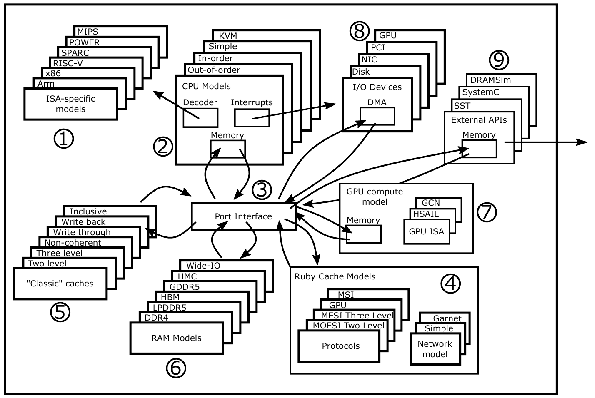
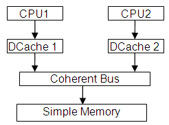
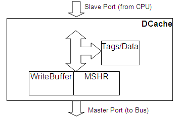
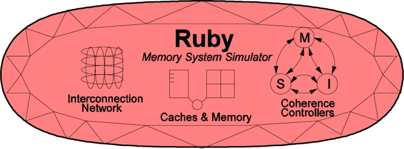
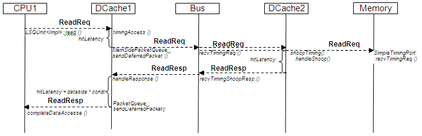

gem5 逻辑架构
=============

源码阅读基线为 `f5c5a6e390 <https://github.com/gem5/gem5/commit/f5c5a6e390f55dd5984977815bf9d0bd05da6945>`__\ 。

gem5 是一个模块化的离散事件计算机系统模拟器。一次实验先用 Python 搭建 目标机器、指定 workload，再由 C++ 模型执行指令、处理访存和设备操作。 各模型通过端口交换请求与响应，通过事件队列推进模拟时间。 实验结束或到达指定阶段时，可以读取统计量，或保存 checkpoint 供后续实验恢复。 `Learning gem5 官方概览 <https://www.gem5.org/documentation/learning_gem5/introduction/>`__

架构总览
--------

*Lowe-Power 等，2020，The gem5 Simulator: Version 20.0+，第 1.3 节图 4。 从论文第 6 页截取原图，图内内容保持原样，许可为 CC BY 4.0。* `ResearchGate 图页 <https://www.researchgate.net/figure/An-overview-of-gem5s-architecture-Its-modular-components-allow-any-of-each-model-type_fig1_342763366>`__ · `arXiv 原文，第 6 页 <https://arxiv.org/pdf/2007.03152v1#page=6>`__ · `CC BY 4.0 <https://creativecommons.org/licenses/by/4.0/>`__

图中央的 **③ Port Interface** 表示不同模型约定的访存接口。 实际系统里的每条连接由 Python 配置指定，地址路由和请求仲裁由接入的 crossbar 等组件处理。以 CPU load 为例，② 使用 ① 提供的指令语义， 通过 ③ 把访存送入 ④ Ruby 或 ⑤ Classic。需要访问主存时，请求继续到 ⑥， 数据沿配置好的路径返回。采用 ⑧ 中的设备模型时，CPU 可以通过 MMIO 访问设备寄存器，设备可以通过 DMA 端口访问内存，并经中断控制器通知 CPU。

.. list-table::
   :header-rows: 1

   * - 图中编号
     - 模块与研究用途
     - gem5 源码入口
   * - ①
     - **ISA 模型**\ 提供指令解码、执行语义和架构状态。选择与 guest 程序或系统匹配的 ISA。
     - `src/arch <https://github.com/gem5/gem5/tree/f5c5a6e390f55dd5984977815bf9d0bd05da6945/src/arch>`__
   * - ②
     - **CPU 模型**\ 决定如何推进指令。Simple 适合简化执行模型的实验，Minor 用于研究顺序流水线，O3 用于研究乱序执行，KVM 在满足宿主虚拟化条件时可用于快速推进。
     - `Simple <https://github.com/gem5/gem5/tree/f5c5a6e390f55dd5984977815bf9d0bd05da6945/src/cpu/simple>`__\ 、\ `Minor <https://github.com/gem5/gem5/tree/f5c5a6e390f55dd5984977815bf9d0bd05da6945/src/cpu/minor>`__\ 、\ `O3 <https://github.com/gem5/gem5/tree/f5c5a6e390f55dd5984977815bf9d0bd05da6945/src/cpu/o3>`__\ 、\ `KVM <https://github.com/gem5/gem5/tree/f5c5a6e390f55dd5984977815bf9d0bd05da6945/src/cpu/kvm>`__
   * - ③
     - **Port Interface**\ 定义请求、响应和重试的交互方式，支持在兼容接口之间替换或重连组件。
     - `port.hh <https://github.com/gem5/gem5/blob/f5c5a6e390f55dd5984977815bf9d0bd05da6945/src/mem/port.hh>`__
   * - ④
     - **Ruby**\ 分开建模 coherence protocol 和片上网络，适合研究目录协议、消息流量和 NoC 拥塞。
     - `Ruby <https://github.com/gem5/gem5/tree/f5c5a6e390f55dd5984977815bf9d0bd05da6945/src/mem/ruby>`__
   * - ⑤
     - **Classic**\ 用缓存和 crossbar 组装层次，适合比较容量、延迟和带宽等参数。
     - `Classic Cache <https://github.com/gem5/gem5/tree/f5c5a6e390f55dd5984977815bf9d0bd05da6945/src/mem/cache>`__\ 、\ `Coherent XBar <https://github.com/gem5/gem5/blob/f5c5a6e390f55dd5984977815bf9d0bd05da6945/src/mem/coherent_xbar.cc>`__
   * - ⑥
     - **RAM Models**\ 建模主存请求调度和介质时序，适合研究 DRAM 排队、行命中和带宽。
     - `MemCtrl <https://github.com/gem5/gem5/blob/f5c5a6e390f55dd5984977815bf9d0bd05da6945/src/mem/mem_ctrl.cc>`__\ 、\ `DRAMInterface <https://github.com/gem5/gem5/blob/f5c5a6e390f55dd5984977815bf9d0bd05da6945/src/mem/dram_interface.cc>`__
   * - ⑦
     - **GPU compute model**\ 执行计算 kernel 并产生访存，适合研究 GPU 计算与内存层次的相互影响。
     - `GPU Compute <https://github.com/gem5/gem5/tree/f5c5a6e390f55dd5984977815bf9d0bd05da6945/src/gpu-compute>`__\ 、\ `AMD GPU ISA <https://github.com/gem5/gem5/tree/f5c5a6e390f55dd5984977815bf9d0bd05da6945/src/arch/amdgpu>`__
   * - ⑧
     - **I/O Devices**\ 建模 PCI、磁盘、网卡等设备的寄存器、DMA 或中断行为，适合研究驱动与设备交互。
     - `设备模型 <https://github.com/gem5/gem5/tree/f5c5a6e390f55dd5984977815bf9d0bd05da6945/src/dev>`__
   * - ⑨
     - **External APIs**\ 通过桥接或封装接入外部模型，例如 SystemC TLM、SST 或 DRAMSim。
     - `TLM Bridge <https://github.com/gem5/gem5/tree/f5c5a6e390f55dd5984977815bf9d0bd05da6945/src/systemc/tlm_bridge>`__\ 、\ `SST <https://github.com/gem5/gem5/tree/f5c5a6e390f55dd5984977815bf9d0bd05da6945/src/sst>`__\ 、\ `DRAMSim <https://github.com/gem5/gem5/blob/f5c5a6e390f55dd5984977815bf9d0bd05da6945/src/mem/dramsim3.cc>`__

图中枚举的是论文发表时的模型示例，具体组合受当前构建选项、平台和 workload 约束。下面继续看支撑这些模型运行的配置入口、事件循环与观测接口。

逻辑分层与输入输出
------------------

.. list-table::
   :header-rows: 1

   * - 层次
     - 核心职责
     - 主要输入 → 输出
     - 源码入口
   * - 配置与实验控制
     - 组装目标机器，设定启动、退出和分阶段运行策略
     - 对象参数、端口连接、workload → SimObject 实例及连接
     - `SimObject.py <https://github.com/gem5/gem5/blob/f5c5a6e390f55dd5984977815bf9d0bd05da6945/src/python/m5/SimObject.py>`__\ 、\ `stdlib Simulator <https://github.com/gem5/gem5/blob/f5c5a6e390f55dd5984977815bf9d0bd05da6945/src/python/gem5/simulate/simulator.py>`__
   * - 仿真内核
     - 初始化对象、调度事件、推进模拟时间
     - 事件、发生时间与优先级 → 回调执行、状态变更、退出事件
     - `simulate.cc <https://github.com/gem5/gem5/blob/f5c5a6e390f55dd5984977815bf9d0bd05da6945/src/sim/simulate.cc>`__\ 、\ `eventq.cc <https://github.com/gem5/gem5/blob/f5c5a6e390f55dd5984977815bf9d0bd05da6945/src/sim/eventq.cc>`__
   * - CPU 与 ISA
     - 执行 guest 指令，模拟流水线和访存时序
     - 指令、寄存器状态、访存响应 → 架构状态、请求、异常
     - `CPU <https://github.com/gem5/gem5/tree/f5c5a6e390f55dd5984977815bf9d0bd05da6945/src/cpu>`__\ 、\ `ISA <https://github.com/gem5/gem5/tree/f5c5a6e390f55dd5984977815bf9d0bd05da6945/src/arch>`__
   * - 内存层次
     - 模拟缓存、一致性、互连及 DRAM 服务
     - 访存请求、地址映射 → 数据、响应时间、排队和重试
     - `Classic Cache <https://github.com/gem5/gem5/tree/f5c5a6e390f55dd5984977815bf9d0bd05da6945/src/mem/cache>`__\ 、\ `Ruby <https://github.com/gem5/gem5/tree/f5c5a6e390f55dd5984977815bf9d0bd05da6945/src/mem/ruby>`__\ 、\ `MemCtrl <https://github.com/gem5/gem5/blob/f5c5a6e390f55dd5984977815bf9d0bd05da6945/src/mem/mem_ctrl.cc>`__
   * - 系统、workload 与设备
     - 提供地址布局以及程序或操作系统的运行环境
     - 程序或系统镜像、MMIO、设备事件 → 系统调用结果、设备状态、IRQ、DMA
     - `System <https://github.com/gem5/gem5/blob/f5c5a6e390f55dd5984977815bf9d0bd05da6945/src/sim/system.hh>`__\ 、\ `Process <https://github.com/gem5/gem5/blob/f5c5a6e390f55dd5984977815bf9d0bd05da6945/src/sim/process.cc>`__\ 、\ `设备模型 <https://github.com/gem5/gem5/tree/f5c5a6e390f55dd5984977815bf9d0bd05da6945/src/dev>`__
   * - 观测与状态保存
     - 记录模型行为及实验阶段，保存可恢复状态
     - 模型计数器、事件、对象状态 → 配置快照、统计、调试日志、checkpoint
     - `统计控制 <https://github.com/gem5/gem5/blob/f5c5a6e390f55dd5984977815bf9d0bd05da6945/src/sim/stat_control.cc>`__\ 、\ `序列化 <https://github.com/gem5/gem5/blob/f5c5a6e390f55dd5984977815bf9d0bd05da6945/src/sim/serialize.cc>`__

配置层如何启动仿真
------------------

Python 配置脚本选择 CPU、缓存、互连、内存和设备等 SimObject，设置时钟和 地址范围，并把请求端口与响应端口接起来。可直接使用 ``m5.objects``\ ， 也可用 gem5 Standard Library 的 `Board、Processor、CacheHierarchy 和 Memory <https://github.com/gem5/gem5/tree/f5c5a6e390f55dd5984977815bf9d0bd05da6945/src/python/gem5/components>`__ 组合常用配置，由 ``Simulator`` 管理运行和退出事件。

``Root`` 是对象树的根，\ ``System`` 表示一台被模拟的机器。对象树管理归属与 生命周期，Port 连接决定数据走哪条路径。例如，L1 可以挂在 CPU 对象下面， 而 L1 的下游请求仍通过端口发送给 crossbar。 ``m5.instantiate()`` 解析参数、创建对应的 C++ 对象、绑定端口并初始化状态， 同时输出配置快照。\ ``m5.simulate()`` 首次运行时调用对象的 ``startup()``\ ， 之后进入 C++ 仿真循环，在遇到退出事件时将控制权交回 Python。 `Python 运行入口 <https://github.com/gem5/gem5/blob/f5c5a6e390f55dd5984977815bf9d0bd05da6945/src/python/m5/simulate.py>`__ · `官方配置教程 <https://www.gem5.org/documentation/learning_gem5/part1/simple_config/>`__

仿真内核如何表示时间
--------------------

``Tick`` 是统一的模拟时间单位，组件时钟周期可以换算成若干 Tick。 ``schedule()`` 将回调安排在指定时间。\ ``doSimLoop()`` 调用 ``EventQueue::serviceOne()``\ ，取出队列头部事件，把该队列的当前时间推进到 事件的发生时刻，再执行 ``process()``\ 。回调可以更新模型状态、发出响应， 也可以安排下一次事件。没有事件的时间间隔可以跳过。 这套机制让 CPU 周期、缓存响应、DRAM 调度和设备定时器共享模拟时间轴。 `事件循环 <https://github.com/gem5/gem5/blob/f5c5a6e390f55dd5984977815bf9d0bd05da6945/src/sim/simulate.cc>`__ · `事件分发 <https://github.com/gem5/gem5/blob/f5c5a6e390f55dd5984977815bf9d0bd05da6945/src/sim/eventq.cc>`__

模拟时间描述目标机器的行为，host wall-clock time 描述运行 gem5 花了多久。 例如，增加 DRAM 时序参数可以拉长模拟中的访存延迟，而运行这次实验所需的 现实时间还取决于宿主机和模型执行开销。

CPU 与 ISA 如何分工
-------------------

**ISA** 定义指令解码后的语义及架构状态，例如寄存器、异常、特权状态、 地址翻译规则。各 ISA 的实现位于 `src/arch <https://github.com/gem5/gem5/tree/f5c5a6e390f55dd5984977815bf9d0bd05da6945/src/arch>`__\ 。 **CPU 模型** 决定何时取指、发射、等待访存和提交，从而影响可观察的时序 及吞吐。同一 ISA 下可以按研究问题选择不同的 CPU 模型。

- **AtomicSimpleCPU** 使用 atomic 访存接口，适合快速推进， 例如到达感兴趣的程序阶段。\ `源码 <https://github.com/gem5/gem5/blob/f5c5a6e390f55dd5984977815bf9d0bd05da6945/src/cpu/simple/atomic.cc>`__
- **TimingSimpleCPU** 通过 Timing Port 发出请求并等待响应，适合观察 简单执行模型受缓存与内存延迟影响的程度。\ `源码 <https://github.com/gem5/gem5/blob/f5c5a6e390f55dd5984977815bf9d0bd05da6945/src/cpu/simple/timing.cc>`__
- **O3CPU** 建模取指、解码、重命名、发射与执行、按序提交等阶段。 Load/Store Queue 跟踪在途访存以及 load 和 store 的依赖关系。 适合研究乱序执行、缓存延迟隐藏和资源争用。 `CPU <https://github.com/gem5/gem5/blob/f5c5a6e390f55dd5984977815bf9d0bd05da6945/src/cpu/o3/cpu.cc>`__ · `LSQ <https://github.com/gem5/gem5/blob/f5c5a6e390f55dd5984977815bf9d0bd05da6945/src/cpu/o3/lsq_unit.cc>`__

内存层次如何处理请求
--------------------

公共接口
~~~~~~~~

``Request`` 保存一次访问的地址、大小及请求者等属性，\ ``Packet`` 携带 组件间传输所需的命令、数据与请求信息。\ ``RequestPort`` 发请求， ``ResponsePort`` 接请求并返回响应。Timing 模式允许组件因资源不足拒收， 发送方等待 retry 通知后重发；接受请求后，如果命令需要响应， 响应沿返回路径异步交付。这样，队列容量、拥塞和背压都能反映到发起端。 Atomic 访问同步返回并给出模型估算的延迟；Functional 访问用于加载、 调试等需要直接读写目标状态的操作。 `Port <https://github.com/gem5/gem5/blob/f5c5a6e390f55dd5984977815bf9d0bd05da6945/src/mem/port.hh>`__ · `Packet <https://github.com/gem5/gem5/blob/f5c5a6e390f55dd5984977815bf9d0bd05da6945/src/mem/packet.hh>`__ · `官方内存系统文档 <https://www.gem5.org/documentation/general_docs/memory_system/>`__

Classic
~~~~~~~

*仓库原图。两个 CPU 通过各自的 DCache 和一致性互连接入共享内存。*

Cache 查询 tag 和访问权限，命中时按模型时延服务请求。缺失时，MSHR （Miss Status Holding Register）记录尚未完成的 cache line 请求， 并可合并同一 cache line 上兼容的访问。Write Buffer 保存等候向下游发送的 写请求，例如脏块回写。Coherent XBar 按地址路由，并转发一致性探测。 Classic 适合研究缓存大小、相联度、预取、访存延迟和共享互连争用。 `Cache <https://github.com/gem5/gem5/blob/f5c5a6e390f55dd5984977815bf9d0bd05da6945/src/mem/cache/base.cc>`__ · `MSHR <https://github.com/gem5/gem5/blob/f5c5a6e390f55dd5984977815bf9d0bd05da6945/src/mem/cache/mshr.cc>`__ · `Coherent XBar <https://github.com/gem5/gem5/blob/f5c5a6e390f55dd5984977815bf9d0bd05da6945/src/mem/coherent_xbar.cc>`__

*仓库原图。图中的 Slave Port 和 Master Port 在当前源码中分别对应 ResponsePort 和 RequestPort 的角色。*

Ruby
~~~~

*gem5 官方 Ruby 文档引用的 GEMS 教程原图。图展示组件职责，当前接线与 状态转移可按实验选择的协议查阅。* `官方图文来源 <https://www.gem5.org/documentation/general_docs/ruby/>`__

Ruby 将一致性控制器、缓存数据结构和片上网络拆开建模。 CPU 的请求经 RubyPort 进入 Sequencer，由后者跟踪在途请求。 SLICC 协议描述控制器收到消息后如何检查状态和权限、改变 cache line 状态， 以及何时向其他控制器发送消息。MessageBuffer 保存控制器之间的消息， 网络模型决定消息传输；例如 Garnet 可以建模路由器与链路。 收到数据和权限后，控制器经 Sequencer 返还结果。 Ruby 适合研究目录协议、跨核共享、一致性消息流量及 NoC 竞争。 `RubyPort <https://github.com/gem5/gem5/blob/f5c5a6e390f55dd5984977815bf9d0bd05da6945/src/mem/ruby/system/RubyPort.cc>`__ · `MESI_Two_Level 协议 <https://github.com/gem5/gem5/blob/f5c5a6e390f55dd5984977815bf9d0bd05da6945/src/mem/ruby/protocol/MESI_Two_Level.slicc>`__ · `Garnet <https://github.com/gem5/gem5/tree/f5c5a6e390f55dd5984977815bf9d0bd05da6945/src/mem/ruby/network/garnet>`__

DRAM
~~~~

当上层需要访问主存时，可将请求交给 ``MemCtrl``\ 。它管理请求队列和读写调度， DRAM 接口按地址映射及 DRAM 时序约束决定访问何时可以完成， 例如目标 bank 的状态、行命中情况与刷新都会影响服务时间。 这一层适合研究 channel 带宽、bank 并行性和内存控制器排队。 `MemCtrl <https://github.com/gem5/gem5/blob/f5c5a6e390f55dd5984977815bf9d0bd05da6945/src/mem/mem_ctrl.cc>`__ · `DRAMInterface <https://github.com/gem5/gem5/blob/f5c5a6e390f55dd5984977815bf9d0bd05da6945/src/mem/dram_interface.cc>`__

Workload、设备和中断如何配合
----------------------------

- **SE（Syscall Emulation）** 加载用户态程序，由 gem5 处理受支持的系统调用。 适合聚焦应用指令、CPU 和访存行为，例如比较两种 L2 配置对同一程序的影响。 `Process <https://github.com/gem5/gem5/blob/f5c5a6e390f55dd5984977815bf9d0bd05da6945/src/sim/process.cc>`__ · `系统调用实现 <https://github.com/gem5/gem5/blob/f5c5a6e390f55dd5984977815bf9d0bd05da6945/src/sim/syscall_emul.cc>`__
- **FS（Full System）** 搭建目标平台，由 guest 操作系统运行内核与驱动。 适合研究内核调度、驱动、设备中断、DMA 及其与 CPU 或内存的相互影响。 `官方 SE / FS 说明 <https://www.gem5.org/documentation/learning_gem5/part1/simple_config/>`__ · `设备源码 <https://github.com/gem5/gem5/tree/f5c5a6e390f55dd5984977815bf9d0bd05da6945/src/dev>`__

以 ARM SP804 定时器为例，驱动写入 MMIO 寄存器后，地址路由将写操作送到 设备模型。设备按初始计数值和时钟计算到期时间， ``restartCounter()`` 调度 ``zeroEvent``\ 。事件队列到达该 Tick 时调用 ``counterAtZero()``\ ，设备更新中断状态，满足条件时发出 IRQ，并按模式决定 是否安排下一次到期。中断控制器和 CPU 随后按各自的规则传递、接收中断， guest CPU 响应后才会执行内核中断处理程序。具备 DMA 的设备还可以通过 DMA 端口发起内存请求，适合研究设备流量和 CPU 流量的竞争。 `SP804 <https://github.com/gem5/gem5/blob/f5c5a6e390f55dd5984977815bf9d0bd05da6945/src/dev/arm/timer_sp804.cc>`__ · `PIO <https://github.com/gem5/gem5/blob/f5c5a6e390f55dd5984977815bf9d0bd05da6945/src/dev/io_device.cc>`__ · `DMA <https://github.com/gem5/gem5/blob/f5c5a6e390f55dd5984977815bf9d0bd05da6945/src/dev/dma_device.cc>`__

串起来看一次取数
----------------

仓库官方示例 `two_level.py <https://github.com/gem5/gem5/blob/f5c5a6e390f55dd5984977815bf9d0bd05da6945/configs/learning_gem5/part1/two_level.py>`__ 用 X86TimingSimpleCPU、分离的 L1I/L1D、共享 L2 和 DDR3 运行 SE 程序。 以一次 L1D、L2 都缺失且由 DRAM 提供数据的普通 load 为例：

1. CPU 执行 load，完成地址翻译后通过数据端口发出 Timing 请求。
2. L1D 记录缺失，经 L2XBar 向 L2 请求 cache line。L2 同样缺失时， 经 SystemXBar 将请求交给 MemCtrl。某一跳拒收时，由对应的发送端等待重试。
3. MemCtrl 排队并按 DRAM 时序推进请求。数据就绪后，响应沿层次向上返回， 缓存完成填充并处理挂起的访问，CPU 收到数据后继续执行。

*仓库原图用双核、单层 DCache 和 SimpleMemory 展示读缺失、互连探测及 响应回传。双层缓存示例在 CPU 与 DRAM 之间多一层 L2 和相应互连， 可用上面的步骤对照源码。*

如何用输出回答实验问题
----------------------

- **确认输入配置**\ 时查看默认输出目录 ``m5out`` 中的 ``config.ini`` 或 ``config.json``\ ，核对实际实例化的对象与参数。
- **解释性能变化**\ 时查看 ``stats.txt`` 中目标阶段的指令数、周期数、 cache miss 或内存排队统计。比如改变 L2 容量后，可同时对照 L2 miss、 主存流量和 CPU 周期，判断收益在哪一层产生。
- **追一笔请求**\ 时使用模块的 debug flags，把相同地址的请求、重试和响应 按模拟 Tick 对齐。\ **重复测量同一程序阶段**\ 时可以采用 checkpoint， 并在关注阶段的起点重置统计、在终点导出统计。 `官方统计与输出说明 <https://www.gem5.org/documentation/learning_gem5/part1/gem5_stats/>`__ · `Checkpoint 与 drain 入口 <https://github.com/gem5/gem5/blob/f5c5a6e390f55dd5984977815bf9d0bd05da6945/src/python/m5/simulate.py>`__
