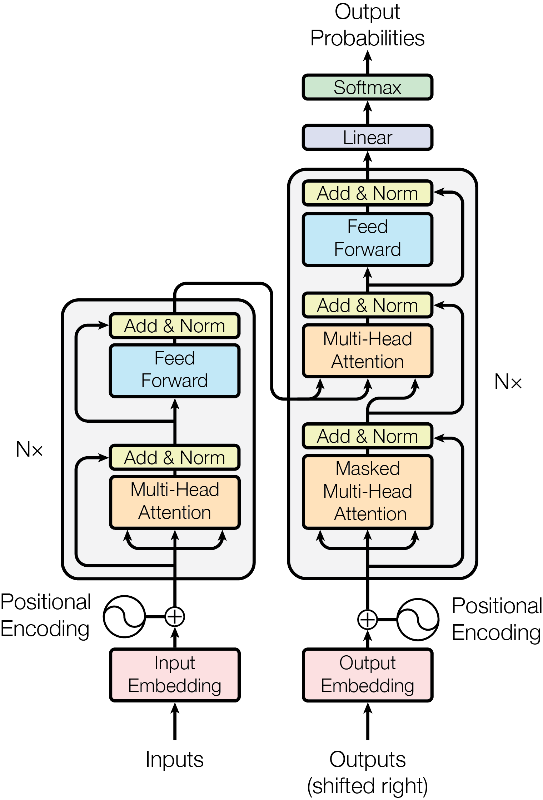

.. Michael Wu 版权所有

:Authors: Michael Wu
:Version: 1.0

LLM 数学模型
************

我们想搞明白什么
================

我们试着从数学和数据流两个视角，把 Decoder-only Transformer 的运行过程讲清楚：一段文本先被切分并编号，
Token ID 经查表变成向量；每层用 Attention 在上下文中读取信息，再用 MLP 做非线性变换；最后
LM Head 把 Hidden State 映射成整个词表上的 Logits，并通过解码策略选出下一个 Token。

我们先不急着钻进每一个公式，一路盯住下面这条主线就行：

.. code-block:: text

   文本 -> Token IDs -> Embedding -> 多层 Transformer -> Logits
        -> 概率分布/选词 -> 新 Token -> 下一轮计算

这里最想说清楚的一点是：我们不要把 LLM 想成一个装满句子的数据库，而要把它看成一个由大量可训练参数定义的函数：
它接收离散 Token 序列，经过反复的线性变换、非线性变换和概率计算，输出下一个 Token 的条件分布。

术语
====

我们在 AI 领域会碰到很多专业英语。有些词平时根本不用，有些虽然是日常单词，在这里却换了一层意思，
如果顺着原始词义硬猜，很容易越学越偏。所以我们先把后面会反复出现的词约定清楚。

.. csv-table:: LLM Terms
   :header: "术语", "说明"

   "Token", "Tokenizer 定义的基本离散单位，通常对应一个 word、subword、character 或 byte sequence"
   "Token ID", "Token 在 vocabulary 中的整数 index，同时也是 embedding table 的 row index"
   "Tokenizer", "负责将 text 编码为 token IDs，以及将 token IDs 解码回 text。"
   "Vocabulary（Vocab）", "Tokenizer 支持的全部 token 集合，建立 token ID ↔ token piece 的映射。"
   "Embedding", "将离散的 token ID 映射到连续高维向量空间（Embedding Vector）的过程。"
   "Embedding Vector", "Token ID 经过 embedding 查表得到的、表示该 token 的高维数值向量。"
   "Embedding Matrix / Embedding Table", "保存所有 token embedding vectors 的矩阵，shape 为 [vocab_size, hidden_size]"
   "Hidden Size / d_model", "Transformer 内部表征向量（representation vector）的维度，等于 embedding vector 的维度。"
   "Hidden State / Hidden Vector", "Embedding vector 经过 Transformer layers 计算后得到的、融合当前上下文信息的内部表示向量。"
   "Logit", "Softmax 之前的未归一化原始得分，取值范围为全体实数；logit 越大，通常对应更高的输出概率。"
   "Softmax", "归一化指数函数，将一组任意实数得分转换为总和为 1 的概率分布。"
   "LM Head", "模型最后的输出模块，它把 final hidden vector 线性投影（projection）到 vocabulary 空间，得到每个 token 的 logit"
   "Prefill", "在开始逐 token 生成前，模型先把整段 input prompt 一次性送入 Transformer，计算各层 hidden states，并建立 KV Cache"
   "Decode", "自回归推理中逐 token 生成的阶段，Prefill 完成后，每轮生成一个新 token，并复用、更新 KV Cache，直到满足停止条件。"
   "Decoder-only", "仅使用带因果掩码（causal mask）的 Transformer blocks、无独立 Encoder 和 cross-attention 的架构。"
   "Autoregression", "自回归：模型每次根据已有上下文预测下一个 token，再把生成的 token 加入上下文，循环生成后续 token"
   "MLP（Multi-Layer Perceptron）", "多层感知机：对每个 token 的 hidden vector 独立进行非线性变换，用于提取、组合和变换其中的特征"
   "FFN（Feed-Forward Network）", "前馈网络：Transformer 每层对每个 token 的 hidden vector 独立做非线性变换的 MLP 模块，通常先升维再降回 d_model"
   "Tensor", "多维数值数组（连同 shape）的统称：scalar 是 0 维 tensor，vector 是 1 维 tensor，matrix 是 2 维 tensor，也可以有更高维 tensor"
   "Self-Attention", "让序列中的每个 token 根据自己及可见的其他 token 信息，更新自己的 hidden state"
   "Temperature", "采样阶段控制随机性的参数，借用物理温度影响分布随机性的概念，通过缩放 logits 改变 token 概率分布的尖锐程度。"
   "Position Encoding", "向 token 的 hidden representation 中加入位置信息的方法，使模型能够感知序列中 token 的顺序关系。"
   "RoPE（Rotary Position Embedding）", "将位置信息通过旋转变换注入 Query 和 Key 向量的 Position Encoding 方法，使 Attention 能感知 token 的相对位置关系。"

LLM 所需的数学工具
==================

我们会用到哪些数学
------------------

对于基于 Transformer 的 LLM，我们真正会反复用到的数学工具并不多，主要就是下面这些：

.. csv-table:: Transformer-based LLM Mathematics
   :header: "数学领域", "在 LLM 中的作用"

   "Linear Algebra", "线性代数：是 LLM 最核心的数学工具，如矩阵乘法、线性变换、Projection、Basis、子空间等，用于 Attention、MLP、LM Head 和高维 Representation"
   "Nonlinear Functions", "非线性函数：GELU、SiLU、SwiGLU 等非线性函数，使多层神经网络能够表达复杂的非线性关系"
   "Probability & Information Theory", "概率论与信息论：描述 token probability distribution、Sampling、Temperature、Top-k / Top-p，以及 Cross-Entropy、log probability 等训练目标"
   "Statistics", "统计学：mean、variance、RMS 等统计量主要用于 LayerNorm / RMSNorm，也用于参数初始化和训练过程中的数值分析"
   "Calculus", "微积分：通过 derivative、partial derivative、gradient 和 chain rule 计算 loss 对模型参数的梯度，是 Backpropagation 的数学基础"
   "Optimization", "优化理论：利用 gradient，通过 SGD、AdamW 等优化方法迭代更新 learned parameters"

我们要理解基于 Transformer 的 LLM 怎样运行，并不要求一上来就学很高深的数学。核心仍然是理工科本科阶段常见的线性代数、
概率论与统计、微积分和基础优化理论。真正的难点更多在于：这些相对基础的数学操作被扩展到数千甚至更高维
的 Tensor 上，并通过 Attention、MLP、Residual、Normalization 等结构反复组合，同时涉及数十亿甚至数千亿
个 learned parameters。只有当进一步研究模型训练理论、收敛性、表示学习、Scaling Law、信息几何或优化理论等
问题时，才会涉及更深层的数学内容。

截至 2026 年 8 月，我们要理解主流 Transformer-based SOTA 开源大模型的核心机制，数学基础仍主要集中在上面的表格中。
即使模型进一步引入 MoE、GQA、MLA、RoPE、稀疏 Attention、各种 Normalization 或 Gated MLP 等结构，底层数学工具
依旧属于上面表格的范畴。对于『理解模型如何工作』这个目标，我们需要补的更多是新的模型架构机制，而不是不断增加
新的数学工具；只有进一步研究训练收敛、Scaling Law、表示几何、优化理论等问题时，才会涉及更多数学工具。

符号约定
--------

在正式推公式前，我们先像论文或数学建模报告那样，把后面反复出现的符号放在一起。这样读到
:math:`QK^T` 时，不需要再猜某个字母表示矩阵、维度还是序列长度。

本文采用下面几条约定：

* 小写字母通常表示标量、Token ID 或单个向量，大写字母通常表示矩阵或一批向量。
* 上标 :math:`(l)` 表示第 :math:`l` 个 Transformer Layer，不表示乘方；上标 :math:`T` 表示矩阵转置。
* 下标 :math:`t` 通常表示当前 Token 位置或 Decode Step，下标 :math:`i,j` 表示某个元素或位置。
* 为避免和 Attention 的 Value Matrix :math:`V` 混淆，词表大小统一写成 :math:`V_{\text{vocab}}`。
* 同一个字母在其他论文里可能采用不同定义，判断公式时仍要以当前文档给出的 Shape 为准。

.. list-table:: 主要符号
   :header-rows: 1
   :widths: 18 24 58

   * - 符号
     - 类型或 Shape
     - 含义
   * - :math:`V_{\text{vocab}}`
     - Scalar
     - Vocabulary Size，即词表中的 Token 数量
   * - :math:`L` / :math:`n`
     - Scalar
     - 当前参与计算的 Sequence Length / 一段完整序列的总长度
   * - :math:`i,j` / :math:`t,l`
     - Integer Index
     - 元素或位置索引 / 当前 Token、Decode Step 或 Transformer Layer 编号
   * - :math:`N_{\text{layers}}`
     - Scalar
     - Transformer Layer 总数
   * - :math:`h`
     - Scalar
     - Attention Head 数量
   * - :math:`d_m`
     - Scalar
     - Model Dimension、Hidden Size，也就是每个 Hidden Vector 的维度
   * - :math:`d_k` / :math:`d_v` / :math:`d_{\text{head}}`
     - Scalar
     - 单个 Head 的 Key / Value / Head 维度；Query 通常也使用 :math:`d_k`
   * - :math:`x_i` / :math:`y_t`
     - Integer
     - 第 :math:`i` 个输入 Token ID / 位置 :math:`t` 的正确 Next Token 标签
   * - :math:`E`
     - :math:`\mathbb{R}^{V_{\text{vocab}}\times d_m}`
     - Embedding Matrix，第 :math:`x_i` 行就是该 Token 的初始向量
   * - :math:`H^{(l)}` / :math:`X`
     - :math:`\mathbb{R}^{L\times d_m}`
     - 第 :math:`l` 层处理的一整段 Hidden States / 某层 Attention 的输入矩阵
   * - :math:`U` / :math:`H'`
     - :math:`\mathbb{R}^{L\times d_m}`
     - Attention Residual 后 / 整个 Transformer Layer 处理后的 Hidden States
   * - :math:`h_t` / :math:`x_t`
     - :math:`\mathbb{R}^{1\times d_m}`
     - 单个位置的 Hidden Vector；具体名称随所在公式而定
   * - :math:`\theta`
     - Parameter Set
     - 模型全部可训练参数的集合
   * - :math:`W_*`
     - Learned Matrix
     - 可训练权重矩阵；下标说明用途，如 :math:`W_Q`、:math:`W_O`、:math:`W_{\text{lm}}`
   * - :math:`W_{\text{lm}}`
     - :math:`\mathbb{R}^{V_{\text{vocab}}\times d_m}`
     - LM Head Weight Matrix，把 Hidden Vector 投影到 Vocabulary Space
   * - :math:`w_i`
     - :math:`\mathbb{R}^{1\times d_m}`
     - :math:`W_{\text{lm}}` 的第 :math:`i` 行，即第 :math:`i` 个 Token 的输出方向
   * - :math:`Q` / :math:`K` / :math:`V`
     - Matrix
     - Attention 的 Query、Key、Value Matrices；这里的 :math:`V` 不是词表大小
   * - :math:`q_t` / :math:`k_t` / :math:`v_t`
     - Row Vector
     - Decode Step :math:`t` 新计算出的 Query、Key、Value Vectors
   * - :math:`K_{\text{cache}}` / :math:`V_{\text{cache}}`
     - Matrix
     - 当前 Layer 保存的全部历史 Key / Value Vectors
   * - :math:`S` / :math:`A`
     - Matrix
     - Attention Scores / Softmax 后的 Attention Weights
   * - :math:`S_i` / :math:`A_i`
     - Scalar
     - 某一行中第 :math:`i` 个 Attention Score / 对应的 Attention Weight
   * - :math:`C` / :math:`O`
     - Vector or Matrix
     - Value 加权后的 Context / 经过 Output Projection 的 Attention 输出
   * - :math:`z_t` / :math:`Z`
     - Vector / Matrix
     - 单个位置的 Logits Vector / 整段序列所有位置的 Logits Matrix
   * - :math:`z` / :math:`z_i` / :math:`z_{\max}`
     - Scalar
     - 激活函数的输入 / 第 :math:`i` 个 Logit / 一组 Logits 中的最大值
   * - :math:`M`
     - :math:`\mathbb{R}^{L\times L}`
     - Causal Mask，未来位置为 :math:`-\infty`，可见位置为 0
   * - :math:`\mathcal{L}` / :math:`N_{\text{valid}}`
     - Scalar
     - Training Loss / 实际参与 Loss 平均的有效 Token 位置数
   * - :math:`p_\theta` / :math:`p_i(T)`
     - Probability
     - 参数为 :math:`\theta` 的模型概率 / Temperature 为 :math:`T` 时第 :math:`i` 项的概率
   * - :math:`k` / :math:`p`
     - Sampling Parameter
     - Top-k 的候选数量 / Top-p 的累计概率阈值
   * - :math:`T` / :math:`\eta`
     - Scalar
     - Sampling Temperature / Optimizer Learning Rate
   * - :math:`g` / :math:`\epsilon`
     - Vector / Scalar
     - RMSNorm 的可训练缩放参数 / 防止除零的极小常数
   * - :math:`C_{\text{context}}` / :math:`C_{\text{usable}}`
     - Token Count
     - 一次请求的总 Context Window / 实际可用的上下文长度
   * - :math:`C_{\text{model}}`、:math:`C_{\text{engine}}`、:math:`C_{\text{memory}}`
     - Token Count
     - 模型能力、推理服务和 KV Cache 显存分别允许的上下文长度
   * - :math:`N_{\text{system}}`、:math:`N_{\text{history}}`、:math:`N_{\text{user}}`
     - Token Count
     - System Prompt、历史对话和当前用户输入的 Token 数量
   * - :math:`N_{\text{tools}}` / :math:`N_{\text{output}}`
     - Token Count
     - 工具定义或检索材料 / 模型生成结果占用的 Token 数量
   * - :math:`M_{\text{KV}}`
     - Bytes
     - 单个序列的 KV Cache 近似显存占用
   * - :math:`N_{\text{kv-heads}}` / :math:`B_{\text{dtype}}`
     - Scalar
     - KV Head 数量 / KV Cache 每个元素占用的字节数

.. list-table:: 常用运算符
   :header-rows: 1
   :widths: 24 76

   * - 写法
     - 含义
   * - :math:`\mathbb{R}^{a\times b}`
     - 由实数组成、Shape 为 :math:`[a,b]` 的矩阵空间
   * - :math:`W^T`
     - 矩阵 :math:`W` 的转置
   * - :math:`\odot`
     - 两个 Shape 相同的 Tensor 做逐元素乘法
   * - :math:`\operatorname{Concat}`
     - 沿指定维度拼接 Tensor
   * - :math:`\operatorname{softmax}`
     - 把一组 Logits 或 Scores 转换为总和为 1 的权重
   * - :math:`\nabla_\theta\mathcal{L}`
     - Loss 对全部模型参数的 Gradient
   * - :math:`x_{<t}` / :math:`x_{\le t}`
     - 位置 :math:`t` 之前 / 截至位置 :math:`t` 的全部 Token
   * - :math:`\leftarrow` / :math:`\approx`
     - 把右侧结果更新到左侧变量 / 近似相等

先把 LLM 写成一个数学函数
---------------------------

按照上面的约定，词表大小是 :math:`V_{\text{vocab}}`，上下文长度是 :math:`L`，Hidden Size 是
:math:`d_m`，模型参数的集合是 :math:`\theta`。Tokenizer 先把文本变成整数序列：

.. math::

   (\text{text}) \longrightarrow
   (x_1,x_2,\ldots,x_L),\qquad
   x_i\in\{0,1,\ldots,V_{\text{vocab}}-1\}

我们可以把 Embedding Matrix
:math:`E\in\mathbb{R}^{V_{\text{vocab}}\times d_m}` 想成一张可训练的向量表。
Token ID :math:`x_i` 的 Embedding 是取出第 :math:`x_i` 行，而不是把整数本身送去做连续数值计算：

.. math::

   h_i^{(0)} = E[x_i]\in\mathbb{R}^{d_m}

接着，我们把 :math:`L` 个向量按行摞起来，就得到模型第一层接收的矩阵
:math:`H^{(0)}\in\mathbb{R}^{L\times d_m}`。经过 :math:`N_{\text{layers}}` 层 Transformer 后，
模型得到 :math:`H^{(N_{\text{layers}})}`，LM Head 再把最后一个位置的 Hidden State 变成词表上的概率分布：

.. math::

   p_\theta(x_{L+1}=j\mid x_{1:L})
   =\operatorname{softmax}(h_L^{(N)}W_{\text{lm}}^T)_j

这里的 :math:`p_\theta` 才是模型真正学习的东西：给定已经看到的 Token，下一个 Token 各种可能性的
条件概率分布。生成整段序列时，联合概率可按概率链式法则分解：

.. math::

   p_\theta(x_{1:n})
   =\prod_{t=1}^{n}p_\theta(x_t\mid x_{<t})

所以我们说的『自回归』不是额外的一层网络，而是同一个 Next-Token 函数被反复调用，每次把刚选出的 Token
追加到条件中。

Shape 是读懂公式的第一检查项
^^^^^^^^^^^^^^^^^^^^^^^^^^^^^^

读公式时，我们可以养成一个很实用的习惯：先对 Shape。矩阵乘法 :math:`AB` 合法的条件是
:math:`A` 的最后一维等于 :math:`B` 的第一维。例如：

.. csv-table:: 一条 Token 数据流中的典型 Shape
   :header: "对象", "Shape", "含义"

   "Token IDs", "[L]", "长度为 L 的整数序列"
   "Embedding / Hidden States", "[L, d_m]", "每行对应一个 Token 的连续表示"
   "单头 Q / K", "[L, d_k]", "查询和匹配特征"
   "单头 Attention Scores", "[L, L]", "每个 Query 对每个 Key 的分数"
   "单头 Context", "[L, d_v]", "对 Value 加权求和后的表示"
   "Logits", "[L, V_vocab]", "每个位置对整个词表的原始分数"

到了工程代码里，我们还会看到 Batch、Head 等维度，例如 Q 常写成
``[batch, num_heads, seq_len, head_dim]``。这些只是把同一组数学运算批量化，并没有改变每个 Head
内部的点积、Softmax 和加权求和。

线性代数：在表示空间中搬运信息
------------------------------

我们先看线性变换（Linear Transformation）：它就是用一个矩阵把输入向量映射到另一个向量空间。在线性代数里通常
写成 :math:`f(x)=Wx`，其中 :math:`W` 是这个线性变换的矩阵表示；在 Transformer 里，因为常
把 token hidden state 写成行向量，所以更常见 :math:`Q=XW_Q`、:math:`K=XW_K`、:math:`V=XW_V`，其
中 :math:`W_Q/W_K/W_V` 是 learned weight matrices，意思是这些矩阵里的参数不是人工指定的，
而是通过训练和反向传播得到的。严格来说，Linear Transformation 是『映射本身』，Weight Matrix 是实现这个映射的参数。

接着看非线性变换（Nonlinear Transformation）：只要不满足
:math:`f(ax+by)=af(x)+bf(y)` 这种线性性质，就属于这一类，
典型例子包括 ReLU、GELU、SiLU 等激活函数。神经网络通常把线性变换和非线性变换组合起来，例如
:math:`xW_1 \rightarrow \operatorname{GELU} \rightarrow W_2`。如果网络只有多层线性变换，
那么它们最终仍然可以合并成一次矩阵乘法，本质上还是一个线性变换；加入非线性后，模型才能表达更复杂的函数关系。

.. note::

   在大模型工程领域，token 的 hidden state 通常按 row vector 来组织，因此常写
   成 :math:`xW`，而在线性代数数学教材里，向量一般默认写成 column vector，因此常写成 :math:`Wx`。这只是
   矩阵表示约定不同，本质上描述的是同一个线性映射过程。对单个 token 来说，hidden vector 在程序里通常
   就是一个 1 维 Tensor（row vector），只有在写成数学矩阵形式时，才显式区分是列向量还是行向量。只要相应
   调整 weight matrix 的方向或转置，得到的线性变换含义是等价的。

对于高维空间，我们一开始很难直接想象，所以先借三维几何建立直觉。设一个三维向量 :math:`x=[x,y,z]`，经过
一个 :math:`3\times3` 矩阵 :math:`W` 做变换，得到 :math:`xW`。这个过程可以把整个三维空间统一地
旋转、缩放、剪切、镜像或压缩，但它不会把原本的直线『掰弯』：直线变换后仍然是直线，向量的
加法和数乘关系也会保持。因此『线性』可以直观理解为：空间中所有点都按照同一套比例和组合规则发生变化。
与之相对的 Nonlinear Transformation 可以让不同位置按不同规则变化，例如把直线变成曲线、把平面变成曲面。
我们可以先粗略地记成：Linear Transformation 是『整体一致地变形空间』，而 Nonlinear Transformation 是
允许空间发生弯曲和局部不同程度的变形。在线性代数中，这些三维空间里的概念大多可以直接推广到更高维。

.. note::

   为方便理解高维向量空间中的变换，我们可以把 3D 当成高维空间的『可视化模型』，在 3D 中理解的
   向量、方向、距离、夹角、投影、旋转、拉伸、子空间等概念，绝大多数都可以严格推广到高维向量空间。
   但有一个需要注意的地方：不能把所有 3D 几何直觉机械照搬到高维。高维空间会出现很多反直觉现象，
   例如随机向量几乎正交、距离高度集中等。

再说一个很容易混淆的词：投影（Projection）。在线性代数中，严格意义上的 Projection 是把一个向量映射到某个方向或子空间，例如把
三维向量投影到一个平面上；对应的投影矩阵 :math:`P` 通常满足 :math:`P^2=P`。但在 LLM 领域
里，projection 的使用更宽泛，通常指通过一个 learned weight matrix 将 hidden vector 映射到
另一个 representation space，例如 :math:`Q=XW_Q` 就常称为 Query Projection，类似
还有 Key / Value Projection 和 Output Projection。这里的 projection 本质上通常就是
一次 Linear Transformation，并不一定满足严格数学意义上 :math:`P^2=P` 的投影性质；因此
在 LLM 文档中看到 projection，可以优先理解为『通过训练好的权重矩阵把向量映射到新的表示空间』，从数学
上看就是普通的矩阵乘法。我们看到 ``q_proj``、``k_proj`` 这类名字时，先按这个工程含义理解就够了。

非线性函数：让多层网络不再等价于一层
------------------------------------

如果我们把 Transformer 拆开看，会发现绝大部分计算量来自矩阵乘法，但每个 Transformer Layer 中
还会穿插少量关键的 Nonlinear Operations。否则，如果整个网络只有线性投影，那么连续
多层线性变换在数学上仍然可以合并成一个更大的线性变换，模型的表达能力会受到很大限制。

每层的 Attention 主体计算，如 Q/K/V Projection、:math:`QK^T` 和 :math:`AV`，
主要是大规模矩阵乘法，其中 Q/K/V Projection 等属于线性变换，而其中最关键的非线性
操作是 Softmax。Q/K 经过线性投影并计算相关性后，会得到 Attention Scores；对于
对于某个 Query 对应的一整行 Score，我们用 Softmax 对每个元素计算：

.. math::

   A_i = \frac{e^{S_i}}
   {\sum_{j=1}^{L} e^{S_j}}

其中 :math:`L` 是当前参与 Attention 的 Key 数量。在 Prefill 阶段通常
等于当前 sequence length；在 Decode 阶段则等于当前 KV Cache 中可见的 Key 数量。
这里我们要留意，Softmax 不只是『把总和变成 1』，它会先经过指数函数产生非线性映射，再做归一化。
指数函数会放大 score 之间的相对差异，使较大的 score 获得更高的 Attention Weight，
较小的 score 被进一步压低，同时保证整行 Attention Weights 之和为 1。

MLP / FFN 中最关键的非线性操作来自激活函数。现代 LLM 常见的 SwiGLU 会先
通过 Weight Matrix 得到 Gate 和 Up 两路线性投影，然后对 Gate 分支应用 SiLU。

对于 Gate 中的单个元素 :math:`z`，SiLU 的计算可以展开为：

.. math::

   \operatorname{SiLU}(z) = \frac{z}{1 + e^{-z}}

这个公式我们可以拆成两步看，第一步先算 Sigmoid：

.. math::

   \sigma(z) = \frac{1}{1 + e^{-z}}

第二步再算 :math:`z \cdot \sigma(z)`。所以 SiLU 的非线性核心同样来自指数函数。由于缩放系数 :math:`\sigma(z)` 本身依赖
输入 :math:`z`，每个元素都会根据自己的数值被动态保留、抑制或缩放，而不是固定比例的线性变换。

SwiGLU 随后会把经过 SiLU 的 Gate 分支与 Up 分支做逐元素乘法，再通过 Down Projection
投影回 Hidden Size。整体可以概括为：

.. math::

   \operatorname{MLP}(x) = \left[
   \operatorname{SiLU}(xW_{\text{gate}})
   \odot
   (xW_{\text{up}})
   \right]
   W_{\text{down}}

其中 :math:`\odot` 表示逐元素乘法（element-wise multiplication）。

到这里我们可以先得出一个结论：Transformer 的主体仍然是大量矩阵乘法，而关键的非线性主要集中在
Attention 的 Softmax 和 MLP 的 SiLU / GELU 等 Activation Function 中。它们虽然占总
FLOPs 的比例不高，却决定了整个网络不能被简化成单一线性变换。

概率与信息论：从 Logits 到训练目标
-----------------------------------

对于 Softmax，我们还可以观察到一个很实用的性质：它只关心 Logits 之间的相对差。给所有 Logit
同时加常数 :math:`c`，概率不变；工程实现因此
通常先减去最大值，避免 :math:`e^z` 溢出：

.. math::

   \operatorname{softmax}(z)_i
   =\frac{e^{z_i-z_{\max}}}{\sum_j e^{z_j-z_{\max}}}

Temperature 在采样前把 :math:`z_i` 换成 :math:`z_i/T`：

.. math::

   p_i(T)=\frac{e^{z_i/T}}{\sum_j e^{z_j/T}},\qquad T>0

有了概率以后还不一定马上采样。Top-k 只保留得分最高的 :math:`k` 个候选；Top-p 则按概率从大到小累加，保留累计概率达到阈值
:math:`p` 的最小候选集合；被移除的候选可视为 Logit 被设成 :math:`-\infty`，然后对剩余候选重新归一化。

到了训练时，我们已经知道正确的下一 Token :math:`y_t`。One-hot 标签下，每个位置的 Cross-Entropy 就是正确
Token 的负对数概率：

.. math::

   \mathcal{L}_t=-\log p_\theta(y_t\mid x_{\le t}),\qquad
   \mathcal{L}=\frac{1}{N_{\text{valid}}}
   \sum_{t\in\text{valid positions}}\mathcal{L}_t

这里 :math:`N_{\text{valid}}` 是未被 Padding 或 Loss Mask 排除的位置数。换句话说，我们最小化
Cross-Entropy，就是在提高训练数据中
正确 Next Token 的条件概率；它直接训练的是概率分布，并不直接保证事实正确、推理可靠或回答符合人类偏好。

微积分与优化：参数怎样学出来
--------------------------------

我们可以把一次训练想成『先做题，再看错了多少，最后订正参数』。前向传播先用当前参数 :math:`\theta`
算出 Loss，反向传播再利用链式法则，从 Loss 沿计算图反向计算
每个参数的偏导数：

.. math::

   \nabla_\theta\mathcal{L}
   =\left(\frac{\partial\mathcal{L}}{\partial\theta_1},
   \ldots,\frac{\partial\mathcal{L}}{\partial\theta_n}\right)

最朴素的 SGD 更新为：

.. math::

   \theta_{s+1}=\theta_s-\eta\nabla_\theta\mathcal{L}(\theta_s)

其中 :math:`\eta` 是 Learning Rate。实际训练中我们更常见到 AdamW：它会为梯度维护一阶、二阶矩的滑动统计，并把 Weight Decay
与梯度更新解耦，但目标仍是利用梯度迭代改变参数。这样训练和推理的边界就很清楚了：训练包含
``forward -> loss -> backward -> optimizer step``；普通推理只做 Forward，不计算梯度，也不修改权重。

Transformer：把数学操作连成模型
=================================

先弄清：神经网络设计的核心是什么
------------------------------------

这里我们先停一下。后面虽然会看到很多矩阵和公式，但真正重要的不是记住 Transformer 有多少层，而是理解：
**神经网络究竟在设计什么？**

对于传统的符号算法，通常是人先发现规律，再把规律写成精确的符号和逻辑。条件是什么，下一步做什么，怎样从前提推出
结论，都由设计者事先规定好。计算机负责忠实地执行这些规则：

.. code-block:: text

   人发现规律 -> 人把规律写成逻辑 -> 计算机精确执行和推导

神经网络换了一种思路。很多问题的规律真实存在，我们却很难把它完整地写成规则。例如，我们很难列出所有语言规则，
再靠一组 ``if / else`` 判断一句话接下来应该出现哪个词。于是，我们不再直接设计『答案是怎样一步步算出来的』，而是
设计一个能够从大量样本中 **形成规律** 的系统：

.. code-block:: text

   人准备数据、目标和学习框架 -> 训练从样本中寻找规律 -> 模型用学到的规律处理新输入

所以，神经网络把设计问题上移了一层。我们设计的重点，不再是某条具体规则，而是 **怎样让重要的规律
充分暴露出来，让无关的变化尽量被隐藏起来，并让这些规律能够被训练过程找到**。这里的『暴露』，就是让模型容易观察
和表达某种关系；『隐藏』，就是避免模型把能力浪费在与任务无关的细节上。

例如，Attention 并没有预先写好哪两个 Token 必须相关。它做的是让 Token 之间可以比较和传递信息，至于最终形成语法、
指代还是语义上的关系，要由训练来决定。我们设计 Attention，是因为我们认为『上下文中的相互关系』很重要，而不是因为
我们已经知道每一种关系的精确规则。

.. note::

   **符号算法把已经知道的规律写成精确逻辑；神经网络则试图从数据中形成我们难以直接写出的规律。**

   因此，神经网络的结构设计，本质上是在设计模型观察世界、表示规律和学习规律的方式。

当然，模型找到的只是对训练目标有用的统计规律，不一定是真理。数据中存在偏差或虚假相关时，它也可能学到捷径。
所以更完整的目标应该是：让模型更容易学到稳定、重要、可以泛化的规律，而不是仅仅把训练数据记住。

理解这一点，我们再往后看 Layer、Attention、MLP 和各种数学运算时，关注的就不只是『它怎么算』，还包括：
**这样的结构，想让模型看见什么规律？**

为什么 Transformer 能随着规模增长表现出强大能力
--------------------------------------------------

论文题目叫 *Attention Is All You Need*，但这不代表 Attention 单独产生了智能。完整的 Transformer 还包括
Embedding、MLP、Residual、Normalization、训练数据和 Next-Token Prediction。Attention 真正关键的地方，是它为模型
提供了一种非常通用、而且容易扩大规模的『寻找关系』的方法。

我们可以把一段文本想成很多散落的信息。普通的固定连接只能按照设计者事先规定的路线传递信息；Attention 则让每个
Token 根据当前内容，动态地寻找此刻最相关的其他 Token。换一句话说，**Attention 没有把规律写死，而是让模型自己决定
这一次应该从哪里取信息**。同一个 Attention Head 面对不同句子，可以形成完全不同的连接关系。

这种能力之所以适合扩大规模，主要有下面几层原因。

第一，**它提供了通用的关系接口**。语法依赖、指代关系、上下文匹配、代码中的变量引用，看起来是不同问题，但都可以
先转化成『当前位置应该关注哪些位置』。Attention 不需要为每一种关系重新设计一套算法，而是用同一种 Query、Key、Value
计算去学习不同关系。

第二，**很多简单关系可以逐层组合成复杂规律**。一层可能只找到局部匹配，下一层可以读取上一层形成的结果，再组合出
更长距离、更抽象的关系。研究中观察到的 Induction Head 就是一个直观例子：它可以形成类似
``[A][B] ... [A] -> [B]`` 的模式复制行为。单个模式并不神奇，但大量这样的计算回路经过许多层组合后，就可能表现为
上下文学习、类比、简单推理等更复杂的能力。

第三，**模型越大，可以同时容纳的规律就越多**。更多参数提供了更大的表示空间，更多层允许规律进行更多次组合，更多
训练数据则让模型看到更丰富、更罕见的关系。Next-Token Prediction 又会在几乎每个 Token 位置提供训练信号，于是语法、
事实、风格、推理步骤和代码结构，都可能被压进同一套参数中。Scaling Law 实验发现，当模型、数据和计算量协调增加时，
语言模型的 Loss 会呈现相当稳定的幂律下降；规模并不只是让模型『记得更多』，也在不断提高它提取和组合规律的能力。

第四，**Transformer 的计算很适合并行**。相比必须按时间一步步运行的 RNN，训练阶段的 Attention 可以同时处理整段序列。
这不直接产生更聪明的算法，却让我们能够使用更多 GPU、更多数据和更大的模型。换句话说，Transformer 不仅能够学习复杂
关系，在工程上也真的能够被训练到足够大的规模。

于是，我们看到的链路大概是：

.. code-block:: text

   Attention 提供动态寻找关系的方式
       -> 多层网络把简单关系反复组合
       -> 更多参数和数据容纳更多规律
       -> 并行计算让大规模训练成为可能
       -> 模型表现出越来越通用的能力

这里还要谨慎使用『涌现』这个词。有些能力确实可能要等多个子能力都足够成熟后才表现出来，看上去像突然跨过了一道门槛；
但也有研究指出，一些所谓的突然涌现只是评价指标造成的。例如底层能力可能一直在平滑提高，而 ``完全答对才得 1 分``
这种离散指标会让曲线看起来突然跳变。因此，更稳妥的说法是：**随着规模增加，模型内部可表示、可组合的规律持续增多；
某些任务能力会在超过可观察门槛后，呈现出类似涌现的现象。**

所以，Transformer 强大的根本原因不是『Attention 公式本身藏着智能』，而是它提供了一种足够通用、可以组合、能够训练、
又能高效扩展的规律发现机制。当模型、数据和计算量一起增长时，这套机制才逐渐形成我们看到的复杂能力。

模型架构
--------

现在我们把前面的数学零件装起来。Transformer 是 LLM 的核心计算模块，由多层结构相同的 Transformer Layer 堆叠而成。
每一层主要包含 Self-Attention 和 MLP：

* Self-Attention 负责让每个 token 的 representation vector 根据自身及前文 token 的信息进行加权聚合，
  从而更新为包含上下文信息的 hidden state。
* MLP 负责将每个 token 的 representation vector 先升维到更大的特征空间进行非线性变换，再降维
  到 hidden size，以提取、组合并强化更复杂的特征。

我们让这些 Token 经过一层又一层计算，它们的 Embedding Vector 会逐步演化为融合上下文信息的 Hidden State。到最后一层得
到 final hidden state，LM Head 将其投影到词表空间，通过与 LM Head 中每个 token 对应的 weight vector 做点积，
得到 vocab_size 个 logits。logit 越大，通常表示该 token 作为下一个 token 的匹配度越高，最后根据解码策略选
择下一个 token：Greedy Decoding 可直接取最大 logit；而 Sampling 则先经 Softmax 将 logits 转为概率分布，
再按概率采样。随后通过 autoregressive generation 将新 token 加入 context，重复上述过程，直到满足结束条件。

初代 Transformer 架构大概如下：

   2017 年原始 Transformer 的 Encoder-Decoder 架构；现代文本 LLM 通常只保留右侧 Decoder
   的 Causal Self-Attention 思路，并去掉 Encoder Cross-Attention。

这张图是 2017 年原始论文里的 Transformer 架构。我们再把它和 2026 年常见的现代 LLM 放在一起看：

.. csv-table:: 2017 Transformer vs 2026 LLM Transformer
   :header: "维度", "2017 Transformer", "2026 LLM 常见做法", "主要改进"

   "整体架构", "Encoder-Decoder", "Decoder-only 为主", "统一自回归 next-token 预测，架构简化，更适合大规模生成式预训练"
   "位置编码", "Positional Encoding 加到 embedding", "RoPE 在每层 Attention 作用于 Q/K", "把相对位置信息直接融入 Attention 匹配过程，并更容易扩展长上下文"
   "Attention", "标准 Multi-Head Attention", "MHA / GQA / MQA", "减少 K/V head 数可显著降低 KV Cache 占用和 Decode 带宽压力"
   "归一化位置", "主要是 Post-Norm", "通常使用 Pre-Norm", "深层网络训练更稳定，梯度传播更容易"
   "Normalization", "LayerNorm", "RMSNorm 很常见", "计算更简单，现代 LLM 中被广泛采用"
   "FFN / MLP", "两层 FFN + ReLU", "SwiGLU / gated MLP", "通过门控和更合适的非线性提高表示能力"
   "KV Cache", "无 KV Cache 设计重点", "KV Cache 是标准推理机制", "生成新 token 时复用历史 K/V，避免重复计算整个上下文"
   "Attention 实现", "直接实现 Attention 数学计算", "FlashAttention 等高效 kernel", "减少显存读写和中间矩阵存储，显著提升训练与推理效率"
   "模型结构", "Dense Transformer", "Dense 或 MoE", "MoE 增加总参数量，同时每个 token 只激活部分专家，降低实际计算量"
   "训练目标", "机器翻译中的 seq2seq", "大规模 causal language modeling", "从专用序列转换模型演化为通用 next-token prediction 基座"

* https://www.geeksforgeeks.org/deep-learning/architecture-and-working-of-transformers-in-deep-learning
* https://poloclub.github.io/transformer-explainer

对于 LLM / Transformer，Feed-Forward Network（FFN）经常也直接称为 MLP，指每个 Transformer Block
里 Attention 之后、对每个 token 独立做通道维非线性变换的那一块。FFN 强调它在 Transformer 架构里的角色是
前馈子层，MLP 强调它的实现由若干线性层 + 非线性/门控组成。

Multi-Head Attention 就是多头注意力。我们可以把每个 Head 暂时想成一个不同的观察角度：
在数学上，每个 Head 对应 Q/K/V Projection 的一组参数；
工程实现通常把所有 Head 合并进较大的矩阵，再通过 Reshape 切分。因此不同 Head 可以学习不同的
Attention Pattern，让模型在多个不同的表示子空间中并行学习不同的 token-to-token 关联关系。

模型权重
--------

拿到一个开源模型时，我们通常会看到下面三类东西： ::

   开源模型
   │
   ├── Architecture / config
   │   ├── Transformer layer num                  // 决定 Transformer Block 重复堆叠多少次
   │   ├── d_model size                           // 每个 token 的 hidden vector 有多少维
   │   ├── attention heads num                    // Self-Attention 被并行拆成多少个 head
   │   ├── KV heads num                           // Key/Value 实际使用多少组 head，影响 GQA/MQA 等结构
   │   ├── head_dim                               // 每个 attention head 内部向量的维度
   │   ├── MLP intermediate size                  // MLP 中间层扩展到多少维再投影回来
   │   ├── activation                             // MLP 使用哪种非线性激活函数，如 SiLU/GELU
   │   ├── RoPE parameter                         // 定义 token 位置信息如何编码进 Attention
   │   ├── vocab_size                             // 模型能够输出和表示多少种 token
   │   └── model type                             // 指明使用哪一种具体模型架构实现
   │
   ├── Weights [模型参数量就是模型中所有可训练 weight/bias tensor 里标量浮点数的总数量]
   │   ├── embedding.weight                       // token ID → 初始 embedding vector 的查表矩阵
   │   ├── layer.0.q_proj.weight                  // 第 0 层把 hidden state 投影成 Query
   │   ├── layer.0.k_proj.weight                  // 第 0 层把 hidden state 投影成 Key
   │   ├── layer.0.v_proj.weight                  // 第 0 层把 hidden state 投影成 Value
   │   ├── layer.0.o_proj.weight                  // 第 0 层把 Attention 输出投影回 hidden space
   │   ├── layer.0.mlp.*.weight                   // 第 0 层 MLP 用来加工 token 表示的权重矩阵
   │   ├── ...                                    // 后续每个 Transformer Layer 都有对应权重
   │   └── lm_head.weight                         // final hidden state → vocabulary logits 的输出投影矩阵
   │
   └── Tokenizer
       ├── Vocabulary / Vocab                 // 定义有哪些 token，以及 token ↔ token ID 的映射
       ├── Tokenization rules                 // 定义文本如何切分成 token
       └── Special tokens                     // BOS/EOS/PAD 等特殊 token 的 ID 定义

我们粗略数一下：每个现代 Transformer Layer 通常包含 4 个 Attention 核心矩阵 + 3 个 MLP 核心矩阵，再加若干 Norm 参数。
LLM 参数量变大通常同时来自『层数更多』和『每层矩阵更宽/更大』；其中对参数量增长最敏感的往往
是 d_model 变大。 ::

   d_ff: Feed-Forward dimension, 每层 MLP 中间升维后的内部维度，现代常见 LLM 的 d_ff ≈ 3~4 × d_model
   Attention ≈ 4 × d_model²                 // Standard MHA 下 Q/K/V/O 都近似为 d_model × d_model，GQA 的 K/V 会更小
   MLP       ≈ 3 × d_model × d_ff            // for SwiGLU: gate_proj + up_proj + down_proj

   d_model 翻倍 → 每层参数量大约变成 4 倍
   层数翻倍     → 总参数量约翻倍

为了不让这些 Shape 只停留在符号上，我们拿 TinyLlama 举个例子：
https://huggingface.co/TinyLlama/TinyLlama-1.1B-Chat-v1.0/blob/main/config.json

.. csv-table:: TinyLlama-1.1B Architecture
   :header: "Stage", "Dimension / Operation", "Meaning"

   "Vocabulary", "vocab_size: 32000", "Token 词表大小"
   "Embedding", "embedding dim: 2048", "每个 token 转成 embedding vector，其维度 = d_model = hidden_size"
   "Transformer Layer", "22 (2048 -> 2048)", "模型共 22 层，每层输入 hidden vector 是 2048 维，输出仍是 2048 维"
   "Self-Attention", "[seq_len, 2048] -> [seq_len, 2048]", "根据自身及前文 token 信息，更新当前 token 的 hidden vector"
   "FFN", "2048 -> 5632 -> 2048", "对每个 token 独立做非线性特征变换，先升维后降维，提取、组合更复杂的特征"
   "LM Head", "final_state[d_model] -> logits[vocab_size]", "把 hidden vector 转成所有 token 的 logits"

当模型架构确定后，Parameter Tensor 的数量和 Shape 通常也跟着确定，所以总参数量基本固定。
后续 pre-training / post-training 主要是在不断更新这些参数的数值，使模型逐渐获得语言理解、
知识表示和任务适应能力。

Pre-training 开始时，我们会先把绝大多数可训练权重随机初始化成很小的浮点数。这里的『随机』并不是随手乱填，
而是采用专门设计的初始化策略（如 Normal Initialization、Xavier Initialization 等）生成接近 0 且满足
特定方差分布的参数。然后通过训练逐步调整成有用的参数。随机初始化的主要目的是打破不同神经元之间的对称性，
使不同参数能够在训练过程中学习不同的特征；而合理控制初始化尺度，则可以避免深层 Transformer 网络在训练初期
出现激活值爆炸、梯度消失或训练不稳定等问题。随后，通过大规模数据上的梯度下降优化，这些随机初始化的参数逐渐
被调整为能够表示语言规律、语义关系和知识关联的有效参数。

到了 Post-training，大多数情况下我们仍然只在已有模型参数空间内优化，例如通过 SFT、RLHF、DPO 等方法
调整部分或全部已有参数的数值。因此，参数数量通常保持不变。只有当模型结构本身发生变化时，模型参数数量才会发生
变化。比如：

* 词表扩充（Vocabulary Expansion）：vocab_size 增大，会导致 embed_tokens.weight，以及
  未做 weight tying 时的 lm_head.weight，shape 随之增大。
* 参数高效微调（PEFT / LoRA）：通常冻结原始权重，在部分 Linear 层旁路加入新的低秩参数矩阵，
  因此基础模型参数不变，但模型总参数量会增加少量参数。
* MoE Expert 扩展：如果增加 expert 数量，就会新增对应 expert 的 MLP 参数；这种做法主要出现
  在特定研究、模型扩展或持续学习场景，并非普通 post-training 的必经步骤。
* 模态扩展 / Adapter 扩展：例如从纯文本模型扩展为视觉语言模型时，可能加入 Vision Encoder、
  Projector、Adapter 等新模块，从而增加新的 parameter tensors。

对于 LLM 的世界知识，我们可以先理解成：它通过预训练分布式编码在模型参数及其运行时激活中，尤其涉及 Transformer
各层的 Attention 和 MLP；它不是数据库式的显式存储，而是体现在这些参数共同定义的高维计算函数中。
一些机制解释研究发现 MLP / FFN 与 factual associations 有很强关联，但不能据此断言某条事实只存放在
某个 MLP 神经元或某一层。在架构、训练数据、训练质量和训练规模相近的前提下，参数量越大，模型通常
越有能力表示更多、更细粒度的知识和模式，但参数量本身不保证知识正确或能被稳定召回。

自回归：把一个条件分布反复调用
------------------------------

模型第一次处理 Prompt 时，我们通常一次并行计算所有 Input Tokens；进入后续生成阶段后，每轮通常只新增 1 个 Token。

* Prefill：N 个 input token → 一次并行处理 N 个 token
* Decode：每生成一个新 token → 通常只计算这 1 个新 token + 读取之前的 KV Cache

.. note::

   Decode 最初的英语语义就是『把已经编码的信息还原/解释成可读结果』。这里逐 token 生成之所以叫 Decode，是
   因为它继承自 Encoder-Decoder Transformer 架构：Decoder 原本负责把内部表示逐步『解读成』输出 token；到
   了 Decoder-only LLM，这个概念进一步扩展为逐 token 生成阶段。

   对于 Decoder-only LLM，还要再加一个限制：它实际上是 Causal Self-Attention，当前 token 只能 attention 到
   自己以及前面的 token，不能看到未来 token。

换到模型自己的视角，它其实感知不到『多轮对话』这个应用层概念，只会看到一次输入 Context，然后基于它生成后续 Token： ::

   Request: "The capital of France is"
      ↓
   Prefill: 处理整个 prompt，并建立 KV Cache
   Decode #1 生成 "Paris"
   Decode #2 生成 "."
   Decode #3 生成 <EOS>
      ↓
   Response: "Paris."

到这里还有一个问题：Embedding 本身不带先后顺序，我们怎么让模型知道谁在前、谁在后？输入时，
Position Encoding 会给 Transformer 的 Hidden Vector 增加『顺序信息』。早期 Transformer 会直接编码
一个和 embedding vector 同维度的 position vector，然后直接相加，得到后续模型输入的初始 hidden vector。
它们位于同一个向量空间，并且维度一致，相加后得到同时融合 token 语义信息和位置信息的新 hidden vector。

现代 LLM（如 Qwen、DeepSeek 等）更常见 RoPE（Rotary Position Embedding，旋转位置编码）。与早
期 Transformer 将 position vector 直接加到 embedding vector 不同，RoPE 不直接改变输入 hidden vector，而是
在 Transformer Layer 的 Attention 计算阶段，对 Query 和 Key 向量根据 token 所处的位置进行旋转变换。它通过
改变向量在高维空间中的方向，将位置信息融入 Attention 对 token 关系的计算中，使模型不仅能理解 token 本身的语义，
还能感知不同 token 之间的相对距离和顺序关系。RoPE 不需要 Learned Absolute Position Embedding Table，
并让相对位置信息直接参与 Attention 计算，因此便于构造现代长上下文方案；但可用上下文长度仍受训练长度、
RoPE 参数与外推方法约束，不能仅凭使用 RoPE 就认为长度无限。

最大上下文长度由哪里决定
^^^^^^^^^^^^^^^^^^^^^^^^^^

我们经常会看到模型写着『支持 2K、32K 或 128K 上下文』。这个数字表示一次请求中模型最多能处理
多少个 Token，不是多少个汉字，也不是只计算用户刚输入的 Prompt。对于一次生成请求，我们可以先记住：

.. math::

   N_{\text{system}}+N_{\text{history}}+N_{\text{user}}
   +N_{\text{tools}}+N_{\text{output}}
   \le C_{\text{context}}

也就是说，System Prompt、历史对话、当前问题、工具定义或检索材料，以及即将生成的回答，通常都要共享
同一个 Context Window。应用界面看起来只输入了一小段文字，Chat Template 在背后拼进去的内容也会占 Token。

那么，:math:`C_{\text{context}}` 到底写在哪里？答案是：没有一个数字能单独决定最终可用长度，我们要分四层看。

模型配置给出名义上限
""""""""""""""""""""

对于 Hugging Face 格式的 Llama 类模型，我们通常先看 ``config.json`` 中的
``max_position_embeddings``，再看 ``rope_theta``、``rope_scaling`` 等位置编码参数。
本文使用的 TinyLlama 配置里 ``max_position_embeddings=2048``，所以它的原始名义上下文长度是
2048 Tokens，Prompt 和生成结果要一起放进这 2048 个位置。

如果模型使用 Learned Absolute Position Embedding，那么 Position Embedding Table 的行数会形成很直接的
结构限制。RoPE 没有这张 Learned Position Table，理论上可以为更大的 Position Index 继续计算旋转角度，
但这不等于模型自动学会了任意长上下文。我们只改 ``max_position_embeddings``，可能只是让程序不再拒绝
更长输入，并没有让模型在长距离上保持原来的理解能力。

训练长度决定模型是否真的会用
""""""""""""""""""""""""""""""""

模型在 Pre-training 或 Long-context Continual Training 中真正见过多长的序列，以及长序列在训练数据中占多少，
会影响它能否在远距离上稳定检索和组合信息。对于 RoPE 模型，修改 ``rope_theta``，或者使用
Position Interpolation、NTK-aware Scaling、YaRN 等方法，可以把位置范围扩展出去；通常还需要相应的长文本训练
或微调，并用 Needle-in-a-haystack、LongBench、RULER 等长上下文任务验证效果。

所以『程序能够 Forward』和『模型在这个长度上仍然好用』是两件事。模型卡标注的 Context Length，最好理解为
经过训练和评测后对外承诺的有效范围，而不是某个位置公式在数学上还能继续算到哪里。

推理引擎还可以把上限设得更小
""""""""""""""""""""""""""""""""

部署模型时，推理引擎会读取模型配置，也可以再设置自己的最大长度。例如 vLLM 的 ``--max-model-len``
明确表示 Prompt 和 Output 合计的模型上下文长度；不指定时通常从模型配置推导，设置为 ``auto`` 时还会寻找
当前 GPU 显存能够容纳的最大长度。

因此，一个号称 128K 的模型如果在服务端只配置 32K，API 实际最多只能使用 32K。请求里的 ``max_tokens`` 或
``max_new_tokens`` 通常只限制最多生成多少 Token，也不能突破服务端的总 Context Window。当
``prompt_tokens + max_new_tokens`` 超过上限时，框架或服务可能拒绝请求、截断输入，或者缩短可生成长度。

KV Cache 显存决定当前机器装不装得下
""""""""""""""""""""""""""""""""""""""""

上下文越长，每层需要保存的历史 K/V 越多。忽略对齐、分页和量化等实现细节，单个序列的 KV Cache 大小
可以粗略估算为：

.. math::

   M_{\text{KV}}
   \approx 2\times N_{\text{layers}}\times L
   \times N_{\text{kv-heads}}\times d_{\text{head}}
   \times B_{\text{dtype}}

这里的 2 表示 Key 和 Value 两份缓存，:math:`L` 是当前上下文 Token 数，:math:`B_{\text{dtype}}` 是每个元素
占用的字节数。上下文长度翻倍，单个序列的 KV Cache 也近似翻倍；并发请求越多，总缓存还要继续增加。
GQA、MQA、KV Cache Quantization、Offloading 和 PagedAttention 可以减少或更灵活地管理这部分内存，
但不会凭空改变模型在长上下文上的训练能力。

所以实际运行时，我们可以用下面这个近似关系建立直觉：

.. math::

   C_{\text{usable}}
   \approx\min(C_{\text{model}},C_{\text{engine}},C_{\text{memory}})

其中 :math:`C_{\text{model}}` 是模型经过位置编码、长序列训练和评测后真正可靠的范围；
:math:`C_{\text{engine}}` 是服务配置允许的 Prompt + Output 总长度；:math:`C_{\text{memory}}` 是在当前
硬件、精度和并发量下 KV Cache 能够容纳的长度。

.. note::

   Tokenizer 不直接决定模型架构的最大 Position 数，但会决定同一段文字被切成多少 Token。因此，同样是
   32K Context，不同 Tokenizer 实际能装下的中文字符数或英文单词数并不相同。

   Sliding Window Attention 也不要和总 Context Window 混为一谈。前者描述某一层的单个 Query 能直接看到
   多大的局部窗口；模型仍可能接收更长序列，并通过跨层传播、全局 Token 或混合 Attention 访问更远信息。

多轮对话与自回归生成
^^^^^^^^^^^^^^^^^^^^^^

那么，我们平时看到的一个 Session 里多轮问答是怎么来的？从纯 LLM 推理视角看，通常就是每次新 Request
都把需要保留的历史上下文一起组织成新的 prompt，再发给模型。

现在我们把自回归预测下一个 Token 的过程从头复述一遍： ::

   token ID          // token ID 就是 token 在 vocabulary 中的 index
      ↓
   embedding vector  // [d_model] 将离散 token ID 映射为连续高维向量；初代 Transformer 会加入位置编码，现代 LLM 常在 Attention 中使用 RoPE
      ↓
   Transformer       // 多层 Transformer Layer：每层通过 Attention 和 MLP 不断更新 hidden vector
      ↓
   hidden vector     // [d_model] 经过多层 Transformer Layer 计算后得到的、融合上下文信息的 token 内部表示向量
      ↓
   LM Head           // 将 final hidden state 线性投影到 vocabulary 空间，得到每个候选 token 的 logit score
      ↓
   logits vector     // [V_vocab], V_vocab = vocab_size
      ↓
   sampling          // 对 logits 进行 temperature、top-k/top-p 等处理并得到概率分布，然后按该分布选择 next token ID
      ↓
   next token ID
      ↓
   embedding vector
      ↓
   下一轮 Transformer

Transformer Layer：一次上下文读取与特征加工
------------------------------------------------

走进单个 Transformer Layer 后，我们主要盯住两件事：Attention 让 Token 从上下文中的其他 Token 获取信息，MLP 对融合后的信息进行
非线性加工；经过很多层反复更新，最终得到适合预测下一个 token 的 hidden representation。

训练和推理走的是同一套层，但我们关注的位置不同：

* 训练：所有位置都做 next-token prediction
* 推理：Prefill 时，所有位置都经过 Transformer；通常只对最后位置做 LM Head / Sampling

一次 Attention 的完整公式
^^^^^^^^^^^^^^^^^^^^^^^^^^

我们先忽略 Batch 和多头拆分，Scaled Dot-Product Attention 就可以写成：

.. math::

   Q=HW_Q,\qquad K=HW_K,\qquad V=HW_V

.. math::

   S=\frac{QK^T}{\sqrt{d_k}}+M,\qquad
   A=\operatorname{softmax}(S),\qquad
   O=AVW_O

:math:`QK^T` 中的每个元素，就是一个 Query 与一个 Key 的点积。这里为什么还要除以 :math:`\sqrt{d_k}`？是为了避免
维度增大时点积的方差和绝对值随之变大，使 Softmax 过早进入非常尖锐的区域。:math:`A` 的每一行
和为 1，因此 :math:`AV` 是对可见 Value vectors 的加权和。

Decoder-only 模型使用 Causal Mask :math:`M`：

.. math::

   M_{ij}=\begin{cases}
   0,&j\le i\\
   -\infty,&j>i
   \end{cases}

未来位置的分数加上 :math:`-\infty` 后，Softmax 权重就变成 0。这样我们训练时虽然可以并行计算所有位置，
位置 :math:`i` 仍然只能根据 :math:`x_{\le i}` 预测 :math:`x_{i+1}`，不会偷看未来答案。

Residual 与 Normalization
^^^^^^^^^^^^^^^^^^^^^^^^^

Attention 和 MLP 之间并不是直接硬接起来的。现代 Decoder-only LLM 常使用 Pre-Norm。我们以 RMSNorm 和 SwiGLU 为例，一层可以概括为：

.. math::

   U=H+\operatorname{Attention}(\operatorname{RMSNorm}(H))

.. math::

   H'=U+\operatorname{MLP}(\operatorname{RMSNorm}(U))

Residual Connection 的加法要求子层输出仍为 :math:`d_m` 维。我们可以把它想成一条旁路：
子层负责加工，原输入还可以直接往后走，
于是信息和梯度都有了一条更直接的路径。
RMSNorm 对单个 Hidden Vector :math:`x\in\mathbb{R}^{d_m}` 的核心计算是：

.. math::

   \operatorname{RMSNorm}(x)
   =g\odot\frac{x}{\sqrt{\frac{1}{d_m}\sum_{i=1}^{d_m}x_i^2+\epsilon}}

其中 :math:`g` 是可训练缩放参数，:math:`\epsilon` 防止分母过小。它控制表示向量的整体尺度，但不像
LayerNorm 那样先减去均值。Normalization、Residual、Attention 和 MLP 共同构成完整 Block；只写
Attention 加 MLP 是理解主线的简化，不表示其他两项可以从实际模型中删除。

再回到 Attention 内部，我们会用 3 个训练好的矩阵做投影运算： ::

   Attention weights   // 注：通常 d_model = num_heads * head_dim
     ├── Wq ──> Query  // [d_model,    num_heads * head_dim] 当前 token 想从其他 token 中寻找什么信息
     ├── Wk ──> Key    // [d_model, num_kv_heads * head_dim] 当前 token 可被其他 token 按什么特征匹配
     └── Wv ──> Value  // [d_model, num_kv_heads * head_dim] 当前 token 被关注后，实际向其他 token 提供什么信息

   Attention process
     ├─ hidden → Q / K / V  // 用 Wq/Wk/Wv 三个训练好的矩阵做线性投影，得到 Query、Key、Value
     ├─ RoPE(Q, K)          // 用 token 的 position 对 Q/K 做旋转变换，把位置信息编码进 Attention 匹配
     └─ Attention calc      // 用 Q·K 计算相关性，经 Softmax 得到权重，再按权重对 V 加权求和

从线性代数的几何视角看，我们可以把 Wq/Wk/Wv 看成三个 Learned Linear Transformations，
它们把同一个 Hidden Vector 映射到
三个不同的 representation spaces。

矩阵的每一列可以看作一个训练得到的方向，输出向量的每个分量，就是 hidden vector 与对应方向的点积，因此可以
理解为 hidden state 在这些 learned directions 上的响应强度。这里工程上通常称为投影 projection，但严格
数学意义上它不一定是正交投影。

KV Cache：不改变数学定义，只复用历史中间结果
------------------------------------------------

到了 Decode，我们马上会碰到一个工程问题：历史 Token 已经算过了，还要不要每轮从头再算？现代 LLM
通常用 KV Cache 解决它。KV Cache 并没有改变 Self-Attention 的数学定义，而是优化
了推理时的计算过程：历史 token 在各个 Transformer Layer 中已经计算出的 Key 和 Value 会被保存下来，后续生成
新 token 时直接复用，不再重新计算整个历史 sequence。这样每个 Decode step 只需要计算当前新 token 的 Q/K/V，再
让当前 Query 与缓存中的全部历史 Key / Value 做 Attention，从而显著减少重复计算。

.. note::

   在 LLM Decode 的 Attention 计算阶段，主体几乎全部都是矩阵/向量浮点数运算。
   当前 token 的 hidden vector 会先与 :math:`W_Q/W_K/W_V` 做线性投影，得到 Q/K/V；
   随后 Q 与 KV Cache 中的历史 K 做乘法计算 Attention Score，再经过 Softmax 得到权重，
   最后用这些权重对历史 V 做加权计算，并经过 Output Projection 得到 Attention 输出。

   从计算机执行视角看，Attention 的主要计算负载就是大量浮点乘法和加法，
   核心通常表现为矩阵乘法和向量乘法；RoPE、Scale、Mask、Softmax、Reshape/Transpose 等
   则属于辅助的 Tensor 运算。Decode 阶段每次只处理一个新 token，因此很多矩阵运算会表现为
   一维 Row Vector 与 Weight Matrix 或 KV Cache Matrix 之间的乘法。

   下面为简化说明，以单个 Attention Head 的 Q/K/V Projection 为主进行描述，并省略
   RoPE、GQA/MQA 等细节。

.. note::

   Attention Head 可以理解为一组 Q/K/V 子空间与 Attention 计算单元。对于模型维度
   :math:`d_m`，若共有 :math:`h` 个 Attention Heads，标准 MHA（Multi-Head Attention）
   通常会把 Q/K/V 的 feature dimension 划分到多个 Head 中，使单个 Head 的维度约
   为 :math:`d_k=d_v=d_m/h`。

   每个 Head 使用联合投影矩阵中属于自己的参数切片，将同一个 Hidden State 映射到不同
   的低维特征子空间，再分别计算 Attention。可以把多个 Head 理解为从不同『观察角度』分析同一段
   上下文：某些 Head 可能更关注局部 token 关系，另一些更关注长距离依赖、语义对应或结构信息。这样
   模型不必把所有关系都压缩到同一个 Attention 空间中，而是可以并行提取多种不同类型的上下文关联。
   最后再将 :math:`h` 个 Head 得到的 Context vectors 沿 feature dimension 横向拼接成
   一个 row vector，恢复到约 :math:`d_m` 维，并经过 Output Projection 进一步融合。
   因此，单个 Head 主要处理 :math:`d_k/d_v` 维向量，而 MHA 是多个 Head 并行计算后再合并；
   在标准设置下通常有 :math:`h d_v=d_m`。

   现代 LLM 中还常使用 GQA（Grouped-Query Attention）或 MQA（Multi-Query Attention）来降
   低 KV Cache 和 Attention 的开销。它们的核心区别是减少 K/V Head 的数量：GQA 让一组 Query Heads
   共享一个 K/V Head，而 MQA 更进一步，让所有 Query Heads 共享同一个 K/V Head。这样可以显著减少
   K/V 参数量、KV Cache 显存占用以及 Decode 时的内存带宽压力，同时尽量保留多头 Query 的表达能力。

下面沿用文首的符号约定，以单个 Attention Head 为主展开计算。其中 :math:`L` 是 Prefill
阶段的 Prompt Token 数，:math:`t` 是已经计算到的 Decode Step，:math:`l` 是当前 Layer。

**第 1 步，Prefill：** 一次计算整个 Prompt，将本层全部 Hidden States 分别
投影成 Query、Key、Value。K/V 后续还会使用，因此缓存：

.. math::

      X = H^{(l)} \in\mathbb{R}^{L\times d_m}
      \qquad
      W_Q,W_K \in\mathbb{R}^{d_m\times d_k}
      \qquad
      W_V \in\mathbb{R}^{d_m\times d_v}

.. math::

      Q=XW_Q\in\mathbb{R}^{L\times d_k}
      \qquad
      K=XW_K\in\mathbb{R}^{L\times d_k}
      \qquad
      V=XW_V\in\mathbb{R}^{L\times d_v}

.. math::

   K_{\text{cache}} = K
   \qquad
   V_{\text{cache}} = V

**第 2 步，Decode：** 本层只处理当前新 Token 的 Hidden State，只计算
当前 Token 的 Query、Key、Value：

.. math::

   x_t = H_t^{(l)}
   \in\mathbb{R}^{1\times d_m}

.. math::

   q_t=x_tW_Q
   \qquad
   k_t=x_tW_K
   \qquad
   v_t=x_tW_V

.. math::

   q_t,k_t\in\mathbb{R}^{1\times d_k}
   \qquad
   v_t\in\mathbb{R}^{1\times d_v}

**第 3 步，更新 Cache：** 将当前 Token 新计算出的 Key / Value Vector，分别追加到
本层 KV Cache 对应矩阵的最后一行。
Prefill 阶段已经缓存了 :math:`L` 个 token 的 K/V，因此截至第 :math:`t` 个 Decode step，
KV Cache 中一共有 :math:`L+t` 个 token：

.. math::

   K_{\text{cache}} \leftarrow
   \operatorname{Concat}(K_{\text{cache}},k_t)
   \in\mathbb{R}^{(L+t)\times d_k}

.. math::

   V_{\text{cache}} \leftarrow
   \operatorname{Concat}(V_{\text{cache}},v_t)
   \in\mathbb{R}^{(L+t)\times d_v}

**第 4 步，计算权重：** 当前 Query 与 KV Cache 中全部 Key 计算 Attention Score。
由于 KV Cache 同时包含 Prefill 阶
段的 :math:`L` 个 Prompt token 和 Decode 阶段截至当前的 :math:`t` 个新 token，
因此 Score 的长度为 :math:`L+t`：

.. math::

   S_t = \frac{
   q_tK_{\text{cache}}^T
   }{
   \sqrt{d_k}
   }
   \in\mathbb{R}^{1\times(L+t)}

.. math::

   A_t = \operatorname{softmax}(S_t)
   \in\mathbb{R}^{1\times(L+t)}

**第 5 步，聚合 Value：** 再使用 Attention Weights 对 KV Cache 中全部 Value 加权求和，
得到当前 Attention Head 的 Context Vector：

.. math::

   C_t = A_tV_{\text{cache}}
   \in\mathbb{R}^{1\times d_v}

**第 6 步，合并多个 Head：** 将每个 Attention Head 计算得到的 Context Vector，
沿 Feature Dimension 横向拼接
成一个更长的 row vector，然后经过 Output Projection：

.. math::

   C_t = \operatorname{Concat}(C_{t,1},\ldots,C_{t,h})
   \in\mathbb{R}^{1\times(hd_v)}

.. math::

   O_t = C_tW_O
   \in\mathbb{R}^{1\times d_m}

**第 7 步，进入下一层：** 后续仍然经过残差连接、Norm 和 MLP，得到
当前 Token 在下一层的 Hidden State：

.. math::

   H_t^{(l+1)}
   \in\mathbb{R}^{1\times d_m}

有了 KV Cache：

* Prefill 计算一次整个 Prompt 并缓存 K/V
* Decode 每步只计算当前 token 的 Q/K/V
* 当前 Query 直接与缓存中的全部历史 K/V 做 Attention

所以从根上说，KV Cache 就是一笔『空间换时间』的账：我们用额外显存保存历史 K/V，换来避免大量重复计算。

LM Head：从 Hidden Space 回到 Vocabulary Space
------------------------------------------------

我们一路算到最后一层，拿到的仍然是 :math:`d_m` 维 Hidden State，还不是 Token。
LM Head 就是最后这座桥：它把 Hidden State 线性
投影到 Vocabulary 空间，得到 Vocabulary 中每个 token 对应的 logit。

这里继续沿用文首的符号约定。LM Head Weight
:math:`W_{\text{lm}}\in\mathbb{R}^{V_{\text{vocab}}\times d_m}` 的第 :math:`i` 行
:math:`w_i`，就是第 :math:`i` 个 Token 对应的 Weight Vector。

计算时，我们让 :math:`h_t` 与 Vocabulary 中所有 Token 的 Weight Vector 分别做点乘，
一次得到完整的 logits vector：

.. math::

   z_t = h_t W_{\text{lm}}^T
   \in \mathbb{R}^{1\times V_{\text{vocab}}}

因此第 :math:`i` 个 token 的 logit 为：

.. math::

   z_{t,i} = h_t w_i^T

所以从计算角度看，LM Head 本质上就是一次 Linear Projection。如果我们一次处理
整个 Sequence，设 final hidden states 为：

.. math::

   H
   \in \mathbb{R}^{L\times d_m}

那么可以一次计算所有位置的 logits：

.. math::

   Z = H W_{\text{lm}}^T
   \in \mathbb{R}^{L\times V_{\text{vocab}}}

其中 :math:`Z` 的每一行，就是对应位置的 Vocabulary logits vector。对于
Autoregressive Decode，通常只需要最后一个位置的 logits 来选择 next token。

换成几何语言，我们可以把 :math:`W_{\text{lm}}` 的每一行 :math:`w_i` 想成高维 Hidden Space 中与
某个 token 对应的一根 learned direction，而 :math:`h_t` 是当前 Context 经过所
有 Transformer Layers 计算后得到的 final hidden representation。

前面的多层 Transformer 会不断变换 Hidden State，我们希望最终的 :math:`h_t` 能够通
过 LM Head 的这些 token weight vectors 进行线性区分。对于第 :math:`i` 个 token，LM Head 计算：

.. math::

   z_{t,i} = h_t w_i^T

这个点积结果就是该 token 的 logit。可以直观地理解为：:math:`h_t` 与某个 token 对应
的 learned direction 越匹配，得到的点积通常越大，该 token 的 logit 也就越高。

LM Head 到这里就完成任务了。它交给我们的只是 Logits，不是最终的 Next Token；后面还要经过
Decoding / Sampling 策略，从 Vocabulary 中选择实际生成的 token。

.. note::

   LLM 生成下一个 token 时，可以直接选择 logit 最大的 token，也可以将 logits 转换为
   probability distribution 后进行随机采样。

   - Greedy Decoding：每一步直接选择 logit 最大的 token。给定相同模型和 context，
     生成结果通常是确定的，并且不需要显式计算 Softmax。
   - Sampling：先对 logits 进行处理并通过 Softmax 得到 probability distribution，
     再按照该分布随机选择 token，因此同一个 prompt 可以生成不同结果。
   - Temperature：在 Softmax 前用 Temperature :math:`T` 调整 logits；:math:`T` 越
     低，logit 之间的差异被放大，分布越尖锐；:math:`T` 越高，差异被压缩，
     分布越平坦。
   - Top-k / Top-p：进一步限制参与 Sampling 的候选 token 集合，避免从概率极低的
     token 中采样。
   - 一旦某一步选择了不同的 token，下一步的 context 就会发生变化，因此后续的
     hidden states、logits 以及最终生成结果都可能沿着不同路径继续演化。

   对于 Temperature :math:`T`：

   - :math:`T = 1`：不改变 logits 的相对尺度，对应标准 Softmax。
   - :math:`T > 1`：缩小 logit 差异 → 分布更平坦 → 随机性更强。
   - :math:`0 < T < 1`：放大 logit 差异 → 分布更尖锐 → 更倾向高概率 token。
   - :math:`T \rightarrow 0`：概率分布趋近于集中在最大 logit 的 token 上，表现接近 Greedy Decoding。

把整条链路合起来
================

最后，我们像真的在给小黄鸭讲一遍那样，把一次推理压缩成五步，看看自己能不能不跳步地说通：

1. **离散化**：Tokenizer 把文本切片并编号，得到 :math:`x_{1:L}`；这一步定义 Vocabulary 和
   Token ID 的语义，不属于 Transformer 参数计算。
2. **连续表示**：用 :math:`E[x_i]` 查 Embedding Table，得到 :math:`H^{(0)}`；Token 从离散符号变成
   :math:`d_m` 维向量。
3. **上下文计算**：每层先以 :math:`QK^T/\sqrt{d_k}` 算匹配关系，再用 Softmax 权重聚合 V；MLP、
   Residual 和 Normalization 继续更新每个位置的 Hidden State。
4. **回到词表**：LM Head 计算 :math:`z=hW_{\text{lm}}^T`，把 :math:`d_m` 维向量
   映射成 :math:`V_{\text{vocab}}` 个 Logits；Softmax 或 Greedy / Sampling 策略选出一个 Token ID。
5. **循环**：新 Token 进入上下文。Decode 复用每层的 KV Cache，只为新位置计算新的中间结果，直到
   EOS、长度上限或其他停止条件触发。

训练与这条链路使用同一个 Forward 函数。区别是，训练时我们会在所有有效位置计算 Next-Token Cross-Entropy，
再通过 Backpropagation 和 Optimizer 更新权重。推理则固定权重，把学到的条件分布一次次展开成文本。

参考资料
========

以下资料用于核对公式、架构演进和示例配置，优先列原始论文与模型原始配置：

* `Attention Is All You Need <https://arxiv.org/abs/1706.03762>`_：原始 Transformer、Scaled
  Dot-Product Attention、Multi-Head Attention、位置编码与 Encoder-Decoder 架构。
* `Scaling Laws for Neural Language Models <https://arxiv.org/abs/2001.08361>`_：模型规模、
  数据规模、训练计算量与语言模型 Loss 之间的经验幂律关系。
* `In-context Learning and Induction Heads <https://arxiv.org/abs/2209.11895>`_：Induction Head
  与 In-Context Learning 之间的机制证据；在小型 Attention-only 模型中证据较强，在大型模型中主要是相关性证据。
* `Are Emergent Abilities of Large Language Models a Mirage?
  <https://arxiv.org/abs/2304.15004>`_：某些看似突然出现的能力可能来自非线性或离散评价指标。
* `RoFormer: Enhanced Transformer with Rotary Position Embedding
  <https://arxiv.org/abs/2104.09864>`_：RoPE 的旋转形式及相对位置性质。
* `Scaling Laws of RoPE-based Extrapolation <https://arxiv.org/abs/2310.05209>`_：RoPE Base、
  训练长度与上下文外推能力之间的关系。
* `GQA: Training Generalized Multi-Query Transformer Models from Multi-Head Checkpoints
  <https://arxiv.org/abs/2305.13245>`_：MHA、GQA 与 MQA 的 K/V Head 数量关系。
* `GLU Variants Improve Transformer <https://arxiv.org/abs/2002.05202>`_：SwiGLU 等 Gated FFN
  变体。
* `Root Mean Square Layer Normalization <https://arxiv.org/abs/1910.07467>`_：RMSNorm 定义。
* `Transformer Feed-Forward Layers Are Key-Value Memories
  <https://arxiv.org/abs/2012.14913>`_：关于 FFN 与事实关联的机制解释证据及其适用边界。
* `Understanding Deep Learning Requires Rethinking Generalization
  <https://arxiv.org/abs/1611.03530>`_：神经网络能够拟合随机标签的实验，说明降低训练误差不等于学到真实规律。
* `Shortcut Learning in Deep Neural Networks <https://arxiv.org/abs/2004.07780>`_：模型可能依赖在
  标准数据集上有效、但无法迁移到真实场景的 Shortcut。
* `TinyLlama-1.1B-Chat-v1.0 config.json
  <https://huggingface.co/TinyLlama/TinyLlama-1.1B-Chat-v1.0/blob/main/config.json>`_：文中
  ``hidden_size=2048``、22 层、32 个 Query Heads、4 个 KV Heads、``intermediate_size=5632``
  ``vocab_size=32000`` 与 ``max_position_embeddings=2048`` 的示例来源。
* `vLLM serve CLI <https://docs.vllm.ai/en/stable/cli/serve/>`_：``--max-model-len`` 对
  Prompt + Output 总长度的定义，以及按 GPU 显存自动选择可用长度的行为。
* `Hugging Face Cache Strategies <https://huggingface.co/docs/transformers/main/kv_cache>`_：
  Dynamic、Static、Quantized 和 Offloaded KV Cache 的用途与内存取舍。
